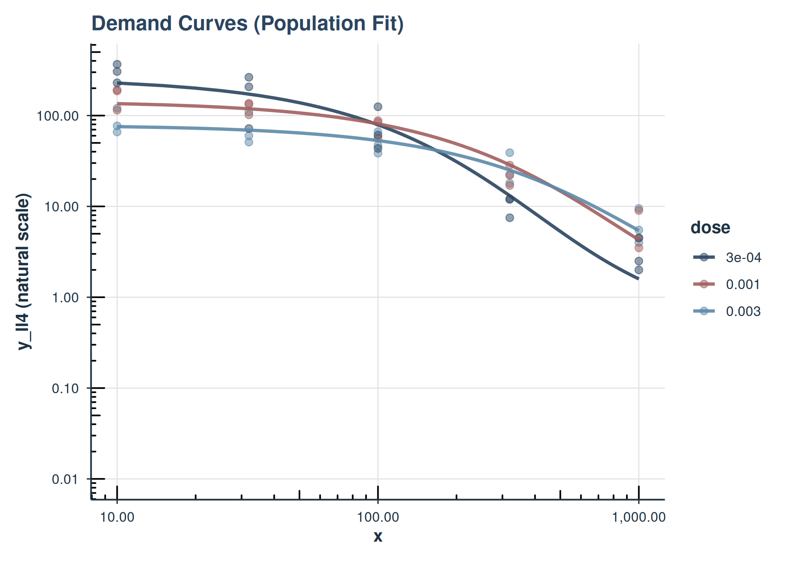

# Advanced Mixed-Effects Demand Modeling

## Introduction

This vignette covers advanced topics for mixed-effects nonlinear demand
modeling with `beezdemand`. It assumes you are already familiar with the
basics covered in
[`vignette("mixed-demand")`](https://brentkaplan.github.io/beezdemand/articles/mixed-demand.md),
including fitting models with
[`fit_demand_mixed()`](https://brentkaplan.github.io/beezdemand/reference/fit_demand_mixed.md),
inspecting results with
[`tidy()`](https://generics.r-lib.org/reference/tidy.html) /
[`glance()`](https://generics.r-lib.org/reference/glance.html) /
[`augment()`](https://generics.r-lib.org/reference/augment.html), and
basic plotting.

Topics covered here include:

- **Multi-factor models** (additive and interaction)
- **Collapsing factor levels** (asymmetric specifications for Q0 and
  alpha)
- **Estimated marginal means** and **pairwise comparisons**
- **Multi-factor visualization** with faceting
- **Complex random effects structures**
- **Continuous covariates** and `fixed_rhs`
- **Trends** with `emtrends`
- **Model comparison and overlay** with
  [`compare_models()`](https://brentkaplan.github.io/beezdemand/reference/compare_models.md),
  [`anova()`](https://rdrr.io/r/stats/anova.html), and
  [`plot_demand_overlay()`](https://brentkaplan.github.io/beezdemand/reference/plot_demand_overlay.md)

``` r

quick_nlme_control <- nlme::nlmeControl(
  msMaxIter = 100,
  niterEM = 20,
  maxIter = 100, # Low iterations for speed
  pnlsTol = 0.1,
  tolerance = 1e-4, # Looser tolerance
  opt = "nlminb",
  msVerbose = FALSE
)

# Prepare data subsets used throughout
ko_alf <- ko[ko$drug == "Alfentanil", ]

# Fit the no-factor (intercept-only) model for comparison
fit_no_factors_alf <- fit_demand_mixed(
  data = ko_alf,
  y_var = "y_ll4",
  x_var = "x",
  id_var = "monkey",
  equation_form = "zben",
  nlme_control = quick_nlme_control,
  start_value_method = "heuristic"
)

# Fit the one-factor model used as a baseline/fallback in later sections
fit_one_factor_dose <- fit_demand_mixed(
  data = ko_alf,
  y_var = "y_ll4",
  x_var = "x",
  id_var = "monkey",
  factors = "dose",
  equation_form = "zben",
  nlme_control = quick_nlme_control,
  start_value_method = "heuristic"
)
```

### Model with Two Factors (Additive)

Here, Q\_{0} and \alpha vary by drug and dose additively. For this, we
need more data than just ko_alf, so we use `ko`. Note that with complex
models and small sample sizes, convergence can fail.
`start_value_method = "pooled_nls"` is worth trying when the heuristic
start values do not converge.

*This example is computationally intensive and is not run during
standard vignette building. To run it, set
`BEEZDEMAND_VIGNETTE_MODE=full` as an environment variable before
building. When successful, the output shows fixed-effect estimates for
each drug and dose combination on Q0 and alpha, plus random-effects
variance components.*

#### Model with Two Factors and Interaction

This allows the effect of dose to be different for each drug (and
vice-versa).

*This example is computationally intensive and is not run during
standard vignette building. The interaction model allows the effect of
dose to differ by drug (and vice versa), producing drug:dose interaction
terms in the fixed-effects table.*

#### Using Different equation_form and y_var

The simplified equation form expects y_var to be raw consumption.

*This example uses `equation_form = "simplified"` with raw consumption
values (no LL4 transformation needed). The simplified equation handles
zeros natively. When this example runs, the output resembles the `zben`
model output but with `y` as the dependent variable.*

### Collapsing Factor Levels

Sometimes you might want to group levels of a factor, and you may want
different groupings for Q\_{0} versus \alpha. The `collapse_levels`
argument allows you to specify separate collapsing schemes for each
parameter.

**Structure:**

``` r

collapse_levels = list(
  Q0 = list(factor_name = list(new_level = c("old_level1", "old_level2"), ...)),
  alpha = list(factor_name = list(new_level = c("old_level1", ...), ...))
)
```

Either `Q0` or `alpha` (or both) can be omitted to keep original levels
for that parameter.

#### Example: Same collapsing for both parameters

``` r

# Ensure levels to collapse are present in ko_alf$dose
# levels(ko_alf$dose) are "0.001", "0.003", "3e-04"
fit_collapsed_same <- try(
  fit_demand_mixed(
    data = ko_alf,
    y_var = "y_ll4",
    x_var = "x",
    id_var = "monkey",
    factors = "dose",
    collapse_levels = list(
      Q0 = list(
        dose = list(low_doses = c("3e-04", "0.001"), high_dose = "0.003")
      ),
      alpha = list(
        dose = list(low_doses = c("3e-04", "0.001"), high_dose = "0.003")
      )
    ),
    equation_form = "zben",
    nlme_control = quick_nlme_control
  ),
  silent = TRUE
)

if (
  !is.null(fit_collapsed_same) &&
    !inherits(fit_collapsed_same, "try-error") &&
    !is.null(fit_collapsed_same$model)
) {
  print(fit_collapsed_same)
  cat("\nQ0 params:", fit_collapsed_same$param_info$num_params_Q0, "\n")
  cat("alpha params:", fit_collapsed_same$param_info$num_params_alpha, "\n")
} else {
  cat("Collapsed levels model failed to converge.\n")
}
#> Demand NLME Model Fit ('beezdemand_nlme' object)
#> ---------------------------------------------------
#> 
#> Call:
#> fit_demand_mixed(data = ko_alf, y_var = "y_ll4", x_var = "x", 
#>     id_var = "monkey", factors = "dose", equation_form = "zben", 
#>     collapse_levels = list(Q0 = list(dose = list(low_doses = c("3e-04", 
#>         "0.001"), high_dose = "0.003")), alpha = list(dose = list(low_doses = c("3e-04", 
#>         "0.001"), high_dose = "0.003"))), nlme_control = quick_nlme_control)
#> 
#> Equation Form Selected:  zben 
#> NLME Model Formula:
#> y_ll4 ~ Q0 * exp(-(10^alpha/Q0) * (10^Q0) * x)
#> <environment: 0x5dbaaf91cbf0>
#> Fixed Effects Structure (Q0):     ~ dose_Q0 
#> Fixed Effects Structure (alpha):  ~ dose_alpha 
#> Factors:  dose 
#> Interaction Term Included:  FALSE 
#> ID Variable for Random Effects:  monkey 
#> 
#> Start Values Used (Fixed Effects Intercepts):
#>   Q0 Intercept (log10 scale):  2.271 
#>   alpha Intercept (log10 scale):  -3 
#> 
#> --- NLME Model Fit Summary (from nlme object) ---
#> Nonlinear mixed-effects model fit by maximum likelihood
#>   Model: nlme_model_formula_obj 
#>   Data: data 
#>   Log-likelihood: 10.80738
#>   Fixed: list(Q0 ~ dose_Q0, alpha ~ dose_alpha) 
#>            Q0.(Intercept)       Q0.dose_Q0low_doses         alpha.(Intercept) 
#>                1.89628442                0.37072017               -4.64112061 
#> alpha.dose_alphalow_doses 
#>               -0.04341491 
#> 
#> Random effects:
#>  Formula: list(Q0 ~ 1, alpha ~ 1)
#>  Level: monkey
#>  Structure: Diagonal
#>         Q0.(Intercept) alpha.(Intercept)  Residual
#> StdDev:   4.402928e-06      2.692825e-06 0.1903097
#> 
#> Number of Observations: 45
#> Number of Groups: 3 
#> 
#> --- Additional Fit Statistics ---
#> Log-likelihood:  10.81 
#> AIC:  -7.615 
#> BIC:  5.032 
#> ---------------------------------------------------
#> 
#> Q0 params: 2 
#> alpha params: 2
```

#### Example: Different collapsing for Q0 and alpha

This is useful when you want fine-grained distinctions for one parameter
but not the other. For instance, you might hypothesize that maximum
consumption (Q\_{0}) varies by dose, but sensitivity (\alpha) does not.

``` r

# Q0: keep 2 collapsed levels (low vs high)
# alpha: collapse all to 1 level (intercept only)
fit_collapsed_asymmetric <- try(
  fit_demand_mixed(
    data = ko_alf,
    y_var = "y_ll4",
    x_var = "x",
    id_var = "monkey",
    factors = "dose",
    collapse_levels = list(
      Q0 = list(
        dose = list(low_doses = c("3e-04", "0.001"), high_dose = "0.003")
      ),
      alpha = list(dose = list(all_doses = c("3e-04", "0.001", "0.003")))
    ),
    equation_form = "zben",
    nlme_control = quick_nlme_control
  ),
  silent = TRUE
)

if (
  !is.null(fit_collapsed_asymmetric) &&
    !inherits(fit_collapsed_asymmetric, "try-error") &&
    !is.null(fit_collapsed_asymmetric$model)
) {
  print(fit_collapsed_asymmetric)
  cat("\nQ0 params:", fit_collapsed_asymmetric$param_info$num_params_Q0, "\n")
  cat(
    "alpha params:",
    fit_collapsed_asymmetric$param_info$num_params_alpha,
    "\n"
  )
  cat(
    "\nQ0 formula:",
    fit_collapsed_asymmetric$formula_details$fixed_effects_formula_str_Q0,
    "\n"
  )
  cat(
    "alpha formula:",
    fit_collapsed_asymmetric$formula_details$fixed_effects_formula_str_alpha,
    "\n"
  )
} else {
  cat("Asymmetric collapsed levels model failed to converge.\n")
}
#> Demand NLME Model Fit ('beezdemand_nlme' object)
#> ---------------------------------------------------
#> 
#> Call:
#> fit_demand_mixed(data = ko_alf, y_var = "y_ll4", x_var = "x", 
#>     id_var = "monkey", factors = "dose", equation_form = "zben", 
#>     collapse_levels = list(Q0 = list(dose = list(low_doses = c("3e-04", 
#>         "0.001"), high_dose = "0.003")), alpha = list(dose = list(all_doses = c("3e-04", 
#>         "0.001", "0.003")))), nlme_control = quick_nlme_control)
#> 
#> Equation Form Selected:  zben 
#> NLME Model Formula:
#> y_ll4 ~ Q0 * exp(-(10^alpha/Q0) * (10^Q0) * x)
#> <environment: 0x5dbab142d9a0>
#> Fixed Effects Structure (Q0):     ~ dose_Q0 
#> Fixed Effects Structure (alpha):  ~ 1 
#> Factors:  dose 
#> Interaction Term Included:  FALSE 
#> ID Variable for Random Effects:  monkey 
#> 
#> Start Values Used (Fixed Effects Intercepts):
#>   Could not determine Q0/alpha intercepts from start_values_used structure.
#>   Full start_values_used vector:
#> [1]  2.271  0.000 -3.000
#> 
#> --- NLME Model Fit Summary (from nlme object) ---
#> Nonlinear mixed-effects model fit by maximum likelihood
#>   Model: nlme_model_formula_obj 
#>   Data: data 
#>   Log-likelihood: 10.73793
#>   Fixed: list(Q0 ~ dose_Q0, alpha ~ 1) 
#>      Q0.(Intercept) Q0.dose_Q0low_doses               alpha 
#>           1.9041039           0.3572637          -4.6750675 
#> 
#> Random effects:
#>  Formula: list(Q0 ~ 1, alpha ~ 1)
#>  Level: monkey
#>  Structure: Diagonal
#>         Q0.(Intercept)        alpha  Residual
#> StdDev:   4.410547e-06 2.696391e-06 0.1906036
#> 
#> Number of Observations: 45
#> Number of Groups: 3 
#> 
#> --- Additional Fit Statistics ---
#> Log-likelihood:  10.74 
#> AIC:  -9.476 
#> BIC:  1.364 
#> ---------------------------------------------------
#> 
#> Q0 params: 2 
#> alpha params: 1 
#> 
#> Q0 formula: ~ dose_Q0 
#> alpha formula: ~ 1
```

**Note:** When all levels of a factor are collapsed to a single level
for a parameter, that factor is automatically removed from the formula
for that parameter (it contributes only to the intercept). A message
will inform you when this occurs.

#### EMMs and Comparisons with Collapsed Factors

When using `collapse_levels`, the
[`get_demand_param_emms()`](https://brentkaplan.github.io/beezdemand/reference/get_demand_param_emms.md)
and
[`get_demand_comparisons()`](https://brentkaplan.github.io/beezdemand/reference/get_demand_comparisons.md)
functions automatically handle the asymmetric factor structures. EMMs
will be computed using the collapsed levels, and comparisons will only
be performed when there are multiple levels to compare.

**Differential Collapsing Output:** When Q0 and alpha have different
numbers of factor levels (e.g., Q0 keeps original `dose` levels while
alpha collapses to fewer groups), the EMM output will include separate
factor columns:

- Original factor column (e.g., `dose`) for the uncollapsed parameter
  (Q0)
- Suffixed column (e.g., `dose_alpha`) for the collapsed parameter
  (alpha)

This results in a cross-joined table showing all combinations of Q0
levels and alpha levels. For example, if dose has 5 original levels and
alpha collapses to 2 groups, the EMM table will have 10 rows (5 × 2).

``` r

# Using the asymmetric collapsed model from above (if it converged)
if (
  !is.null(fit_collapsed_asymmetric) &&
    !inherits(fit_collapsed_asymmetric, "try-error") &&
    !is.null(fit_collapsed_asymmetric$model)
) {
  cat("--- EMMs with collapsed factors ---\n")
  # EMMs will show collapsed Q0 levels but single alpha value
  collapsed_emms <- get_demand_param_emms(
    fit_obj = fit_collapsed_asymmetric,
    factors_in_emm = "dose", # Use original factor name
    include_ev = TRUE
  )
  print(collapsed_emms)

  cat("\n--- Comparisons with collapsed factors ---\n")
  # Q0 will have comparisons (2 levels), alpha will have none (1 level)
  collapsed_comparisons <- get_demand_comparisons(
    fit_obj = fit_collapsed_asymmetric,
    compare_specs = ~dose, # Use original factor name
    param = c("Q0", "alpha")
  )

  cat("\nQ0 contrasts (collapsed levels):\n")
  print(collapsed_comparisons$Q0$contrasts_log10)

  cat("\nalpha contrasts (intercept-only, no comparisons):\n")
  print(collapsed_comparisons$alpha$contrasts_log10)
} else {
  cat("Asymmetric collapsed model not available for EMM demonstration.\n")
}
#> --- EMMs with collapsed factors ---
#> # A tibble: 2 × 16
#>   dose      Q0_param_log10 LCL_Q0_param_log10 UCL_Q0_param_log10 Q0_natural
#>   <fct>              <dbl>              <dbl>              <dbl>      <dbl>
#> 1 high_dose           1.90               1.77               2.04       80.2
#> 2 low_doses           2.26               2.16               2.36      183. 
#> # ℹ 11 more variables: LCL_Q0_natural <dbl>, UCL_Q0_natural <dbl>,
#> #   alpha_param_log10 <dbl>, LCL_alpha_param_log10 <dbl>,
#> #   UCL_alpha_param_log10 <dbl>, alpha_natural <dbl>, LCL_alpha_natural <dbl>,
#> #   UCL_alpha_natural <dbl>, EV <dbl>, LCL_EV <dbl>, UCL_EV <dbl>
#> 
#> --- Comparisons with collapsed factors ---
#> 
#> Q0 contrasts (collapsed levels):
#> # A tibble: 1 × 8
#>   contrast_definition   estimate     SE    df lower.CL upper.CL t.ratio  p.value
#>   <chr>                    <dbl>  <dbl> <dbl>    <dbl>    <dbl>   <dbl>    <dbl>
#> 1 high_dose - low_doses   -0.357 0.0803    40   -0.520   -0.195   -4.45  6.73e-5
#> 
#> alpha contrasts (intercept-only, no comparisons):
#> # A tibble: 0 × 0
```

### Visualizing Multi-Factor Models

#### Plotting a Two-Factor Model with Faceting

We use `fit_two_factors_add` (if it converged: y_ll4 ~ drug + dose) and
facet by one factor and color by another.

``` r

# Assuming fit_two_factors_add was successfully created earlier
# If it failed, this chunk won't produce a plot.
active_two_factor_fit <- if (
  !is.null(fit_two_factors_add) && !is.null(fit_two_factors_add$model)
) {
  fit_two_factors_add
} else {
  # Fallback to a simpler model if the two-factor one failed in the vignette
  if (!is.null(fit_one_factor_dose$model)) fit_one_factor_dose else NULL
}

if (
  !is.null(active_two_factor_fit$model) &&
    !is.null(active_two_factor_fit$param_info$factors) &&
    length(active_two_factor_fit$param_info$factors) >= 1
) {
  # Determine factors for aesthetics based on what's in active_two_factor_fit
  color_factor <- if ("dose" %in% active_two_factor_fit$param_info$factors) {
    "dose"
  } else {
    NULL
  }
  facet_factor_name <- if (
    "drug" %in% active_two_factor_fit$param_info$factors
  ) {
    "drug"
  } else {
    # If only 'dose' is available from fit_one_factor_dose, we can't facet by 'drug'
    # So, maybe facet by dose instead, or don't facet.
    if (
      "dose" %in%
        active_two_factor_fit$param_info$factors &&
        is.null(color_factor)
    ) {
      color_factor <- "dose" # color by dose if not faceting by it
      NULL # No faceting
    } else {
      NULL
    }
  }

  facet_formula_plot <- if (!is.null(facet_factor_name)) {
    stats::as.formula(paste("~", facet_factor_name))
  } else {
    NULL
  }

  plot(
    active_two_factor_fit,
    inv_fun = ll4_inv,
    color_by = color_factor,
    # linetype_by = if("dose" %in% active_two_factor_fit$param_info$factors) "dose" else NULL, # Example
    facet_formula = facet_formula_plot,
    title = "Demand Curves (Population Fit)",
    observed_point_alpha = 0.5,
    ind_line_alpha = .5
  )
} else {
  cat(
    "A suitable two-factor or one-factor model object not available for this plotting example.\n"
  )
}
```



This example attempts to use fit_two_factors_add. If that model didn’t
converge (common with minimal iterations for vignette speed), it falls
back to fit_one_factor_dose and adjusts aesthetics. The plot will show
population lines, colored by one factor and faceted by another (if two
factors are available).

#### Plotting a Model Fit with equation_form = “simplified”

If you fit a model using equation_form = “simplified” (which models raw
y), the inv_fun is typically identity because predictions are already on
the natural scale.

``` r

# Assuming fit_simplified_example converged earlier
if (
  !is.null(fit_simplified_example) && !is.null(fit_simplified_example$model)
) {
  plot(
    fit_simplified_example,
    inv_fun = identity, # Predictions are already on raw y scale
    color_by = "dose",
    shape_by = "dose",
    title = "Demand Model ('simplified' equation, Raw Y)"
  )
} else {
  cat("fit_simplified_example model object not available for plotting.\n")
}
#> fit_simplified_example model object not available for plotting.
```

Users can further customize the returned ggplot object by adding more
layers or theme adjustments. For instance, to add custom axis limits or
breaks:

``` r

plot_object +
    ggplot2::scale_x_continuous(
        limits = c(0, 1000),
        breaks = c(0, 100, 500, 1000)
    )
```

### Analyzing Estimated Marginal Means (`get_demand_param_emms`)

This function returns estimated marginal means for Q\_{0} and \alpha on
both the log10 and natural scales, and optionally the essential value
(EV).

**Note on `collapse_levels`:** When a model is fit using
`collapse_levels` with asymmetric specifications (different collapsing
for Q0 and alpha), the EMM functions automatically use the appropriate
collapsed factor names for each parameter. You still specify the
original factor name in `factors_in_emm`, and the output will show the
collapsed levels. If a parameter has only one level (intercept-only),
that parameter’s values will be the same across all rows.

``` r

# We'll use a model with factors.
# If fit_two_factors_add converged, use it. Otherwise, use fit_one_factor_dose.
# For the vignette, let's ensure we use one that is likely available.
# If fit_two_factors_add is NULL (failed to converge in example), this will use fit_one_factor_dose
emm_model_to_use <- if (
  !is.null(fit_two_factors_add) && !is.null(fit_two_factors_add$model)
) {
  fit_two_factors_add
} else if (!is.null(fit_one_factor_dose$model)) {
  fit_one_factor_dose
} else {
  NULL
}

if (!is.null(emm_model_to_use)) {
  cat(
    "--- EMMs for model with factors:",
    paste(emm_model_to_use$param_info$factors, collapse = ", "),
    "---\n"
  )

  factors_for_emms <- emm_model_to_use$param_info$factors

  demand_emms_output <- get_demand_param_emms(
    fit_obj = emm_model_to_use,
    factors_in_emm = factors_for_emms, # Use factors from the model
    include_ev = TRUE
  )
  print(demand_emms_output)

  cat("\n--- EMMs for observed factor combinations only: ---\n")
  # This is useful if the EMM grid includes combinations not in data
  observed_demand_emms <- get_observed_demand_param_emms(
    fit_obj = emm_model_to_use,
    factors_in_emm = factors_for_emms,
    include_ev = TRUE
  )
  print(observed_demand_emms)
} else {
  cat(
    "No suitable model with factors converged for EMM analysis in the vignette.\n"
  )
}
#> --- EMMs for model with factors: dose ---
#> # A tibble: 3 × 16
#>   dose  Q0_param_log10 LCL_Q0_param_log10 UCL_Q0_param_log10 Q0_natural
#>   <fct>          <dbl>              <dbl>              <dbl>      <dbl>
#> 1 3e-04           2.42               2.27               2.56      260. 
#> 2 0.001           2.16               2.03               2.28      144. 
#> 3 0.003           1.90               1.78               2.02       78.8
#> # ℹ 11 more variables: LCL_Q0_natural <dbl>, UCL_Q0_natural <dbl>,
#> #   alpha_param_log10 <dbl>, LCL_alpha_param_log10 <dbl>,
#> #   UCL_alpha_param_log10 <dbl>, alpha_natural <dbl>, LCL_alpha_natural <dbl>,
#> #   UCL_alpha_natural <dbl>, EV <dbl>, LCL_EV <dbl>, UCL_EV <dbl>
#> 
#> --- EMMs for observed factor combinations only: ---
#> # A tibble: 3 × 16
#>   dose  Q0_param_log10 LCL_Q0_param_log10 UCL_Q0_param_log10 Q0_natural
#>   <fct>          <dbl>              <dbl>              <dbl>      <dbl>
#> 1 3e-04           2.42               2.27               2.56      260. 
#> 2 0.001           2.16               2.03               2.28      144. 
#> 3 0.003           1.90               1.78               2.02       78.8
#> # ℹ 11 more variables: LCL_Q0_natural <dbl>, UCL_Q0_natural <dbl>,
#> #   alpha_param_log10 <dbl>, LCL_alpha_param_log10 <dbl>,
#> #   UCL_alpha_param_log10 <dbl>, alpha_natural <dbl>, LCL_alpha_natural <dbl>,
#> #   UCL_alpha_natural <dbl>, EV <dbl>, LCL_EV <dbl>, UCL_EV <dbl>
```

### Performing Pairwise Comparisons (`get_demand_comparisons`)

Compare levels of factors for Q\_{0} and \alpha.

**Note on `collapse_levels`:** When using models fit with asymmetric
`collapse_levels`, comparisons are only performed for parameters that
have multiple levels. If a parameter was collapsed to a single level
(intercept-only), the comparisons for that parameter will be empty.

``` r

# Using the same emm_model_to_use
if (
  !is.null(emm_model_to_use) && length(emm_model_to_use$param_info$factors) > 0
) {
  factors_present <- emm_model_to_use$param_info$factors

  if ("dose" %in% factors_present) {
    cat(
      "--- Pairwise comparisons for 'dose' (averaging over other factors if any): ---\n"
    )
    comparisons_dose <- get_demand_comparisons(
      fit_obj = emm_model_to_use,
      compare_specs = ~dose,
      contrast_type = "pairwise",
      adjust = "fdr",
      report_ratios = TRUE
    )
    print(comparisons_dose)
  }

  if (all(c("drug", "dose") %in% factors_present)) {
    cat(
      "\n--- Pairwise comparisons for 'drug' within each level of 'dose': ---\n"
    )
    # EMMs calculated over drug*dose, then contrast drug within each dose
    comparisons_drug_by_dose <- get_demand_comparisons(
      fit_obj = emm_model_to_use,
      compare_specs = ~ drug * dose,
      contrast_type = "pairwise",
      contrast_by = "dose", # Compare 'drug' levels, holding 'dose' constant
      adjust = "fdr",
      report_ratios = TRUE
    )
    print(comparisons_drug_by_dose)
  }
} else {
  cat(
    "No suitable model with factors converged for comparisons in the vignette.\n"
  )
}
#> --- Pairwise comparisons for 'dose' (averaging over other factors if any): ---
#> Demand Parameter Comparisons (nlme backend)
#> EMMs computed over: ~dose 
#> Contrast type: pairwise
#> P-value adjustment method: fdr 
#> ================================================== 
#> 
#> Q0 (log10-scale contrasts):
#>                 contrast estimate std.error conf.low conf.high p.value
#>  (dose3e-04) - dose0.001    0.258     0.093    0.026     0.490   0.008
#>  (dose3e-04) - dose0.003    0.519     0.091    0.290     0.748   0.000
#>    dose0.001 - dose0.003    0.261     0.085    0.048     0.475   0.006
#> 
#> alpha (log10-scale contrasts):
#>                 contrast estimate std.error conf.low conf.high p.value
#>  (dose3e-04) - dose0.001    0.084     0.068   -0.087     0.255   0.337
#>  (dose3e-04) - dose0.003   -0.010     0.071   -0.187     0.168   0.891
#>    dose0.001 - dose0.003   -0.094     0.070   -0.269     0.082   0.337
```

### Advanced Topics

**Note**: This section covers advanced modeling techniques for
experienced users. These advanced topics require deeper understanding of
mixed-effects models and may be computationally intensive.

**Performance Note**: The code examples in the sections below are
computationally intensive and are not evaluated during standard vignette
building. The code is shown for reference. To run these examples, set
the environment variable `BEEZDEMAND_VIGNETTE_MODE=full` before building
vignettes.

#### More Complex Random Effects Structures

This example shows how to specify a more complex random-effects
structure (e.g., random slopes) for Q\_{0} and \alpha.

Individual-level predicted coefficients come from the
[`get_individual_coefficients()`](https://brentkaplan.github.io/beezdemand/reference/get_individual_coefficients.md)
function. This combines fixed and random effects to calculate
individual-level parameter estimates for each subject.

#### Continuous Covariates and `fixed_rhs`

In addition to factor predictors, you can include continuous covariates
in the fixed-effects linear models for `Q0` and `alpha`.

There are two convenient ways to do this:

1.  Add continuous covariates additively using the
    `continuous_covariates` argument (no formula writing required).
2.  Specify a full right-hand-side using `fixed_rhs` (formula), which
    gives you complete control, including interactions (e.g.,
    factor-by-continuous).

Below we demonstrate both, using a made-up continuous covariate `age`
assigned per subject (`monkey`).

##### A) Additive continuous covariate via `continuous_covariates`

Here we keep a single factor (`dose`) and add `age` as an additive
continuous covariate. The RHS becomes `~ 1 + dose + age` for both
parameters.

##### B) fixed_rhs with a factor (drug) and a continuous covariate (dose)

Here we specify `drug` as a factor but treat `dose` as a continuous
covariate (`dose_num`, a numeric version of `dose`), and include `age`
as an additional continuous covariate. This uses a shared RHS for `Q0`
and `alpha`: `~ 1 + drug + dose_num + age`.

#### Trends with `emtrends`

We can examine how the parameters change with continuous covariates
using
[`get_demand_param_trends()`](https://brentkaplan.github.io/beezdemand/reference/get_demand_param_trends.md),
which wraps
[`emmeans::emtrends()`](https://rvlenth.github.io/emmeans/reference/emtrends.html)
and returns tidy results for Q0 and alpha trends on the log10 scale.

Below we compute trends with respect to `age` and `dose_num`, first
overall and then by `drug` (if the model includes `drug` as a factor).

### Model Comparison and Overlay

#### Comparing Nested Models

Use [`anova()`](https://rdrr.io/r/stats/anova.html) to formally compare
nested NLME models via likelihood ratio test. For example, compare a
one-factor model against a no-factor (intercept-only) baseline:

``` r

# Compare one-factor dose model vs intercept-only
anova(fit_no_factors_alf, fit_one_factor_dose)
#>                                                                                                                                                                                                                                                                                                                                                                                                                                                                                                                                                                                                                                                                                                                                                                                                                                                                                                                                                                                                                                                                                                                                                                                                                                                                                                                                                                                                                                                                                                                                                                                                                                                                                                                                                                                                                                                                                                                                                                                                                                                                                                                                                                                                                                                                                                                                                                                                                                                                                                                                                                                                                                                                                                                                                                                                                                                                                                                                                                                                                                                                                                                                                                                                                                                                                                                                                                                                                                                                                                                                                                                                                                                                                                                                                                                                                                                                                                                                                                                                                                                                                                                                                                                                                                                                                                                                                                                                                                                                                                                                                                                                                                                                                                                                                                                                                                                                                                                                                                                                                                                                                                                                                                                                                                                                                                                                                                                                                                                                                                                                                                                                                                                                                                                                                                                                                                                                                                                                                                                                                                                                                                                                                                                                                                                                                                                                                                                                                                                                                                                                                                                                                                                                                                                                                                                                                                                                                                                                                                                                                                                                                                                                                                                                                                                                                                                                                                                                                                                                                                                                                                                                                                                                                                                                                                                                                                                                                                                                                                                                                                                                                                                                                                                                                                                                                                                                                                                                                                                                                                                                                                                                                                                                                                                                                                                                                                                                                                                                                                                                                                                                                                                                                                                                                                                                                                                                                                                                                                                                                                                                                                                                                                                                                                                                                                                                                                                                                                                                                                                                                                                                                                                                                                                                                                                                                                                                                                                                                                                                                                                                                                                                                                                                                                                                                                                                                                                                                                                                                                                                                                                                                                                                                                                                                                                                                                                                                                                                                                                                                                                                                                                                                                                                                                                                                                                                                                                                                                                                                                                                                                                                                                                                                                                                                                          Model
#> structure(list(modelStruct = structure(list(reStruct = structure(list(monkey = structure(c(-10.6748686862561, -11.1662970631652), formula = structure(list(Q0 ~ 1, alpha ~ 1), class = "listForm"), Dimnames = list(c("Q0", "alpha"), c("Q0", "alpha")), class = c("pdDiag", "pdMat"))), settings = c(0L, 1L, 0L, 1L), class = "reStruct", plen = c(monkey = 2L))), class = c("lmeStructInt", "nlmeStruct", "lmeStruct", "modelStruct"), pmap = structure(c(TRUE, TRUE), dim = 2:1, dimnames = list(NULL, "reStruct")), fixedSigma = FALSE),     dims = list(N = 45L, Q = 1L, qvec = c(monkey = 2, 0, 0), ngrps = c(monkey = 3L, X = 1L, y = 1L), ncol = c(monkey = 2, 2, 1)), contrasts = list(), coefficients = list(fixed = c(Q0 = 2.13111288506703, alpha = -4.66522247394846), random = list(monkey = structure(c(3.25118329531589e-11, 1.82172250585716e-10, -2.14684083538938e-10, -3.64594363155122e-10, 5.32602258973622e-11, 3.11334137258643e-10), dim = 3:2, dimnames = list(c("A", "B", "C"), c("Q0", "alpha"))))), varFix = structure(c(0.00251876759508814,     -0.000993766413344089, -0.000993766413344089, 0.00149109227756112), dim = c(2L, 2L), dimnames = list(c("Q0", "alpha"), c("Q0", "alpha"))), sigma = 0.227557261541045, apVar = "Non-positive definite approximate variance-covariance", logLik = 2.76366778674659, numIter = 2, groups = structure(list(monkey = structure(c(1L, 1L, 1L, 1L, 1L, 2L, 2L, 2L, 2L, 2L, 3L, 3L, 3L, 3L, 3L, 1L, 1L, 1L, 1L, 1L, 2L, 2L, 2L, 2L, 2L, 3L, 3L, 3L, 3L, 3L, 1L, 1L, 1L, 1L, 1L, 2L, 2L, 2L, 2L, 2L, 3L, 3L, 3L, 3L, 3L), levels = c("A",     "B", "C"), class = "factor")), row.names = c("1", "2", "3", "4", "5", "6", "7", "8", "9", "10", "11", "12", "13", "14", "15", "16", "17", "18", "19", "20", "21", "22", "23", "24", "25", "26", "27", "28", "29", "30", "31", "32", "33", "34", "35", "36", "37", "38", "39", "40", "41", "42", "43", "44", "45"), class = "data.frame"), call = nlme.formula(model = nlme_model_formula_obj, data = data, fixed = list(Q0 ~ 1, alpha ~ 1), random = structure(numeric(0), class = c("pdDiag", "pdMat"), formula = structure(list(        Q0 ~ 1, alpha ~ 1), class = "listForm"), Dimnames = list(NULL, NULL)), groups = groups_formula, start = start_values, method = method, control = control_obj), method = "ML", fitted = structure(c(2.10207833921257, 2.03958716265532, 1.85793654181817, 1.37392999200435, 0.540568420263272, 2.10207833921257, 2.03958716265532, 1.85793654181817, 1.37392999200435, 0.540568420263272, 2.10207833921257, 2.03958716265532, 1.85793654181817, 1.37392999200435, 0.540568420263272, 2.10207833921257, 2.03958716265532,     1.85793654181817, 1.37392999200435, 0.540568420263272, 2.10207833921257, 2.03958716265532, 1.85793654181817, 1.37392999200435, 0.540568420263272, 2.10207833921257, 2.03958716265532, 1.85793654181817, 1.37392999200435, 0.540568420263272, 2.10207833921257, 2.03958716265532, 1.85793654181817, 1.37392999200435, 0.540568420263272, 2.10207833921257, 2.03958716265532, 1.85793654181817, 1.37392999200435, 0.540568420263272, 2.10207833921257, 2.03958716265532, 1.85793654181817, 1.37392999200435, 0.540568420263272,     2.10207833926713, 2.03958716275626, 1.85793654204529, 1.37392999249568, 0.540568420849849, 2.1020783393791, 2.03958716278878, 1.85793654186061, 1.37392999184641, 0.540568419970877, 2.10207833899149, 2.03958716242091, 1.85793654154861, 1.37392999167097, 0.540568419969089, 2.10207833926713, 2.03958716275626, 1.85793654204529, 1.37392999249568, 0.540568420849849, 2.1020783393791, 2.03958716278878, 1.85793654186061, 1.37392999184641, 0.540568419970877, 2.10207833899149, 2.03958716242091, 1.85793654154861,     1.37392999167097, 0.540568419969089, 2.10207833926713, 2.03958716275626, 1.85793654204529, 1.37392999249568, 0.540568420849849, 2.1020783393791, 2.03958716278878, 1.85793654186061, 1.37392999184641, 0.540568419970877, 2.10207833899149, 2.03958716242091, 1.85793654154861, 1.37392999167097, 0.540568419969089), dim = c(45L, 2L), dimnames = list(c("1", "2", "3", "4", "5", "6", "7", "8", "9", "10", "11", "12", "13", "14", "15", "16", "17", "18", "19", "20", "21", "22", "23", "24", "25", "26", "27",     "28", "29", "30", "31", "32", "33", "34", "35", "36", "37", "38", "39", "40", "41", "42", "43", "44", "45"), c("fixed", "monkey"))), residuals = structure(c(-0.0210912917867234, 0.0018055232444798, -0.035114890963216, 0.217134661953793, 0.437168514199665, -0.215587610951494, -0.26143590389408, -0.185838661632308, -0.021747050256463, 0.199912856035553, -0.282534397948696, -0.332016970508544, -0.272475762892109, -0.118656452635088, 0.061914860569552, 0.181222889570871, 0.0842644786587585, 0.0865461321424776,     -0.0315068477003637, 0.413690636249236, 0.168600497021878, 0.0955454890342047, 0.068920169261119, 0.080915032571838, 0.00422074667465977, -0.0432728519049794, -0.0309869898903479, -0.105888083344295, -0.143479770677917, 0.112908544537561, 0.462587725045501, 0.382016764236865, 0.238973471634603, -0.294743510086621, 0.112908544537561, 0.382932875378464, 0.276383182860735, -0.0726066989657985, -0.294743510086621, -0.139883908547549, 0.258704350699844, -0.182254662183929, -0.219447254540878, -0.498834419408339,     -0.232956189918703, -0.0210912918412816, 0.00180552314353832, -0.0351148911903325, 0.217134661462462, 0.437168513613088, -0.215587611118017, -0.261435904027546, -0.18583866167475, -0.0217470500985151, 0.199912856327948, -0.282534397727614, -0.332016970274136, -0.27247576262255, -0.118656452301705, 0.0619148608637349, 0.181222889516313, 0.084264478557817, 0.0865461319153611, -0.0315068481916945, 0.413690635662658, 0.168600496855354, 0.0955454889007386, 0.0689201692186767, 0.0809150327297858, 0.0042207469670541,     -0.0432728516838981, -0.0309869896559398, -0.105888083074736, -0.143479770344534, 0.112908544831744, 0.462587724990942, 0.382016764135924, 0.238973471407487, -0.294743510577951, 0.112908543950984, 0.382932875211941, 0.276383182727269, -0.0726066990082408, -0.294743509928673, -0.139883908255154, 0.258704350920925, -0.182254661949521, -0.219447254271318, -0.498834419074956, -0.23295618962452), dim = c(45L, 2L), dimnames = list(c("1", "2", "3", "4", "5", "6", "7", "8", "9", "10", "11", "12", "13",     "14", "15", "16", "17", "18", "19", "20", "21", "22", "23", "24", "25", "26", "27", "28", "29", "30", "31", "32", "33", "34", "35", "36", "37", "38", "39", "40", "41", "42", "43", "44", "45"), c("fixed", "monkey")), std = c(0.227557261541045, 0.227557261541045, 0.227557261541045, 0.227557261541045, 0.227557261541045, 0.227557261541045, 0.227557261541045, 0.227557261541045, 0.227557261541045, 0.227557261541045, 0.227557261541045, 0.227557261541045, 0.227557261541045, 0.227557261541045, 0.227557261541045,     0.227557261541045, 0.227557261541045, 0.227557261541045, 0.227557261541045, 0.227557261541045, 0.227557261541045, 0.227557261541045, 0.227557261541045, 0.227557261541045, 0.227557261541045, 0.227557261541045, 0.227557261541045, 0.227557261541045, 0.227557261541045, 0.227557261541045, 0.227557261541045, 0.227557261541045, 0.227557261541045, 0.227557261541045, 0.227557261541045, 0.227557261541045, 0.227557261541045, 0.227557261541045, 0.227557261541045, 0.227557261541045, 0.227557261541045, 0.227557261541045,     0.227557261541045, 0.227557261541045, 0.227557261541045)), plist = list(Q0 = list(fixed = TRUE, random = list(monkey = TRUE)), alpha = list(fixed = TRUE, random = list(monkey = TRUE))), map = list(fmap = list(Q0 = 1, alpha = 2), rmap = list(monkey = list(Q0 = 1, alpha = 2)), rmapRel = list(monkey = list(Q0 = 1, alpha = 2)), bmap = c(0, monkey = 6)), fixDF = structure(list(X = c(Q0 = 41, alpha = 41), terms = c(Q0 = 41, alpha = 41)), assign = list(Q0 = 1, alpha = 2), varFixFact = structure(c(-0.0430865794783083,     -0.0257354670435093, 0, 0.0386146640223778), dim = c(2L, 2L))), formula = y_ll4 ~ Q0 * exp(-(10^alpha/Q0) * (10^Q0) * x)), class = c("nlme", "lme"))                                                                                                                                                                                                                                                                                                                                                                                                                                                                                                                                                                                                                                                                                                                                                                                                                                                                                                                                                                                                                                                                                                                                                                                                                                                                                                                                                                                                                                                                                                                                                                                                                                                                                                                                                                                                                                                                                                                                                                                                                                                                                                                                                                                                                                                                                                                                                                                                                                                                                                                                                                                                                                                                                                                                                                                                                                                                                                                                                                                                                                                                                                                                                                                                                                                                                                                                                                                                                                                                                                                                                                                                                                                                                                                                                                                                                                                                                                                                                                                                                                                1
#> structure(list(modelStruct = structure(list(reStruct = structure(list(monkey = structure(c(-10.674355496015, -11.1654384766276), formula = structure(list(Q0 ~ 1, alpha ~ 1), class = "listForm"), Dimnames = list(c("Q0.(Intercept)", "alpha.(Intercept)"), c("Q0.(Intercept)", "alpha.(Intercept)")), class = c("pdDiag", "pdMat"))), settings = c(0L, 1L, 0L, 1L), class = "reStruct", plen = c(monkey = 2L))), class = c("lmeStructInt", "nlmeStruct", "lmeStruct", "modelStruct"), pmap = structure(c(TRUE, TRUE), dim = 2:1, dimnames = list(NULL, "reStruct")), fixedSigma = FALSE), dims = list(N = 45L, Q = 1L, qvec = c(monkey = 2, 0, 0), ngrps = c(monkey = 3L, X = 1L, y = 1L), ncol = c(monkey = 2, 6, 1)), contrasts = list(dose = structure(c(0, 1, 0, 0, 0, 1), dim = 3:2, dimnames = list(c("3e-04", "0.001", "0.003"), c("2", "3")))), coefficients = list(fixed = c("Q0.(Intercept)" = 2.4153496979435, Q0.dose0.001 = -0.257733997783798, Q0.dose0.003 = -0.519065274461171, "alpha.(Intercept)" = -4.65085466249018, alpha.dose0.001 = -0.0840812817366956, alpha.dose0.003 = 0.00973404854497058), random = list(monkey = structure(c(8.83036786036642e-11, 1.24627505631766e-10, -2.12931184235666e-10, -3.42443064255888e-10, 3.35189287175666e-11, 3.08924135538698e-10), dim = 3:2, dimnames = list(c("A", "B", "C"), c("Q0.(Intercept)", "alpha.(Intercept)"))))), varFix = structure(c(0.00483094660111187, -0.00483094659639922, -0.00483094659639922, -0.00226083065008909, 0.00226083065008909, 0.00226083065008909, -0.00483094659639922, 0.00856034354549371, 0.00483094659639922, 0.00226083065008909, -0.00372868756232793, -0.00226083065008909, -0.00483094659639922, 0.00483094659639922, 0.00833279604327669, 0.00226083065008909, -0.00226083065008909, -0.00320415501687124, -0.00226083065008909, 0.00226083065008909, 0.00226083065008909, 0.00237901775350923, -0.00237901775174435, -0.00237901775174435, 0.00226083065008909, -0.00372868756232793, -0.00226083065008909, -0.00237901775174435, 0.0046319532947319, 0.00237901775174435, 0.00226083065008909, -0.00226083065008909, -0.00320415501687124, -0.00237901775174435, 0.00237901775174435, 0.00501935655466273), dim = c(6L, 6L), dimnames = list(c("Q0.(Intercept)", "Q0.dose0.001", "Q0.dose0.003", "alpha.(Intercept)", "alpha.dose0.001", "alpha.dose0.003"), c("Q0.(Intercept)", "Q0.dose0.001", "Q0.dose0.003", "alpha.(Intercept)", "alpha.dose0.001", "alpha.dose0.003"))), sigma = 0.162557410569375, apVar = structure(c(495538.161714862, 64382.4114225967, -0.58771876344554, 64382.4114225967, 44605.4346511012, -0.168994846751741, -0.587718763446855, -0.168994846752211, 0.0111122473176121), dim = c(3L, 3L), dimnames = list(c("reStruct.monkey1", "reStruct.monkey2", "lSigma"), c("reStruct.monkey1", "reStruct.monkey2", "lSigma")), Pars = c(reStruct.monkey1 = -12.49107953981, reStruct.monkey2 = -12.9821625204226, lSigma = -1.81672404379508), natural = TRUE), logLik = 17.9003479644563, numIter = 2, groups = structure(list(monkey = structure(c(1L, 1L, 1L, 1L, 1L, 2L, 2L, 2L, 2L, 2L, 3L, 3L, 3L, 3L, 3L, 1L, 1L, 1L, 1L, 1L, 2L, 2L, 2L, 2L, 2L, 3L, 3L, 3L, 3L, 3L, 1L, 1L, 1L, 1L, 1L, 2L, 2L, 2L, 2L, 2L, 3L, 3L, 3L, 3L, 3L), levels = c("A", "B", "C"), class = "factor")), row.names = c("1", "2", "3", "4", "5", "6", "7", "8", "9", "10", "11", "12", "13", "14", "15", "16", "17", "18", "19", "20", "21", "22", "23", "24", "25", "26", "27", "28", "29", "30", "31", "32", "33", "34", "35", "36", "37", "38", "39", "40", "41", "42", "43", "44", "45"), class = "data.frame"), call = nlme.formula(model = nlme_model_formula_obj,     data = data, fixed = list(Q0 ~ dose, alpha ~ dose), random = structure(numeric(0), class = c("pdDiag", "pdMat"), formula = structure(list(Q0 ~ 1, alpha ~ 1), class = "listForm"), Dimnames = list(NULL, NULL)), groups = groups_formula, start = start_values, method = method, control = control_obj), method = "ML", fitted = structure(c(1.87837404597706, 1.83956442152029, 1.72460439845024, 1.39964763675935, 0.734114149667484, 1.87837404597706, 1.83956442152029, 1.72460439845024, 1.39964763675935, 0.734114149667484, 1.87837404597706, 1.83956442152029, 1.72460439845024, 1.39964763675935, 0.734114149667484, 2.13131187349976, 2.07456672633859, 1.90854850165129, 1.4571599878102, 0.632798102115056, 2.13131187349976, 2.07456672633859, 1.90854850165129, 1.4571599878102, 0.632798102115056, 2.13131187349976, 2.07456672633859, 1.90854850165129, 1.4571599878102, 0.632798102115056, 2.35790124754334, 2.23627866651826, 1.89861088023482, 1.11799291328946, 0.217540186362859, 2.35790124754334, 2.23627866651826, 1.89861088023482, 1.11799291328946, 0.217540186362859, 2.35790124754334, 2.23627866651826, 1.89861088023482, 1.11799291328946, 0.217540186362859, 1.8783740460758, 1.83956442164124, 1.72460439863394, 1.39964763709305, 0.734114150141784, 1.8783740460952, 1.83956442162452, 1.72460439851474, 1.3996476367245, 0.73411414950783, 1.8783740457602, 1.8395644212951, 1.72460439820203, 1.39964763646051, 0.734114149352838, 2.13131187360336, 2.07456672647448, 1.90854850187598, 1.45715998822794, 0.632798102626934, 2.13131187361486, 2.07456672643347, 1.90854850168981, 1.45715998771913, 0.632798101913793, 2.13131187328107, 2.07456672610782, 1.90854850138809, 1.45715998748353, 0.63279810180444, 2.35790124766483, 2.23627866670712, 1.89861088058839, 1.11799291386577, 0.217540186696396, 2.35790124764726, 2.23627866657981, 1.89861088018994, 1.11799291307798, 0.217540186210414, 2.35790124731792, 2.23627866626785, 1.89861087992613, 1.11799291292462, 0.217540186181769), dim = c(45L, 2L), dimnames = list(c("1", "2", "3", "4", "5", "6", "7", "8", "9", "10", "11", "12", "13", "14", "15", "16", "17", "18", "19", "20", "21", "22", "23", "24", "25", "26", "27", "28", "29", "30", "31", "32", "33", "34", "35", "36", "37", "38", "39", "40", "41", "42", "43", "44", "45"), c("fixed", "monkey"))), residuals = structure(c(0.202613001448786, 0.20182826437951, 0.0982172524047173, 0.191417017198795, 0.243622784795452, 0.00811668228401552, -0.0614131627590497, -0.0525065182643749, -0.047464695011461, 0.00636712663134065, -0.0588301047131865, -0.131994229373513, -0.139143619524176, -0.144374097390086, -0.131630868834661, 0.151989355283683, 0.0492849149754888, 0.0359341723093556, -0.114736843506207, 0.321460954397451, 0.13936696273469, 0.060565925350935, 0.0183082094279969, -0.00231496323400537, -0.0880089351771243, -0.0725063861921669, -0.0659665535736176, -0.156500043177417, -0.22670976648376, 0.0206788626857771, 0.206764816714736, 0.185325260373924, 0.198299133217956, -0.0388064313717227, 0.435936778437973, 0.127109967047699, 0.0796916789977939, -0.113281037382446, -0.0388064313717227, 0.183144325352864, 0.0028814423690795, -0.37894616604687, -0.260121592957525, -0.242897340693441, 0.090072043981709, 0.202613001350055, 0.201828264258556, 0.0982172522210152, 0.191417016865101, 0.243622784321152, 0.0081166821658849, -0.0614131628632786, -0.0525065183288784, -0.0474646949766067, 0.00636712679099471, -0.0588301044963246, -0.131994229148331, -0.13914361927597, -0.144374097091247, -0.131630868520015, 0.151989355180088, 0.0492849148396006, 0.0359341720846715, -0.114736843923949, 0.321460953885574, 0.139366962619592, 0.0605659252560535, 0.0183082093894817, -0.00231496314293533, -0.088008934975862, -0.0725063859734734, -0.0659665533428475, -0.156500042914218, -0.22670976615709, 0.0206788629963929, 0.206764816593243, 0.185325260185065, 0.198299132864387, -0.0388064319480363, 0.435936778104437, 0.127109966943776, 0.0796916789362467, -0.113281037337565, -0.0388064311602427, 0.18314432550531, 0.00288144259449563, -0.378946165796463, -0.260121592648837, -0.242897340328607, 0.0900720441627993), dim = c(45L, 2L), dimnames = list(c("1", "2", "3", "4", "5", "6", "7", "8", "9", "10", "11", "12", "13", "14", "15", "16", "17", "18", "19", "20", "21", "22", "23", "24", "25", "26", "27", "28", "29", "30", "31", "32", "33", "34", "35", "36", "37", "38", "39", "40", "41", "42", "43", "44", "45"), c("fixed", "monkey")), std = c(0.162557410569375, 0.162557410569375, 0.162557410569375, 0.162557410569375, 0.162557410569375, 0.162557410569375, 0.162557410569375, 0.162557410569375, 0.162557410569375, 0.162557410569375, 0.162557410569375, 0.162557410569375, 0.162557410569375, 0.162557410569375, 0.162557410569375, 0.162557410569375, 0.162557410569375, 0.162557410569375, 0.162557410569375, 0.162557410569375, 0.162557410569375, 0.162557410569375, 0.162557410569375, 0.162557410569375, 0.162557410569375, 0.162557410569375, 0.162557410569375, 0.162557410569375, 0.162557410569375, 0.162557410569375, 0.162557410569375, 0.162557410569375, 0.162557410569375, 0.162557410569375, 0.162557410569375, 0.162557410569375, 0.162557410569375, 0.162557410569375, 0.162557410569375, 0.162557410569375, 0.162557410569375, 0.162557410569375, 0.162557410569375, 0.162557410569375, 0.162557410569375)), plist = list(Q0 = list(fixed = structure(c(1, 1, 1, 1, 1, 1, 1, 1, 1, 1, 1, 1, 1, 1, 1, 1, 1, 1, 1, 1, 1, 1, 1, 1, 1, 1, 1, 1, 1, 1, 1, 1, 1, 1, 1, 1, 1, 1, 1, 1, 1, 1, 1, 1, 1, 0, 0, 0, 0, 0, 1, 1, 1, 1, 1, 0, 0, 0, 0, 0, 0, 0, 0, 0, 0, 1, 1, 1, 1, 1, 0, 0, 0, 0, 0, 0, 0, 0, 0, 0, 1, 1, 1, 1, 1, 0, 0, 0, 0, 0, 1, 1, 1, 1, 1, 0, 0, 0, 0, 0, 0, 0, 0, 0, 0, 1, 1, 1, 1, 1, 0, 0, 0, 0, 0, 0, 0, 0, 0, 0, 1, 1, 1, 1, 1, 0, 0, 0, 0, 0, 0, 0, 0, 0, 0), dim = c(45L, 3L), dimnames = list(c("1", "2", "3", "4", "5", "16", "17", "18", "19", "20", "31", "32", "33", "34", "35", "6", "7", "8", "9", "10", "21", "22", "23", "24", "25", "36", "37", "38", "39", "40", "11", "12", "13", "14", "15", "26", "27", "28", "29", "30", "41", "42", "43", "44", "45"), c("(Intercept)", "dose0.001", "dose0.003")), assign = c(0L, 1L, 1L), contrasts = list(    dose = "contr.treatment")), random = list(monkey = TRUE)), alpha = list(fixed = structure(c(1, 1, 1, 1, 1, 1, 1, 1, 1, 1, 1, 1, 1, 1, 1, 1, 1, 1, 1, 1, 1, 1, 1, 1, 1, 1, 1, 1, 1, 1, 1, 1, 1, 1, 1, 1, 1, 1, 1, 1, 1, 1, 1, 1, 1, 0, 0, 0, 0, 0, 1, 1, 1, 1, 1, 0, 0, 0, 0, 0, 0, 0, 0, 0, 0, 1, 1, 1, 1, 1, 0, 0, 0, 0, 0, 0, 0, 0, 0, 0, 1, 1, 1, 1, 1, 0, 0, 0, 0, 0, 1, 1, 1, 1, 1, 0, 0, 0, 0, 0, 0, 0, 0, 0, 0, 1, 1, 1, 1, 1, 0, 0, 0, 0, 0, 0, 0, 0, 0, 0, 1, 1, 1, 1, 1, 0, 0, 0, 0, 0, 0, 0, 0, 0, 0), dim = c(45L, 3L), dimnames = list(c("1", "2", "3", "4", "5", "16", "17", "18", "19", "20", "31", "32", "33", "34", "35", "6", "7", "8", "9", "10", "21", "22", "23", "24", "25", "36", "37", "38", "39", "40", "11", "12", "13", "14", "15", "26", "27", "28", "29", "30", "41", "42", "43", "44", "45"), c("(Intercept)", "dose0.001", "dose0.003")), assign = c(0L, 1L, 1L), contrasts = list(dose = "contr.treatment")), random = list(monkey = TRUE))), map = list(fmap = list(Q0 = 1:3, alpha = 4:6), rmap = list(monkey = list(    Q0 = 1, alpha = 2)), rmapRel = list(monkey = list(Q0 = 1, alpha = 2)), bmap = c(0, monkey = 6)), fixDF = structure(list(X = c("Q0.(Intercept)" = 37, Q0.dose0.001 = 37, Q0.dose0.003 = 37, "alpha.(Intercept)" = 37, alpha.dose0.001 = 37, alpha.dose0.003 = 37), terms = c("Q0.(Intercept)" = 37, Q0.dose = 37, "alpha.(Intercept)" = 37, alpha.dose = 37)), assign = list("Q0.(Intercept)" = 1, Q0.dose = c(2, 3), "alpha.(Intercept)" = 4, alpha.dose = c(5, 6)), varFixFact = structure(c(-0.0308697253601794, 0.022336624567459, -0.0350794370307026, -0.0269553013093341, 0.0200897464100325, -0.031911264129519, 0, -0.0649992898883699, 0.0350794370217847, 0.00847501068035209, -0.0448855697675767, 0.031911264129519, 0, 0, 0.0764673513891322, 0.0168214334809173, -0.0125369896261496, 0.0452261371506407, 0, 0, 0, 0.0283644157321864, -0.0211399572699645, 0.0335794562240814, 0, 0, 0, 0, 0.0591977483898408, -0.0335794562240814, 0, 0, 0, 0, 0, -0.0708474174170289), dim = c(6L, 6L))), formula = y_ll4 ~ Q0 * exp(-(10^alpha/Q0) *     (10^Q0) * x)), class = c("nlme", "lme"))     2
#>                                                                                                                                                                                                                                                                                                                                                                                                                                                                                                                                                                                                                                                                                                                                                                                                                                                                                                                                                                                                                                                                                                                                                                                                                                                                                                                                                                                                                                                                                                                                                                                                                                                                                                                                                                                                                                                                                                                                                                                                                                                                                                                                                                                                                                                                                                                                                                                                                                                                                                                                                                                                                                                                                                                                                                                                                                                                                                                                                                                                                                                                                                                                                                                                                                                                                                                                                                                                                                                                                                                                                                                                                                                                                                                                                                                                                                                                                                                                                                                                                                                                                                                                                                                                                                                                                                                                                                                                                                                                                                                                                                                                                                                                                                                                                                                                                                                                                                                                                                                                                                                                                                                                                                                                                                                                                                                                                                                                                                                                                                                                                                                                                                                                                                                                                                                                                                                                                                                                                                                                                                                                                                                                                                                                                                                                                                                                                                                                                                                                                                                                                                                                                                                                                                                                                                                                                                                                                                                                                                                                                                                                                                                                                                                                                                                                                                                                                                                                                                                                                                                                                                                                                                                                                                                                                                                                                                                                                                                                                                                                                                                                                                                                                                                                                                                                                                                                                                                                                                                                                                                                                                                                                                                                                                                                                                                                                                                                                                                                                                                                                                                                                                                                                                                                                                                                                                                                                                                                                                                                                                                                                                                                                                                                                                                                                                                                                                                                                                                                                                                                                                                                                                                                                                                                                                                                                                                                                                                                                                                                                                                                                                                                                                                                                                                                                                                                                                                                                                                                                                                                                                                                                                                                                                                                                                                                                                                                                                                                                                                                                                                                                                                                                                                                                                                                                                                                                                                                                                                                                                                                                                                                                                                                                                                                                                          df
#> structure(list(modelStruct = structure(list(reStruct = structure(list(monkey = structure(c(-10.6748686862561, -11.1662970631652), formula = structure(list(Q0 ~ 1, alpha ~ 1), class = "listForm"), Dimnames = list(c("Q0", "alpha"), c("Q0", "alpha")), class = c("pdDiag", "pdMat"))), settings = c(0L, 1L, 0L, 1L), class = "reStruct", plen = c(monkey = 2L))), class = c("lmeStructInt", "nlmeStruct", "lmeStruct", "modelStruct"), pmap = structure(c(TRUE, TRUE), dim = 2:1, dimnames = list(NULL, "reStruct")), fixedSigma = FALSE),     dims = list(N = 45L, Q = 1L, qvec = c(monkey = 2, 0, 0), ngrps = c(monkey = 3L, X = 1L, y = 1L), ncol = c(monkey = 2, 2, 1)), contrasts = list(), coefficients = list(fixed = c(Q0 = 2.13111288506703, alpha = -4.66522247394846), random = list(monkey = structure(c(3.25118329531589e-11, 1.82172250585716e-10, -2.14684083538938e-10, -3.64594363155122e-10, 5.32602258973622e-11, 3.11334137258643e-10), dim = 3:2, dimnames = list(c("A", "B", "C"), c("Q0", "alpha"))))), varFix = structure(c(0.00251876759508814,     -0.000993766413344089, -0.000993766413344089, 0.00149109227756112), dim = c(2L, 2L), dimnames = list(c("Q0", "alpha"), c("Q0", "alpha"))), sigma = 0.227557261541045, apVar = "Non-positive definite approximate variance-covariance", logLik = 2.76366778674659, numIter = 2, groups = structure(list(monkey = structure(c(1L, 1L, 1L, 1L, 1L, 2L, 2L, 2L, 2L, 2L, 3L, 3L, 3L, 3L, 3L, 1L, 1L, 1L, 1L, 1L, 2L, 2L, 2L, 2L, 2L, 3L, 3L, 3L, 3L, 3L, 1L, 1L, 1L, 1L, 1L, 2L, 2L, 2L, 2L, 2L, 3L, 3L, 3L, 3L, 3L), levels = c("A",     "B", "C"), class = "factor")), row.names = c("1", "2", "3", "4", "5", "6", "7", "8", "9", "10", "11", "12", "13", "14", "15", "16", "17", "18", "19", "20", "21", "22", "23", "24", "25", "26", "27", "28", "29", "30", "31", "32", "33", "34", "35", "36", "37", "38", "39", "40", "41", "42", "43", "44", "45"), class = "data.frame"), call = nlme.formula(model = nlme_model_formula_obj, data = data, fixed = list(Q0 ~ 1, alpha ~ 1), random = structure(numeric(0), class = c("pdDiag", "pdMat"), formula = structure(list(        Q0 ~ 1, alpha ~ 1), class = "listForm"), Dimnames = list(NULL, NULL)), groups = groups_formula, start = start_values, method = method, control = control_obj), method = "ML", fitted = structure(c(2.10207833921257, 2.03958716265532, 1.85793654181817, 1.37392999200435, 0.540568420263272, 2.10207833921257, 2.03958716265532, 1.85793654181817, 1.37392999200435, 0.540568420263272, 2.10207833921257, 2.03958716265532, 1.85793654181817, 1.37392999200435, 0.540568420263272, 2.10207833921257, 2.03958716265532,     1.85793654181817, 1.37392999200435, 0.540568420263272, 2.10207833921257, 2.03958716265532, 1.85793654181817, 1.37392999200435, 0.540568420263272, 2.10207833921257, 2.03958716265532, 1.85793654181817, 1.37392999200435, 0.540568420263272, 2.10207833921257, 2.03958716265532, 1.85793654181817, 1.37392999200435, 0.540568420263272, 2.10207833921257, 2.03958716265532, 1.85793654181817, 1.37392999200435, 0.540568420263272, 2.10207833921257, 2.03958716265532, 1.85793654181817, 1.37392999200435, 0.540568420263272,     2.10207833926713, 2.03958716275626, 1.85793654204529, 1.37392999249568, 0.540568420849849, 2.1020783393791, 2.03958716278878, 1.85793654186061, 1.37392999184641, 0.540568419970877, 2.10207833899149, 2.03958716242091, 1.85793654154861, 1.37392999167097, 0.540568419969089, 2.10207833926713, 2.03958716275626, 1.85793654204529, 1.37392999249568, 0.540568420849849, 2.1020783393791, 2.03958716278878, 1.85793654186061, 1.37392999184641, 0.540568419970877, 2.10207833899149, 2.03958716242091, 1.85793654154861,     1.37392999167097, 0.540568419969089, 2.10207833926713, 2.03958716275626, 1.85793654204529, 1.37392999249568, 0.540568420849849, 2.1020783393791, 2.03958716278878, 1.85793654186061, 1.37392999184641, 0.540568419970877, 2.10207833899149, 2.03958716242091, 1.85793654154861, 1.37392999167097, 0.540568419969089), dim = c(45L, 2L), dimnames = list(c("1", "2", "3", "4", "5", "6", "7", "8", "9", "10", "11", "12", "13", "14", "15", "16", "17", "18", "19", "20", "21", "22", "23", "24", "25", "26", "27",     "28", "29", "30", "31", "32", "33", "34", "35", "36", "37", "38", "39", "40", "41", "42", "43", "44", "45"), c("fixed", "monkey"))), residuals = structure(c(-0.0210912917867234, 0.0018055232444798, -0.035114890963216, 0.217134661953793, 0.437168514199665, -0.215587610951494, -0.26143590389408, -0.185838661632308, -0.021747050256463, 0.199912856035553, -0.282534397948696, -0.332016970508544, -0.272475762892109, -0.118656452635088, 0.061914860569552, 0.181222889570871, 0.0842644786587585, 0.0865461321424776,     -0.0315068477003637, 0.413690636249236, 0.168600497021878, 0.0955454890342047, 0.068920169261119, 0.080915032571838, 0.00422074667465977, -0.0432728519049794, -0.0309869898903479, -0.105888083344295, -0.143479770677917, 0.112908544537561, 0.462587725045501, 0.382016764236865, 0.238973471634603, -0.294743510086621, 0.112908544537561, 0.382932875378464, 0.276383182860735, -0.0726066989657985, -0.294743510086621, -0.139883908547549, 0.258704350699844, -0.182254662183929, -0.219447254540878, -0.498834419408339,     -0.232956189918703, -0.0210912918412816, 0.00180552314353832, -0.0351148911903325, 0.217134661462462, 0.437168513613088, -0.215587611118017, -0.261435904027546, -0.18583866167475, -0.0217470500985151, 0.199912856327948, -0.282534397727614, -0.332016970274136, -0.27247576262255, -0.118656452301705, 0.0619148608637349, 0.181222889516313, 0.084264478557817, 0.0865461319153611, -0.0315068481916945, 0.413690635662658, 0.168600496855354, 0.0955454889007386, 0.0689201692186767, 0.0809150327297858, 0.0042207469670541,     -0.0432728516838981, -0.0309869896559398, -0.105888083074736, -0.143479770344534, 0.112908544831744, 0.462587724990942, 0.382016764135924, 0.238973471407487, -0.294743510577951, 0.112908543950984, 0.382932875211941, 0.276383182727269, -0.0726066990082408, -0.294743509928673, -0.139883908255154, 0.258704350920925, -0.182254661949521, -0.219447254271318, -0.498834419074956, -0.23295618962452), dim = c(45L, 2L), dimnames = list(c("1", "2", "3", "4", "5", "6", "7", "8", "9", "10", "11", "12", "13",     "14", "15", "16", "17", "18", "19", "20", "21", "22", "23", "24", "25", "26", "27", "28", "29", "30", "31", "32", "33", "34", "35", "36", "37", "38", "39", "40", "41", "42", "43", "44", "45"), c("fixed", "monkey")), std = c(0.227557261541045, 0.227557261541045, 0.227557261541045, 0.227557261541045, 0.227557261541045, 0.227557261541045, 0.227557261541045, 0.227557261541045, 0.227557261541045, 0.227557261541045, 0.227557261541045, 0.227557261541045, 0.227557261541045, 0.227557261541045, 0.227557261541045,     0.227557261541045, 0.227557261541045, 0.227557261541045, 0.227557261541045, 0.227557261541045, 0.227557261541045, 0.227557261541045, 0.227557261541045, 0.227557261541045, 0.227557261541045, 0.227557261541045, 0.227557261541045, 0.227557261541045, 0.227557261541045, 0.227557261541045, 0.227557261541045, 0.227557261541045, 0.227557261541045, 0.227557261541045, 0.227557261541045, 0.227557261541045, 0.227557261541045, 0.227557261541045, 0.227557261541045, 0.227557261541045, 0.227557261541045, 0.227557261541045,     0.227557261541045, 0.227557261541045, 0.227557261541045)), plist = list(Q0 = list(fixed = TRUE, random = list(monkey = TRUE)), alpha = list(fixed = TRUE, random = list(monkey = TRUE))), map = list(fmap = list(Q0 = 1, alpha = 2), rmap = list(monkey = list(Q0 = 1, alpha = 2)), rmapRel = list(monkey = list(Q0 = 1, alpha = 2)), bmap = c(0, monkey = 6)), fixDF = structure(list(X = c(Q0 = 41, alpha = 41), terms = c(Q0 = 41, alpha = 41)), assign = list(Q0 = 1, alpha = 2), varFixFact = structure(c(-0.0430865794783083,     -0.0257354670435093, 0, 0.0386146640223778), dim = c(2L, 2L))), formula = y_ll4 ~ Q0 * exp(-(10^alpha/Q0) * (10^Q0) * x)), class = c("nlme", "lme"))                                                                                                                                                                                                                                                                                                                                                                                                                                                                                                                                                                                                                                                                                                                                                                                                                                                                                                                                                                                                                                                                                                                                                                                                                                                                                                                                                                                                                                                                                                                                                                                                                                                                                                                                                                                                                                                                                                                                                                                                                                                                                                                                                                                                                                                                                                                                                                                                                                                                                                                                                                                                                                                                                                                                                                                                                                                                                                                                                                                                                                                                                                                                                                                                                                                                                                                                                                                                                                                                                                                                                                                                                                                                                                                                                                                                                                                                                                                                                                                                                                             5
#> structure(list(modelStruct = structure(list(reStruct = structure(list(monkey = structure(c(-10.674355496015, -11.1654384766276), formula = structure(list(Q0 ~ 1, alpha ~ 1), class = "listForm"), Dimnames = list(c("Q0.(Intercept)", "alpha.(Intercept)"), c("Q0.(Intercept)", "alpha.(Intercept)")), class = c("pdDiag", "pdMat"))), settings = c(0L, 1L, 0L, 1L), class = "reStruct", plen = c(monkey = 2L))), class = c("lmeStructInt", "nlmeStruct", "lmeStruct", "modelStruct"), pmap = structure(c(TRUE, TRUE), dim = 2:1, dimnames = list(NULL, "reStruct")), fixedSigma = FALSE), dims = list(N = 45L, Q = 1L, qvec = c(monkey = 2, 0, 0), ngrps = c(monkey = 3L, X = 1L, y = 1L), ncol = c(monkey = 2, 6, 1)), contrasts = list(dose = structure(c(0, 1, 0, 0, 0, 1), dim = 3:2, dimnames = list(c("3e-04", "0.001", "0.003"), c("2", "3")))), coefficients = list(fixed = c("Q0.(Intercept)" = 2.4153496979435, Q0.dose0.001 = -0.257733997783798, Q0.dose0.003 = -0.519065274461171, "alpha.(Intercept)" = -4.65085466249018, alpha.dose0.001 = -0.0840812817366956, alpha.dose0.003 = 0.00973404854497058), random = list(monkey = structure(c(8.83036786036642e-11, 1.24627505631766e-10, -2.12931184235666e-10, -3.42443064255888e-10, 3.35189287175666e-11, 3.08924135538698e-10), dim = 3:2, dimnames = list(c("A", "B", "C"), c("Q0.(Intercept)", "alpha.(Intercept)"))))), varFix = structure(c(0.00483094660111187, -0.00483094659639922, -0.00483094659639922, -0.00226083065008909, 0.00226083065008909, 0.00226083065008909, -0.00483094659639922, 0.00856034354549371, 0.00483094659639922, 0.00226083065008909, -0.00372868756232793, -0.00226083065008909, -0.00483094659639922, 0.00483094659639922, 0.00833279604327669, 0.00226083065008909, -0.00226083065008909, -0.00320415501687124, -0.00226083065008909, 0.00226083065008909, 0.00226083065008909, 0.00237901775350923, -0.00237901775174435, -0.00237901775174435, 0.00226083065008909, -0.00372868756232793, -0.00226083065008909, -0.00237901775174435, 0.0046319532947319, 0.00237901775174435, 0.00226083065008909, -0.00226083065008909, -0.00320415501687124, -0.00237901775174435, 0.00237901775174435, 0.00501935655466273), dim = c(6L, 6L), dimnames = list(c("Q0.(Intercept)", "Q0.dose0.001", "Q0.dose0.003", "alpha.(Intercept)", "alpha.dose0.001", "alpha.dose0.003"), c("Q0.(Intercept)", "Q0.dose0.001", "Q0.dose0.003", "alpha.(Intercept)", "alpha.dose0.001", "alpha.dose0.003"))), sigma = 0.162557410569375, apVar = structure(c(495538.161714862, 64382.4114225967, -0.58771876344554, 64382.4114225967, 44605.4346511012, -0.168994846751741, -0.587718763446855, -0.168994846752211, 0.0111122473176121), dim = c(3L, 3L), dimnames = list(c("reStruct.monkey1", "reStruct.monkey2", "lSigma"), c("reStruct.monkey1", "reStruct.monkey2", "lSigma")), Pars = c(reStruct.monkey1 = -12.49107953981, reStruct.monkey2 = -12.9821625204226, lSigma = -1.81672404379508), natural = TRUE), logLik = 17.9003479644563, numIter = 2, groups = structure(list(monkey = structure(c(1L, 1L, 1L, 1L, 1L, 2L, 2L, 2L, 2L, 2L, 3L, 3L, 3L, 3L, 3L, 1L, 1L, 1L, 1L, 1L, 2L, 2L, 2L, 2L, 2L, 3L, 3L, 3L, 3L, 3L, 1L, 1L, 1L, 1L, 1L, 2L, 2L, 2L, 2L, 2L, 3L, 3L, 3L, 3L, 3L), levels = c("A", "B", "C"), class = "factor")), row.names = c("1", "2", "3", "4", "5", "6", "7", "8", "9", "10", "11", "12", "13", "14", "15", "16", "17", "18", "19", "20", "21", "22", "23", "24", "25", "26", "27", "28", "29", "30", "31", "32", "33", "34", "35", "36", "37", "38", "39", "40", "41", "42", "43", "44", "45"), class = "data.frame"), call = nlme.formula(model = nlme_model_formula_obj,     data = data, fixed = list(Q0 ~ dose, alpha ~ dose), random = structure(numeric(0), class = c("pdDiag", "pdMat"), formula = structure(list(Q0 ~ 1, alpha ~ 1), class = "listForm"), Dimnames = list(NULL, NULL)), groups = groups_formula, start = start_values, method = method, control = control_obj), method = "ML", fitted = structure(c(1.87837404597706, 1.83956442152029, 1.72460439845024, 1.39964763675935, 0.734114149667484, 1.87837404597706, 1.83956442152029, 1.72460439845024, 1.39964763675935, 0.734114149667484, 1.87837404597706, 1.83956442152029, 1.72460439845024, 1.39964763675935, 0.734114149667484, 2.13131187349976, 2.07456672633859, 1.90854850165129, 1.4571599878102, 0.632798102115056, 2.13131187349976, 2.07456672633859, 1.90854850165129, 1.4571599878102, 0.632798102115056, 2.13131187349976, 2.07456672633859, 1.90854850165129, 1.4571599878102, 0.632798102115056, 2.35790124754334, 2.23627866651826, 1.89861088023482, 1.11799291328946, 0.217540186362859, 2.35790124754334, 2.23627866651826, 1.89861088023482, 1.11799291328946, 0.217540186362859, 2.35790124754334, 2.23627866651826, 1.89861088023482, 1.11799291328946, 0.217540186362859, 1.8783740460758, 1.83956442164124, 1.72460439863394, 1.39964763709305, 0.734114150141784, 1.8783740460952, 1.83956442162452, 1.72460439851474, 1.3996476367245, 0.73411414950783, 1.8783740457602, 1.8395644212951, 1.72460439820203, 1.39964763646051, 0.734114149352838, 2.13131187360336, 2.07456672647448, 1.90854850187598, 1.45715998822794, 0.632798102626934, 2.13131187361486, 2.07456672643347, 1.90854850168981, 1.45715998771913, 0.632798101913793, 2.13131187328107, 2.07456672610782, 1.90854850138809, 1.45715998748353, 0.63279810180444, 2.35790124766483, 2.23627866670712, 1.89861088058839, 1.11799291386577, 0.217540186696396, 2.35790124764726, 2.23627866657981, 1.89861088018994, 1.11799291307798, 0.217540186210414, 2.35790124731792, 2.23627866626785, 1.89861087992613, 1.11799291292462, 0.217540186181769), dim = c(45L, 2L), dimnames = list(c("1", "2", "3", "4", "5", "6", "7", "8", "9", "10", "11", "12", "13", "14", "15", "16", "17", "18", "19", "20", "21", "22", "23", "24", "25", "26", "27", "28", "29", "30", "31", "32", "33", "34", "35", "36", "37", "38", "39", "40", "41", "42", "43", "44", "45"), c("fixed", "monkey"))), residuals = structure(c(0.202613001448786, 0.20182826437951, 0.0982172524047173, 0.191417017198795, 0.243622784795452, 0.00811668228401552, -0.0614131627590497, -0.0525065182643749, -0.047464695011461, 0.00636712663134065, -0.0588301047131865, -0.131994229373513, -0.139143619524176, -0.144374097390086, -0.131630868834661, 0.151989355283683, 0.0492849149754888, 0.0359341723093556, -0.114736843506207, 0.321460954397451, 0.13936696273469, 0.060565925350935, 0.0183082094279969, -0.00231496323400537, -0.0880089351771243, -0.0725063861921669, -0.0659665535736176, -0.156500043177417, -0.22670976648376, 0.0206788626857771, 0.206764816714736, 0.185325260373924, 0.198299133217956, -0.0388064313717227, 0.435936778437973, 0.127109967047699, 0.0796916789977939, -0.113281037382446, -0.0388064313717227, 0.183144325352864, 0.0028814423690795, -0.37894616604687, -0.260121592957525, -0.242897340693441, 0.090072043981709, 0.202613001350055, 0.201828264258556, 0.0982172522210152, 0.191417016865101, 0.243622784321152, 0.0081166821658849, -0.0614131628632786, -0.0525065183288784, -0.0474646949766067, 0.00636712679099471, -0.0588301044963246, -0.131994229148331, -0.13914361927597, -0.144374097091247, -0.131630868520015, 0.151989355180088, 0.0492849148396006, 0.0359341720846715, -0.114736843923949, 0.321460953885574, 0.139366962619592, 0.0605659252560535, 0.0183082093894817, -0.00231496314293533, -0.088008934975862, -0.0725063859734734, -0.0659665533428475, -0.156500042914218, -0.22670976615709, 0.0206788629963929, 0.206764816593243, 0.185325260185065, 0.198299132864387, -0.0388064319480363, 0.435936778104437, 0.127109966943776, 0.0796916789362467, -0.113281037337565, -0.0388064311602427, 0.18314432550531, 0.00288144259449563, -0.378946165796463, -0.260121592648837, -0.242897340328607, 0.0900720441627993), dim = c(45L, 2L), dimnames = list(c("1", "2", "3", "4", "5", "6", "7", "8", "9", "10", "11", "12", "13", "14", "15", "16", "17", "18", "19", "20", "21", "22", "23", "24", "25", "26", "27", "28", "29", "30", "31", "32", "33", "34", "35", "36", "37", "38", "39", "40", "41", "42", "43", "44", "45"), c("fixed", "monkey")), std = c(0.162557410569375, 0.162557410569375, 0.162557410569375, 0.162557410569375, 0.162557410569375, 0.162557410569375, 0.162557410569375, 0.162557410569375, 0.162557410569375, 0.162557410569375, 0.162557410569375, 0.162557410569375, 0.162557410569375, 0.162557410569375, 0.162557410569375, 0.162557410569375, 0.162557410569375, 0.162557410569375, 0.162557410569375, 0.162557410569375, 0.162557410569375, 0.162557410569375, 0.162557410569375, 0.162557410569375, 0.162557410569375, 0.162557410569375, 0.162557410569375, 0.162557410569375, 0.162557410569375, 0.162557410569375, 0.162557410569375, 0.162557410569375, 0.162557410569375, 0.162557410569375, 0.162557410569375, 0.162557410569375, 0.162557410569375, 0.162557410569375, 0.162557410569375, 0.162557410569375, 0.162557410569375, 0.162557410569375, 0.162557410569375, 0.162557410569375, 0.162557410569375)), plist = list(Q0 = list(fixed = structure(c(1, 1, 1, 1, 1, 1, 1, 1, 1, 1, 1, 1, 1, 1, 1, 1, 1, 1, 1, 1, 1, 1, 1, 1, 1, 1, 1, 1, 1, 1, 1, 1, 1, 1, 1, 1, 1, 1, 1, 1, 1, 1, 1, 1, 1, 0, 0, 0, 0, 0, 1, 1, 1, 1, 1, 0, 0, 0, 0, 0, 0, 0, 0, 0, 0, 1, 1, 1, 1, 1, 0, 0, 0, 0, 0, 0, 0, 0, 0, 0, 1, 1, 1, 1, 1, 0, 0, 0, 0, 0, 1, 1, 1, 1, 1, 0, 0, 0, 0, 0, 0, 0, 0, 0, 0, 1, 1, 1, 1, 1, 0, 0, 0, 0, 0, 0, 0, 0, 0, 0, 1, 1, 1, 1, 1, 0, 0, 0, 0, 0, 0, 0, 0, 0, 0), dim = c(45L, 3L), dimnames = list(c("1", "2", "3", "4", "5", "16", "17", "18", "19", "20", "31", "32", "33", "34", "35", "6", "7", "8", "9", "10", "21", "22", "23", "24", "25", "36", "37", "38", "39", "40", "11", "12", "13", "14", "15", "26", "27", "28", "29", "30", "41", "42", "43", "44", "45"), c("(Intercept)", "dose0.001", "dose0.003")), assign = c(0L, 1L, 1L), contrasts = list(    dose = "contr.treatment")), random = list(monkey = TRUE)), alpha = list(fixed = structure(c(1, 1, 1, 1, 1, 1, 1, 1, 1, 1, 1, 1, 1, 1, 1, 1, 1, 1, 1, 1, 1, 1, 1, 1, 1, 1, 1, 1, 1, 1, 1, 1, 1, 1, 1, 1, 1, 1, 1, 1, 1, 1, 1, 1, 1, 0, 0, 0, 0, 0, 1, 1, 1, 1, 1, 0, 0, 0, 0, 0, 0, 0, 0, 0, 0, 1, 1, 1, 1, 1, 0, 0, 0, 0, 0, 0, 0, 0, 0, 0, 1, 1, 1, 1, 1, 0, 0, 0, 0, 0, 1, 1, 1, 1, 1, 0, 0, 0, 0, 0, 0, 0, 0, 0, 0, 1, 1, 1, 1, 1, 0, 0, 0, 0, 0, 0, 0, 0, 0, 0, 1, 1, 1, 1, 1, 0, 0, 0, 0, 0, 0, 0, 0, 0, 0), dim = c(45L, 3L), dimnames = list(c("1", "2", "3", "4", "5", "16", "17", "18", "19", "20", "31", "32", "33", "34", "35", "6", "7", "8", "9", "10", "21", "22", "23", "24", "25", "36", "37", "38", "39", "40", "11", "12", "13", "14", "15", "26", "27", "28", "29", "30", "41", "42", "43", "44", "45"), c("(Intercept)", "dose0.001", "dose0.003")), assign = c(0L, 1L, 1L), contrasts = list(dose = "contr.treatment")), random = list(monkey = TRUE))), map = list(fmap = list(Q0 = 1:3, alpha = 4:6), rmap = list(monkey = list(    Q0 = 1, alpha = 2)), rmapRel = list(monkey = list(Q0 = 1, alpha = 2)), bmap = c(0, monkey = 6)), fixDF = structure(list(X = c("Q0.(Intercept)" = 37, Q0.dose0.001 = 37, Q0.dose0.003 = 37, "alpha.(Intercept)" = 37, alpha.dose0.001 = 37, alpha.dose0.003 = 37), terms = c("Q0.(Intercept)" = 37, Q0.dose = 37, "alpha.(Intercept)" = 37, alpha.dose = 37)), assign = list("Q0.(Intercept)" = 1, Q0.dose = c(2, 3), "alpha.(Intercept)" = 4, alpha.dose = c(5, 6)), varFixFact = structure(c(-0.0308697253601794, 0.022336624567459, -0.0350794370307026, -0.0269553013093341, 0.0200897464100325, -0.031911264129519, 0, -0.0649992898883699, 0.0350794370217847, 0.00847501068035209, -0.0448855697675767, 0.031911264129519, 0, 0, 0.0764673513891322, 0.0168214334809173, -0.0125369896261496, 0.0452261371506407, 0, 0, 0, 0.0283644157321864, -0.0211399572699645, 0.0335794562240814, 0, 0, 0, 0, 0.0591977483898408, -0.0335794562240814, 0, 0, 0, 0, 0, -0.0708474174170289), dim = c(6L, 6L))), formula = y_ll4 ~ Q0 * exp(-(10^alpha/Q0) *     (10^Q0) * x)), class = c("nlme", "lme"))  9
#>                                                                                                                                                                                                                                                                                                                                                                                                                                                                                                                                                                                                                                                                                                                                                                                                                                                                                                                                                                                                                                                                                                                                                                                                                                                                                                                                                                                                                                                                                                                                                                                                                                                                                                                                                                                                                                                                                                                                                                                                                                                                                                                                                                                                                                                                                                                                                                                                                                                                                                                                                                                                                                                                                                                                                                                                                                                                                                                                                                                                                                                                                                                                                                                                                                                                                                                                                                                                                                                                                                                                                                                                                                                                                                                                                                                                                                                                                                                                                                                                                                                                                                                                                                                                                                                                                                                                                                                                                                                                                                                                                                                                                                                                                                                                                                                                                                                                                                                                                                                                                                                                                                                                                                                                                                                                                                                                                                                                                                                                                                                                                                                                                                                                                                                                                                                                                                                                                                                                                                                                                                                                                                                                                                                                                                                                                                                                                                                                                                                                                                                                                                                                                                                                                                                                                                                                                                                                                                                                                                                                                                                                                                                                                                                                                                                                                                                                                                                                                                                                                                                                                                                                                                                                                                                                                                                                                                                                                                                                                                                                                                                                                                                                                                                                                                                                                                                                                                                                                                                                                                                                                                                                                                                                                                                                                                                                                                                                                                                                                                                                                                                                                                                                                                                                                                                                                                                                                                                                                                                                                                                                                                                                                                                                                                                                                                                                                                                                                                                                                                                                                                                                                                                                                                                                                                                                                                                                                                                                                                                                                                                                                                                                                                                                                                                                                                                                                                                                                                                                                                                                                                                                                                                                                                                                                                                                                                                                                                                                                                                                                                                                                                                                                                                                                                                                                                                                                                                                                                                                                                                                                                                                                                                                                                                                                                                 AIC
#> structure(list(modelStruct = structure(list(reStruct = structure(list(monkey = structure(c(-10.6748686862561, -11.1662970631652), formula = structure(list(Q0 ~ 1, alpha ~ 1), class = "listForm"), Dimnames = list(c("Q0", "alpha"), c("Q0", "alpha")), class = c("pdDiag", "pdMat"))), settings = c(0L, 1L, 0L, 1L), class = "reStruct", plen = c(monkey = 2L))), class = c("lmeStructInt", "nlmeStruct", "lmeStruct", "modelStruct"), pmap = structure(c(TRUE, TRUE), dim = 2:1, dimnames = list(NULL, "reStruct")), fixedSigma = FALSE),     dims = list(N = 45L, Q = 1L, qvec = c(monkey = 2, 0, 0), ngrps = c(monkey = 3L, X = 1L, y = 1L), ncol = c(monkey = 2, 2, 1)), contrasts = list(), coefficients = list(fixed = c(Q0 = 2.13111288506703, alpha = -4.66522247394846), random = list(monkey = structure(c(3.25118329531589e-11, 1.82172250585716e-10, -2.14684083538938e-10, -3.64594363155122e-10, 5.32602258973622e-11, 3.11334137258643e-10), dim = 3:2, dimnames = list(c("A", "B", "C"), c("Q0", "alpha"))))), varFix = structure(c(0.00251876759508814,     -0.000993766413344089, -0.000993766413344089, 0.00149109227756112), dim = c(2L, 2L), dimnames = list(c("Q0", "alpha"), c("Q0", "alpha"))), sigma = 0.227557261541045, apVar = "Non-positive definite approximate variance-covariance", logLik = 2.76366778674659, numIter = 2, groups = structure(list(monkey = structure(c(1L, 1L, 1L, 1L, 1L, 2L, 2L, 2L, 2L, 2L, 3L, 3L, 3L, 3L, 3L, 1L, 1L, 1L, 1L, 1L, 2L, 2L, 2L, 2L, 2L, 3L, 3L, 3L, 3L, 3L, 1L, 1L, 1L, 1L, 1L, 2L, 2L, 2L, 2L, 2L, 3L, 3L, 3L, 3L, 3L), levels = c("A",     "B", "C"), class = "factor")), row.names = c("1", "2", "3", "4", "5", "6", "7", "8", "9", "10", "11", "12", "13", "14", "15", "16", "17", "18", "19", "20", "21", "22", "23", "24", "25", "26", "27", "28", "29", "30", "31", "32", "33", "34", "35", "36", "37", "38", "39", "40", "41", "42", "43", "44", "45"), class = "data.frame"), call = nlme.formula(model = nlme_model_formula_obj, data = data, fixed = list(Q0 ~ 1, alpha ~ 1), random = structure(numeric(0), class = c("pdDiag", "pdMat"), formula = structure(list(        Q0 ~ 1, alpha ~ 1), class = "listForm"), Dimnames = list(NULL, NULL)), groups = groups_formula, start = start_values, method = method, control = control_obj), method = "ML", fitted = structure(c(2.10207833921257, 2.03958716265532, 1.85793654181817, 1.37392999200435, 0.540568420263272, 2.10207833921257, 2.03958716265532, 1.85793654181817, 1.37392999200435, 0.540568420263272, 2.10207833921257, 2.03958716265532, 1.85793654181817, 1.37392999200435, 0.540568420263272, 2.10207833921257, 2.03958716265532,     1.85793654181817, 1.37392999200435, 0.540568420263272, 2.10207833921257, 2.03958716265532, 1.85793654181817, 1.37392999200435, 0.540568420263272, 2.10207833921257, 2.03958716265532, 1.85793654181817, 1.37392999200435, 0.540568420263272, 2.10207833921257, 2.03958716265532, 1.85793654181817, 1.37392999200435, 0.540568420263272, 2.10207833921257, 2.03958716265532, 1.85793654181817, 1.37392999200435, 0.540568420263272, 2.10207833921257, 2.03958716265532, 1.85793654181817, 1.37392999200435, 0.540568420263272,     2.10207833926713, 2.03958716275626, 1.85793654204529, 1.37392999249568, 0.540568420849849, 2.1020783393791, 2.03958716278878, 1.85793654186061, 1.37392999184641, 0.540568419970877, 2.10207833899149, 2.03958716242091, 1.85793654154861, 1.37392999167097, 0.540568419969089, 2.10207833926713, 2.03958716275626, 1.85793654204529, 1.37392999249568, 0.540568420849849, 2.1020783393791, 2.03958716278878, 1.85793654186061, 1.37392999184641, 0.540568419970877, 2.10207833899149, 2.03958716242091, 1.85793654154861,     1.37392999167097, 0.540568419969089, 2.10207833926713, 2.03958716275626, 1.85793654204529, 1.37392999249568, 0.540568420849849, 2.1020783393791, 2.03958716278878, 1.85793654186061, 1.37392999184641, 0.540568419970877, 2.10207833899149, 2.03958716242091, 1.85793654154861, 1.37392999167097, 0.540568419969089), dim = c(45L, 2L), dimnames = list(c("1", "2", "3", "4", "5", "6", "7", "8", "9", "10", "11", "12", "13", "14", "15", "16", "17", "18", "19", "20", "21", "22", "23", "24", "25", "26", "27",     "28", "29", "30", "31", "32", "33", "34", "35", "36", "37", "38", "39", "40", "41", "42", "43", "44", "45"), c("fixed", "monkey"))), residuals = structure(c(-0.0210912917867234, 0.0018055232444798, -0.035114890963216, 0.217134661953793, 0.437168514199665, -0.215587610951494, -0.26143590389408, -0.185838661632308, -0.021747050256463, 0.199912856035553, -0.282534397948696, -0.332016970508544, -0.272475762892109, -0.118656452635088, 0.061914860569552, 0.181222889570871, 0.0842644786587585, 0.0865461321424776,     -0.0315068477003637, 0.413690636249236, 0.168600497021878, 0.0955454890342047, 0.068920169261119, 0.080915032571838, 0.00422074667465977, -0.0432728519049794, -0.0309869898903479, -0.105888083344295, -0.143479770677917, 0.112908544537561, 0.462587725045501, 0.382016764236865, 0.238973471634603, -0.294743510086621, 0.112908544537561, 0.382932875378464, 0.276383182860735, -0.0726066989657985, -0.294743510086621, -0.139883908547549, 0.258704350699844, -0.182254662183929, -0.219447254540878, -0.498834419408339,     -0.232956189918703, -0.0210912918412816, 0.00180552314353832, -0.0351148911903325, 0.217134661462462, 0.437168513613088, -0.215587611118017, -0.261435904027546, -0.18583866167475, -0.0217470500985151, 0.199912856327948, -0.282534397727614, -0.332016970274136, -0.27247576262255, -0.118656452301705, 0.0619148608637349, 0.181222889516313, 0.084264478557817, 0.0865461319153611, -0.0315068481916945, 0.413690635662658, 0.168600496855354, 0.0955454889007386, 0.0689201692186767, 0.0809150327297858, 0.0042207469670541,     -0.0432728516838981, -0.0309869896559398, -0.105888083074736, -0.143479770344534, 0.112908544831744, 0.462587724990942, 0.382016764135924, 0.238973471407487, -0.294743510577951, 0.112908543950984, 0.382932875211941, 0.276383182727269, -0.0726066990082408, -0.294743509928673, -0.139883908255154, 0.258704350920925, -0.182254661949521, -0.219447254271318, -0.498834419074956, -0.23295618962452), dim = c(45L, 2L), dimnames = list(c("1", "2", "3", "4", "5", "6", "7", "8", "9", "10", "11", "12", "13",     "14", "15", "16", "17", "18", "19", "20", "21", "22", "23", "24", "25", "26", "27", "28", "29", "30", "31", "32", "33", "34", "35", "36", "37", "38", "39", "40", "41", "42", "43", "44", "45"), c("fixed", "monkey")), std = c(0.227557261541045, 0.227557261541045, 0.227557261541045, 0.227557261541045, 0.227557261541045, 0.227557261541045, 0.227557261541045, 0.227557261541045, 0.227557261541045, 0.227557261541045, 0.227557261541045, 0.227557261541045, 0.227557261541045, 0.227557261541045, 0.227557261541045,     0.227557261541045, 0.227557261541045, 0.227557261541045, 0.227557261541045, 0.227557261541045, 0.227557261541045, 0.227557261541045, 0.227557261541045, 0.227557261541045, 0.227557261541045, 0.227557261541045, 0.227557261541045, 0.227557261541045, 0.227557261541045, 0.227557261541045, 0.227557261541045, 0.227557261541045, 0.227557261541045, 0.227557261541045, 0.227557261541045, 0.227557261541045, 0.227557261541045, 0.227557261541045, 0.227557261541045, 0.227557261541045, 0.227557261541045, 0.227557261541045,     0.227557261541045, 0.227557261541045, 0.227557261541045)), plist = list(Q0 = list(fixed = TRUE, random = list(monkey = TRUE)), alpha = list(fixed = TRUE, random = list(monkey = TRUE))), map = list(fmap = list(Q0 = 1, alpha = 2), rmap = list(monkey = list(Q0 = 1, alpha = 2)), rmapRel = list(monkey = list(Q0 = 1, alpha = 2)), bmap = c(0, monkey = 6)), fixDF = structure(list(X = c(Q0 = 41, alpha = 41), terms = c(Q0 = 41, alpha = 41)), assign = list(Q0 = 1, alpha = 2), varFixFact = structure(c(-0.0430865794783083,     -0.0257354670435093, 0, 0.0386146640223778), dim = c(2L, 2L))), formula = y_ll4 ~ Q0 * exp(-(10^alpha/Q0) * (10^Q0) * x)), class = c("nlme", "lme"))                                                                                                                                                                                                                                                                                                                                                                                                                                                                                                                                                                                                                                                                                                                                                                                                                                                                                                                                                                                                                                                                                                                                                                                                                                                                                                                                                                                                                                                                                                                                                                                                                                                                                                                                                                                                                                                                                                                                                                                                                                                                                                                                                                                                                                                                                                                                                                                                                                                                                                                                                                                                                                                                                                                                                                                                                                                                                                                                                                                                                                                                                                                                                                                                                                                                                                                                                                                                                                                                                                                                                                                                                                                                                                                                                                                                                                                                                                                                                                                                                                              4.472664
#> structure(list(modelStruct = structure(list(reStruct = structure(list(monkey = structure(c(-10.674355496015, -11.1654384766276), formula = structure(list(Q0 ~ 1, alpha ~ 1), class = "listForm"), Dimnames = list(c("Q0.(Intercept)", "alpha.(Intercept)"), c("Q0.(Intercept)", "alpha.(Intercept)")), class = c("pdDiag", "pdMat"))), settings = c(0L, 1L, 0L, 1L), class = "reStruct", plen = c(monkey = 2L))), class = c("lmeStructInt", "nlmeStruct", "lmeStruct", "modelStruct"), pmap = structure(c(TRUE, TRUE), dim = 2:1, dimnames = list(NULL, "reStruct")), fixedSigma = FALSE), dims = list(N = 45L, Q = 1L, qvec = c(monkey = 2, 0, 0), ngrps = c(monkey = 3L, X = 1L, y = 1L), ncol = c(monkey = 2, 6, 1)), contrasts = list(dose = structure(c(0, 1, 0, 0, 0, 1), dim = 3:2, dimnames = list(c("3e-04", "0.001", "0.003"), c("2", "3")))), coefficients = list(fixed = c("Q0.(Intercept)" = 2.4153496979435, Q0.dose0.001 = -0.257733997783798, Q0.dose0.003 = -0.519065274461171, "alpha.(Intercept)" = -4.65085466249018, alpha.dose0.001 = -0.0840812817366956, alpha.dose0.003 = 0.00973404854497058), random = list(monkey = structure(c(8.83036786036642e-11, 1.24627505631766e-10, -2.12931184235666e-10, -3.42443064255888e-10, 3.35189287175666e-11, 3.08924135538698e-10), dim = 3:2, dimnames = list(c("A", "B", "C"), c("Q0.(Intercept)", "alpha.(Intercept)"))))), varFix = structure(c(0.00483094660111187, -0.00483094659639922, -0.00483094659639922, -0.00226083065008909, 0.00226083065008909, 0.00226083065008909, -0.00483094659639922, 0.00856034354549371, 0.00483094659639922, 0.00226083065008909, -0.00372868756232793, -0.00226083065008909, -0.00483094659639922, 0.00483094659639922, 0.00833279604327669, 0.00226083065008909, -0.00226083065008909, -0.00320415501687124, -0.00226083065008909, 0.00226083065008909, 0.00226083065008909, 0.00237901775350923, -0.00237901775174435, -0.00237901775174435, 0.00226083065008909, -0.00372868756232793, -0.00226083065008909, -0.00237901775174435, 0.0046319532947319, 0.00237901775174435, 0.00226083065008909, -0.00226083065008909, -0.00320415501687124, -0.00237901775174435, 0.00237901775174435, 0.00501935655466273), dim = c(6L, 6L), dimnames = list(c("Q0.(Intercept)", "Q0.dose0.001", "Q0.dose0.003", "alpha.(Intercept)", "alpha.dose0.001", "alpha.dose0.003"), c("Q0.(Intercept)", "Q0.dose0.001", "Q0.dose0.003", "alpha.(Intercept)", "alpha.dose0.001", "alpha.dose0.003"))), sigma = 0.162557410569375, apVar = structure(c(495538.161714862, 64382.4114225967, -0.58771876344554, 64382.4114225967, 44605.4346511012, -0.168994846751741, -0.587718763446855, -0.168994846752211, 0.0111122473176121), dim = c(3L, 3L), dimnames = list(c("reStruct.monkey1", "reStruct.monkey2", "lSigma"), c("reStruct.monkey1", "reStruct.monkey2", "lSigma")), Pars = c(reStruct.monkey1 = -12.49107953981, reStruct.monkey2 = -12.9821625204226, lSigma = -1.81672404379508), natural = TRUE), logLik = 17.9003479644563, numIter = 2, groups = structure(list(monkey = structure(c(1L, 1L, 1L, 1L, 1L, 2L, 2L, 2L, 2L, 2L, 3L, 3L, 3L, 3L, 3L, 1L, 1L, 1L, 1L, 1L, 2L, 2L, 2L, 2L, 2L, 3L, 3L, 3L, 3L, 3L, 1L, 1L, 1L, 1L, 1L, 2L, 2L, 2L, 2L, 2L, 3L, 3L, 3L, 3L, 3L), levels = c("A", "B", "C"), class = "factor")), row.names = c("1", "2", "3", "4", "5", "6", "7", "8", "9", "10", "11", "12", "13", "14", "15", "16", "17", "18", "19", "20", "21", "22", "23", "24", "25", "26", "27", "28", "29", "30", "31", "32", "33", "34", "35", "36", "37", "38", "39", "40", "41", "42", "43", "44", "45"), class = "data.frame"), call = nlme.formula(model = nlme_model_formula_obj,     data = data, fixed = list(Q0 ~ dose, alpha ~ dose), random = structure(numeric(0), class = c("pdDiag", "pdMat"), formula = structure(list(Q0 ~ 1, alpha ~ 1), class = "listForm"), Dimnames = list(NULL, NULL)), groups = groups_formula, start = start_values, method = method, control = control_obj), method = "ML", fitted = structure(c(1.87837404597706, 1.83956442152029, 1.72460439845024, 1.39964763675935, 0.734114149667484, 1.87837404597706, 1.83956442152029, 1.72460439845024, 1.39964763675935, 0.734114149667484, 1.87837404597706, 1.83956442152029, 1.72460439845024, 1.39964763675935, 0.734114149667484, 2.13131187349976, 2.07456672633859, 1.90854850165129, 1.4571599878102, 0.632798102115056, 2.13131187349976, 2.07456672633859, 1.90854850165129, 1.4571599878102, 0.632798102115056, 2.13131187349976, 2.07456672633859, 1.90854850165129, 1.4571599878102, 0.632798102115056, 2.35790124754334, 2.23627866651826, 1.89861088023482, 1.11799291328946, 0.217540186362859, 2.35790124754334, 2.23627866651826, 1.89861088023482, 1.11799291328946, 0.217540186362859, 2.35790124754334, 2.23627866651826, 1.89861088023482, 1.11799291328946, 0.217540186362859, 1.8783740460758, 1.83956442164124, 1.72460439863394, 1.39964763709305, 0.734114150141784, 1.8783740460952, 1.83956442162452, 1.72460439851474, 1.3996476367245, 0.73411414950783, 1.8783740457602, 1.8395644212951, 1.72460439820203, 1.39964763646051, 0.734114149352838, 2.13131187360336, 2.07456672647448, 1.90854850187598, 1.45715998822794, 0.632798102626934, 2.13131187361486, 2.07456672643347, 1.90854850168981, 1.45715998771913, 0.632798101913793, 2.13131187328107, 2.07456672610782, 1.90854850138809, 1.45715998748353, 0.63279810180444, 2.35790124766483, 2.23627866670712, 1.89861088058839, 1.11799291386577, 0.217540186696396, 2.35790124764726, 2.23627866657981, 1.89861088018994, 1.11799291307798, 0.217540186210414, 2.35790124731792, 2.23627866626785, 1.89861087992613, 1.11799291292462, 0.217540186181769), dim = c(45L, 2L), dimnames = list(c("1", "2", "3", "4", "5", "6", "7", "8", "9", "10", "11", "12", "13", "14", "15", "16", "17", "18", "19", "20", "21", "22", "23", "24", "25", "26", "27", "28", "29", "30", "31", "32", "33", "34", "35", "36", "37", "38", "39", "40", "41", "42", "43", "44", "45"), c("fixed", "monkey"))), residuals = structure(c(0.202613001448786, 0.20182826437951, 0.0982172524047173, 0.191417017198795, 0.243622784795452, 0.00811668228401552, -0.0614131627590497, -0.0525065182643749, -0.047464695011461, 0.00636712663134065, -0.0588301047131865, -0.131994229373513, -0.139143619524176, -0.144374097390086, -0.131630868834661, 0.151989355283683, 0.0492849149754888, 0.0359341723093556, -0.114736843506207, 0.321460954397451, 0.13936696273469, 0.060565925350935, 0.0183082094279969, -0.00231496323400537, -0.0880089351771243, -0.0725063861921669, -0.0659665535736176, -0.156500043177417, -0.22670976648376, 0.0206788626857771, 0.206764816714736, 0.185325260373924, 0.198299133217956, -0.0388064313717227, 0.435936778437973, 0.127109967047699, 0.0796916789977939, -0.113281037382446, -0.0388064313717227, 0.183144325352864, 0.0028814423690795, -0.37894616604687, -0.260121592957525, -0.242897340693441, 0.090072043981709, 0.202613001350055, 0.201828264258556, 0.0982172522210152, 0.191417016865101, 0.243622784321152, 0.0081166821658849, -0.0614131628632786, -0.0525065183288784, -0.0474646949766067, 0.00636712679099471, -0.0588301044963246, -0.131994229148331, -0.13914361927597, -0.144374097091247, -0.131630868520015, 0.151989355180088, 0.0492849148396006, 0.0359341720846715, -0.114736843923949, 0.321460953885574, 0.139366962619592, 0.0605659252560535, 0.0183082093894817, -0.00231496314293533, -0.088008934975862, -0.0725063859734734, -0.0659665533428475, -0.156500042914218, -0.22670976615709, 0.0206788629963929, 0.206764816593243, 0.185325260185065, 0.198299132864387, -0.0388064319480363, 0.435936778104437, 0.127109966943776, 0.0796916789362467, -0.113281037337565, -0.0388064311602427, 0.18314432550531, 0.00288144259449563, -0.378946165796463, -0.260121592648837, -0.242897340328607, 0.0900720441627993), dim = c(45L, 2L), dimnames = list(c("1", "2", "3", "4", "5", "6", "7", "8", "9", "10", "11", "12", "13", "14", "15", "16", "17", "18", "19", "20", "21", "22", "23", "24", "25", "26", "27", "28", "29", "30", "31", "32", "33", "34", "35", "36", "37", "38", "39", "40", "41", "42", "43", "44", "45"), c("fixed", "monkey")), std = c(0.162557410569375, 0.162557410569375, 0.162557410569375, 0.162557410569375, 0.162557410569375, 0.162557410569375, 0.162557410569375, 0.162557410569375, 0.162557410569375, 0.162557410569375, 0.162557410569375, 0.162557410569375, 0.162557410569375, 0.162557410569375, 0.162557410569375, 0.162557410569375, 0.162557410569375, 0.162557410569375, 0.162557410569375, 0.162557410569375, 0.162557410569375, 0.162557410569375, 0.162557410569375, 0.162557410569375, 0.162557410569375, 0.162557410569375, 0.162557410569375, 0.162557410569375, 0.162557410569375, 0.162557410569375, 0.162557410569375, 0.162557410569375, 0.162557410569375, 0.162557410569375, 0.162557410569375, 0.162557410569375, 0.162557410569375, 0.162557410569375, 0.162557410569375, 0.162557410569375, 0.162557410569375, 0.162557410569375, 0.162557410569375, 0.162557410569375, 0.162557410569375)), plist = list(Q0 = list(fixed = structure(c(1, 1, 1, 1, 1, 1, 1, 1, 1, 1, 1, 1, 1, 1, 1, 1, 1, 1, 1, 1, 1, 1, 1, 1, 1, 1, 1, 1, 1, 1, 1, 1, 1, 1, 1, 1, 1, 1, 1, 1, 1, 1, 1, 1, 1, 0, 0, 0, 0, 0, 1, 1, 1, 1, 1, 0, 0, 0, 0, 0, 0, 0, 0, 0, 0, 1, 1, 1, 1, 1, 0, 0, 0, 0, 0, 0, 0, 0, 0, 0, 1, 1, 1, 1, 1, 0, 0, 0, 0, 0, 1, 1, 1, 1, 1, 0, 0, 0, 0, 0, 0, 0, 0, 0, 0, 1, 1, 1, 1, 1, 0, 0, 0, 0, 0, 0, 0, 0, 0, 0, 1, 1, 1, 1, 1, 0, 0, 0, 0, 0, 0, 0, 0, 0, 0), dim = c(45L, 3L), dimnames = list(c("1", "2", "3", "4", "5", "16", "17", "18", "19", "20", "31", "32", "33", "34", "35", "6", "7", "8", "9", "10", "21", "22", "23", "24", "25", "36", "37", "38", "39", "40", "11", "12", "13", "14", "15", "26", "27", "28", "29", "30", "41", "42", "43", "44", "45"), c("(Intercept)", "dose0.001", "dose0.003")), assign = c(0L, 1L, 1L), contrasts = list(    dose = "contr.treatment")), random = list(monkey = TRUE)), alpha = list(fixed = structure(c(1, 1, 1, 1, 1, 1, 1, 1, 1, 1, 1, 1, 1, 1, 1, 1, 1, 1, 1, 1, 1, 1, 1, 1, 1, 1, 1, 1, 1, 1, 1, 1, 1, 1, 1, 1, 1, 1, 1, 1, 1, 1, 1, 1, 1, 0, 0, 0, 0, 0, 1, 1, 1, 1, 1, 0, 0, 0, 0, 0, 0, 0, 0, 0, 0, 1, 1, 1, 1, 1, 0, 0, 0, 0, 0, 0, 0, 0, 0, 0, 1, 1, 1, 1, 1, 0, 0, 0, 0, 0, 1, 1, 1, 1, 1, 0, 0, 0, 0, 0, 0, 0, 0, 0, 0, 1, 1, 1, 1, 1, 0, 0, 0, 0, 0, 0, 0, 0, 0, 0, 1, 1, 1, 1, 1, 0, 0, 0, 0, 0, 0, 0, 0, 0, 0), dim = c(45L, 3L), dimnames = list(c("1", "2", "3", "4", "5", "16", "17", "18", "19", "20", "31", "32", "33", "34", "35", "6", "7", "8", "9", "10", "21", "22", "23", "24", "25", "36", "37", "38", "39", "40", "11", "12", "13", "14", "15", "26", "27", "28", "29", "30", "41", "42", "43", "44", "45"), c("(Intercept)", "dose0.001", "dose0.003")), assign = c(0L, 1L, 1L), contrasts = list(dose = "contr.treatment")), random = list(monkey = TRUE))), map = list(fmap = list(Q0 = 1:3, alpha = 4:6), rmap = list(monkey = list(    Q0 = 1, alpha = 2)), rmapRel = list(monkey = list(Q0 = 1, alpha = 2)), bmap = c(0, monkey = 6)), fixDF = structure(list(X = c("Q0.(Intercept)" = 37, Q0.dose0.001 = 37, Q0.dose0.003 = 37, "alpha.(Intercept)" = 37, alpha.dose0.001 = 37, alpha.dose0.003 = 37), terms = c("Q0.(Intercept)" = 37, Q0.dose = 37, "alpha.(Intercept)" = 37, alpha.dose = 37)), assign = list("Q0.(Intercept)" = 1, Q0.dose = c(2, 3), "alpha.(Intercept)" = 4, alpha.dose = c(5, 6)), varFixFact = structure(c(-0.0308697253601794, 0.022336624567459, -0.0350794370307026, -0.0269553013093341, 0.0200897464100325, -0.031911264129519, 0, -0.0649992898883699, 0.0350794370217847, 0.00847501068035209, -0.0448855697675767, 0.031911264129519, 0, 0, 0.0764673513891322, 0.0168214334809173, -0.0125369896261496, 0.0452261371506407, 0, 0, 0, 0.0283644157321864, -0.0211399572699645, 0.0335794562240814, 0, 0, 0, 0, 0.0591977483898408, -0.0335794562240814, 0, 0, 0, 0, 0, -0.0708474174170289), dim = c(6L, 6L))), formula = y_ll4 ~ Q0 * exp(-(10^alpha/Q0) *     (10^Q0) * x)), class = c("nlme", "lme")) -17.800696
#>                                                                                                                                                                                                                                                                                                                                                                                                                                                                                                                                                                                                                                                                                                                                                                                                                                                                                                                                                                                                                                                                                                                                                                                                                                                                                                                                                                                                                                                                                                                                                                                                                                                                                                                                                                                                                                                                                                                                                                                                                                                                                                                                                                                                                                                                                                                                                                                                                                                                                                                                                                                                                                                                                                                                                                                                                                                                                                                                                                                                                                                                                                                                                                                                                                                                                                                                                                                                                                                                                                                                                                                                                                                                                                                                                                                                                                                                                                                                                                                                                                                                                                                                                                                                                                                                                                                                                                                                                                                                                                                                                                                                                                                                                                                                                                                                                                                                                                                                                                                                                                                                                                                                                                                                                                                                                                                                                                                                                                                                                                                                                                                                                                                                                                                                                                                                                                                                                                                                                                                                                                                                                                                                                                                                                                                                                                                                                                                                                                                                                                                                                                                                                                                                                                                                                                                                                                                                                                                                                                                                                                                                                                                                                                                                                                                                                                                                                                                                                                                                                                                                                                                                                                                                                                                                                                                                                                                                                                                                                                                                                                                                                                                                                                                                                                                                                                                                                                                                                                                                                                                                                                                                                                                                                                                                                                                                                                                                                                                                                                                                                                                                                                                                                                                                                                                                                                                                                                                                                                                                                                                                                                                                                                                                                                                                                                                                                                                                                                                                                                                                                                                                                                                                                                                                                                                                                                                                                                                                                                                                                                                                                                                                                                                                                                                                                                                                                                                                                                                                                                                                                                                                                                                                                                                                                                                                                                                                                                                                                                                                                                                                                                                                                                                                                                                                                                                                                                                                                                                                                                                                                                                                                                                                                                                                                                                BIC
#> structure(list(modelStruct = structure(list(reStruct = structure(list(monkey = structure(c(-10.6748686862561, -11.1662970631652), formula = structure(list(Q0 ~ 1, alpha ~ 1), class = "listForm"), Dimnames = list(c("Q0", "alpha"), c("Q0", "alpha")), class = c("pdDiag", "pdMat"))), settings = c(0L, 1L, 0L, 1L), class = "reStruct", plen = c(monkey = 2L))), class = c("lmeStructInt", "nlmeStruct", "lmeStruct", "modelStruct"), pmap = structure(c(TRUE, TRUE), dim = 2:1, dimnames = list(NULL, "reStruct")), fixedSigma = FALSE),     dims = list(N = 45L, Q = 1L, qvec = c(monkey = 2, 0, 0), ngrps = c(monkey = 3L, X = 1L, y = 1L), ncol = c(monkey = 2, 2, 1)), contrasts = list(), coefficients = list(fixed = c(Q0 = 2.13111288506703, alpha = -4.66522247394846), random = list(monkey = structure(c(3.25118329531589e-11, 1.82172250585716e-10, -2.14684083538938e-10, -3.64594363155122e-10, 5.32602258973622e-11, 3.11334137258643e-10), dim = 3:2, dimnames = list(c("A", "B", "C"), c("Q0", "alpha"))))), varFix = structure(c(0.00251876759508814,     -0.000993766413344089, -0.000993766413344089, 0.00149109227756112), dim = c(2L, 2L), dimnames = list(c("Q0", "alpha"), c("Q0", "alpha"))), sigma = 0.227557261541045, apVar = "Non-positive definite approximate variance-covariance", logLik = 2.76366778674659, numIter = 2, groups = structure(list(monkey = structure(c(1L, 1L, 1L, 1L, 1L, 2L, 2L, 2L, 2L, 2L, 3L, 3L, 3L, 3L, 3L, 1L, 1L, 1L, 1L, 1L, 2L, 2L, 2L, 2L, 2L, 3L, 3L, 3L, 3L, 3L, 1L, 1L, 1L, 1L, 1L, 2L, 2L, 2L, 2L, 2L, 3L, 3L, 3L, 3L, 3L), levels = c("A",     "B", "C"), class = "factor")), row.names = c("1", "2", "3", "4", "5", "6", "7", "8", "9", "10", "11", "12", "13", "14", "15", "16", "17", "18", "19", "20", "21", "22", "23", "24", "25", "26", "27", "28", "29", "30", "31", "32", "33", "34", "35", "36", "37", "38", "39", "40", "41", "42", "43", "44", "45"), class = "data.frame"), call = nlme.formula(model = nlme_model_formula_obj, data = data, fixed = list(Q0 ~ 1, alpha ~ 1), random = structure(numeric(0), class = c("pdDiag", "pdMat"), formula = structure(list(        Q0 ~ 1, alpha ~ 1), class = "listForm"), Dimnames = list(NULL, NULL)), groups = groups_formula, start = start_values, method = method, control = control_obj), method = "ML", fitted = structure(c(2.10207833921257, 2.03958716265532, 1.85793654181817, 1.37392999200435, 0.540568420263272, 2.10207833921257, 2.03958716265532, 1.85793654181817, 1.37392999200435, 0.540568420263272, 2.10207833921257, 2.03958716265532, 1.85793654181817, 1.37392999200435, 0.540568420263272, 2.10207833921257, 2.03958716265532,     1.85793654181817, 1.37392999200435, 0.540568420263272, 2.10207833921257, 2.03958716265532, 1.85793654181817, 1.37392999200435, 0.540568420263272, 2.10207833921257, 2.03958716265532, 1.85793654181817, 1.37392999200435, 0.540568420263272, 2.10207833921257, 2.03958716265532, 1.85793654181817, 1.37392999200435, 0.540568420263272, 2.10207833921257, 2.03958716265532, 1.85793654181817, 1.37392999200435, 0.540568420263272, 2.10207833921257, 2.03958716265532, 1.85793654181817, 1.37392999200435, 0.540568420263272,     2.10207833926713, 2.03958716275626, 1.85793654204529, 1.37392999249568, 0.540568420849849, 2.1020783393791, 2.03958716278878, 1.85793654186061, 1.37392999184641, 0.540568419970877, 2.10207833899149, 2.03958716242091, 1.85793654154861, 1.37392999167097, 0.540568419969089, 2.10207833926713, 2.03958716275626, 1.85793654204529, 1.37392999249568, 0.540568420849849, 2.1020783393791, 2.03958716278878, 1.85793654186061, 1.37392999184641, 0.540568419970877, 2.10207833899149, 2.03958716242091, 1.85793654154861,     1.37392999167097, 0.540568419969089, 2.10207833926713, 2.03958716275626, 1.85793654204529, 1.37392999249568, 0.540568420849849, 2.1020783393791, 2.03958716278878, 1.85793654186061, 1.37392999184641, 0.540568419970877, 2.10207833899149, 2.03958716242091, 1.85793654154861, 1.37392999167097, 0.540568419969089), dim = c(45L, 2L), dimnames = list(c("1", "2", "3", "4", "5", "6", "7", "8", "9", "10", "11", "12", "13", "14", "15", "16", "17", "18", "19", "20", "21", "22", "23", "24", "25", "26", "27",     "28", "29", "30", "31", "32", "33", "34", "35", "36", "37", "38", "39", "40", "41", "42", "43", "44", "45"), c("fixed", "monkey"))), residuals = structure(c(-0.0210912917867234, 0.0018055232444798, -0.035114890963216, 0.217134661953793, 0.437168514199665, -0.215587610951494, -0.26143590389408, -0.185838661632308, -0.021747050256463, 0.199912856035553, -0.282534397948696, -0.332016970508544, -0.272475762892109, -0.118656452635088, 0.061914860569552, 0.181222889570871, 0.0842644786587585, 0.0865461321424776,     -0.0315068477003637, 0.413690636249236, 0.168600497021878, 0.0955454890342047, 0.068920169261119, 0.080915032571838, 0.00422074667465977, -0.0432728519049794, -0.0309869898903479, -0.105888083344295, -0.143479770677917, 0.112908544537561, 0.462587725045501, 0.382016764236865, 0.238973471634603, -0.294743510086621, 0.112908544537561, 0.382932875378464, 0.276383182860735, -0.0726066989657985, -0.294743510086621, -0.139883908547549, 0.258704350699844, -0.182254662183929, -0.219447254540878, -0.498834419408339,     -0.232956189918703, -0.0210912918412816, 0.00180552314353832, -0.0351148911903325, 0.217134661462462, 0.437168513613088, -0.215587611118017, -0.261435904027546, -0.18583866167475, -0.0217470500985151, 0.199912856327948, -0.282534397727614, -0.332016970274136, -0.27247576262255, -0.118656452301705, 0.0619148608637349, 0.181222889516313, 0.084264478557817, 0.0865461319153611, -0.0315068481916945, 0.413690635662658, 0.168600496855354, 0.0955454889007386, 0.0689201692186767, 0.0809150327297858, 0.0042207469670541,     -0.0432728516838981, -0.0309869896559398, -0.105888083074736, -0.143479770344534, 0.112908544831744, 0.462587724990942, 0.382016764135924, 0.238973471407487, -0.294743510577951, 0.112908543950984, 0.382932875211941, 0.276383182727269, -0.0726066990082408, -0.294743509928673, -0.139883908255154, 0.258704350920925, -0.182254661949521, -0.219447254271318, -0.498834419074956, -0.23295618962452), dim = c(45L, 2L), dimnames = list(c("1", "2", "3", "4", "5", "6", "7", "8", "9", "10", "11", "12", "13",     "14", "15", "16", "17", "18", "19", "20", "21", "22", "23", "24", "25", "26", "27", "28", "29", "30", "31", "32", "33", "34", "35", "36", "37", "38", "39", "40", "41", "42", "43", "44", "45"), c("fixed", "monkey")), std = c(0.227557261541045, 0.227557261541045, 0.227557261541045, 0.227557261541045, 0.227557261541045, 0.227557261541045, 0.227557261541045, 0.227557261541045, 0.227557261541045, 0.227557261541045, 0.227557261541045, 0.227557261541045, 0.227557261541045, 0.227557261541045, 0.227557261541045,     0.227557261541045, 0.227557261541045, 0.227557261541045, 0.227557261541045, 0.227557261541045, 0.227557261541045, 0.227557261541045, 0.227557261541045, 0.227557261541045, 0.227557261541045, 0.227557261541045, 0.227557261541045, 0.227557261541045, 0.227557261541045, 0.227557261541045, 0.227557261541045, 0.227557261541045, 0.227557261541045, 0.227557261541045, 0.227557261541045, 0.227557261541045, 0.227557261541045, 0.227557261541045, 0.227557261541045, 0.227557261541045, 0.227557261541045, 0.227557261541045,     0.227557261541045, 0.227557261541045, 0.227557261541045)), plist = list(Q0 = list(fixed = TRUE, random = list(monkey = TRUE)), alpha = list(fixed = TRUE, random = list(monkey = TRUE))), map = list(fmap = list(Q0 = 1, alpha = 2), rmap = list(monkey = list(Q0 = 1, alpha = 2)), rmapRel = list(monkey = list(Q0 = 1, alpha = 2)), bmap = c(0, monkey = 6)), fixDF = structure(list(X = c(Q0 = 41, alpha = 41), terms = c(Q0 = 41, alpha = 41)), assign = list(Q0 = 1, alpha = 2), varFixFact = structure(c(-0.0430865794783083,     -0.0257354670435093, 0, 0.0386146640223778), dim = c(2L, 2L))), formula = y_ll4 ~ Q0 * exp(-(10^alpha/Q0) * (10^Q0) * x)), class = c("nlme", "lme"))                                                                                                                                                                                                                                                                                                                                                                                                                                                                                                                                                                                                                                                                                                                                                                                                                                                                                                                                                                                                                                                                                                                                                                                                                                                                                                                                                                                                                                                                                                                                                                                                                                                                                                                                                                                                                                                                                                                                                                                                                                                                                                                                                                                                                                                                                                                                                                                                                                                                                                                                                                                                                                                                                                                                                                                                                                                                                                                                                                                                                                                                                                                                                                                                                                                                                                                                                                                                                                                                                                                                                                                                                                                                                                                                                                                                                                                                                                                                                                                                                                            13.505977
#> structure(list(modelStruct = structure(list(reStruct = structure(list(monkey = structure(c(-10.674355496015, -11.1654384766276), formula = structure(list(Q0 ~ 1, alpha ~ 1), class = "listForm"), Dimnames = list(c("Q0.(Intercept)", "alpha.(Intercept)"), c("Q0.(Intercept)", "alpha.(Intercept)")), class = c("pdDiag", "pdMat"))), settings = c(0L, 1L, 0L, 1L), class = "reStruct", plen = c(monkey = 2L))), class = c("lmeStructInt", "nlmeStruct", "lmeStruct", "modelStruct"), pmap = structure(c(TRUE, TRUE), dim = 2:1, dimnames = list(NULL, "reStruct")), fixedSigma = FALSE), dims = list(N = 45L, Q = 1L, qvec = c(monkey = 2, 0, 0), ngrps = c(monkey = 3L, X = 1L, y = 1L), ncol = c(monkey = 2, 6, 1)), contrasts = list(dose = structure(c(0, 1, 0, 0, 0, 1), dim = 3:2, dimnames = list(c("3e-04", "0.001", "0.003"), c("2", "3")))), coefficients = list(fixed = c("Q0.(Intercept)" = 2.4153496979435, Q0.dose0.001 = -0.257733997783798, Q0.dose0.003 = -0.519065274461171, "alpha.(Intercept)" = -4.65085466249018, alpha.dose0.001 = -0.0840812817366956, alpha.dose0.003 = 0.00973404854497058), random = list(monkey = structure(c(8.83036786036642e-11, 1.24627505631766e-10, -2.12931184235666e-10, -3.42443064255888e-10, 3.35189287175666e-11, 3.08924135538698e-10), dim = 3:2, dimnames = list(c("A", "B", "C"), c("Q0.(Intercept)", "alpha.(Intercept)"))))), varFix = structure(c(0.00483094660111187, -0.00483094659639922, -0.00483094659639922, -0.00226083065008909, 0.00226083065008909, 0.00226083065008909, -0.00483094659639922, 0.00856034354549371, 0.00483094659639922, 0.00226083065008909, -0.00372868756232793, -0.00226083065008909, -0.00483094659639922, 0.00483094659639922, 0.00833279604327669, 0.00226083065008909, -0.00226083065008909, -0.00320415501687124, -0.00226083065008909, 0.00226083065008909, 0.00226083065008909, 0.00237901775350923, -0.00237901775174435, -0.00237901775174435, 0.00226083065008909, -0.00372868756232793, -0.00226083065008909, -0.00237901775174435, 0.0046319532947319, 0.00237901775174435, 0.00226083065008909, -0.00226083065008909, -0.00320415501687124, -0.00237901775174435, 0.00237901775174435, 0.00501935655466273), dim = c(6L, 6L), dimnames = list(c("Q0.(Intercept)", "Q0.dose0.001", "Q0.dose0.003", "alpha.(Intercept)", "alpha.dose0.001", "alpha.dose0.003"), c("Q0.(Intercept)", "Q0.dose0.001", "Q0.dose0.003", "alpha.(Intercept)", "alpha.dose0.001", "alpha.dose0.003"))), sigma = 0.162557410569375, apVar = structure(c(495538.161714862, 64382.4114225967, -0.58771876344554, 64382.4114225967, 44605.4346511012, -0.168994846751741, -0.587718763446855, -0.168994846752211, 0.0111122473176121), dim = c(3L, 3L), dimnames = list(c("reStruct.monkey1", "reStruct.monkey2", "lSigma"), c("reStruct.monkey1", "reStruct.monkey2", "lSigma")), Pars = c(reStruct.monkey1 = -12.49107953981, reStruct.monkey2 = -12.9821625204226, lSigma = -1.81672404379508), natural = TRUE), logLik = 17.9003479644563, numIter = 2, groups = structure(list(monkey = structure(c(1L, 1L, 1L, 1L, 1L, 2L, 2L, 2L, 2L, 2L, 3L, 3L, 3L, 3L, 3L, 1L, 1L, 1L, 1L, 1L, 2L, 2L, 2L, 2L, 2L, 3L, 3L, 3L, 3L, 3L, 1L, 1L, 1L, 1L, 1L, 2L, 2L, 2L, 2L, 2L, 3L, 3L, 3L, 3L, 3L), levels = c("A", "B", "C"), class = "factor")), row.names = c("1", "2", "3", "4", "5", "6", "7", "8", "9", "10", "11", "12", "13", "14", "15", "16", "17", "18", "19", "20", "21", "22", "23", "24", "25", "26", "27", "28", "29", "30", "31", "32", "33", "34", "35", "36", "37", "38", "39", "40", "41", "42", "43", "44", "45"), class = "data.frame"), call = nlme.formula(model = nlme_model_formula_obj,     data = data, fixed = list(Q0 ~ dose, alpha ~ dose), random = structure(numeric(0), class = c("pdDiag", "pdMat"), formula = structure(list(Q0 ~ 1, alpha ~ 1), class = "listForm"), Dimnames = list(NULL, NULL)), groups = groups_formula, start = start_values, method = method, control = control_obj), method = "ML", fitted = structure(c(1.87837404597706, 1.83956442152029, 1.72460439845024, 1.39964763675935, 0.734114149667484, 1.87837404597706, 1.83956442152029, 1.72460439845024, 1.39964763675935, 0.734114149667484, 1.87837404597706, 1.83956442152029, 1.72460439845024, 1.39964763675935, 0.734114149667484, 2.13131187349976, 2.07456672633859, 1.90854850165129, 1.4571599878102, 0.632798102115056, 2.13131187349976, 2.07456672633859, 1.90854850165129, 1.4571599878102, 0.632798102115056, 2.13131187349976, 2.07456672633859, 1.90854850165129, 1.4571599878102, 0.632798102115056, 2.35790124754334, 2.23627866651826, 1.89861088023482, 1.11799291328946, 0.217540186362859, 2.35790124754334, 2.23627866651826, 1.89861088023482, 1.11799291328946, 0.217540186362859, 2.35790124754334, 2.23627866651826, 1.89861088023482, 1.11799291328946, 0.217540186362859, 1.8783740460758, 1.83956442164124, 1.72460439863394, 1.39964763709305, 0.734114150141784, 1.8783740460952, 1.83956442162452, 1.72460439851474, 1.3996476367245, 0.73411414950783, 1.8783740457602, 1.8395644212951, 1.72460439820203, 1.39964763646051, 0.734114149352838, 2.13131187360336, 2.07456672647448, 1.90854850187598, 1.45715998822794, 0.632798102626934, 2.13131187361486, 2.07456672643347, 1.90854850168981, 1.45715998771913, 0.632798101913793, 2.13131187328107, 2.07456672610782, 1.90854850138809, 1.45715998748353, 0.63279810180444, 2.35790124766483, 2.23627866670712, 1.89861088058839, 1.11799291386577, 0.217540186696396, 2.35790124764726, 2.23627866657981, 1.89861088018994, 1.11799291307798, 0.217540186210414, 2.35790124731792, 2.23627866626785, 1.89861087992613, 1.11799291292462, 0.217540186181769), dim = c(45L, 2L), dimnames = list(c("1", "2", "3", "4", "5", "6", "7", "8", "9", "10", "11", "12", "13", "14", "15", "16", "17", "18", "19", "20", "21", "22", "23", "24", "25", "26", "27", "28", "29", "30", "31", "32", "33", "34", "35", "36", "37", "38", "39", "40", "41", "42", "43", "44", "45"), c("fixed", "monkey"))), residuals = structure(c(0.202613001448786, 0.20182826437951, 0.0982172524047173, 0.191417017198795, 0.243622784795452, 0.00811668228401552, -0.0614131627590497, -0.0525065182643749, -0.047464695011461, 0.00636712663134065, -0.0588301047131865, -0.131994229373513, -0.139143619524176, -0.144374097390086, -0.131630868834661, 0.151989355283683, 0.0492849149754888, 0.0359341723093556, -0.114736843506207, 0.321460954397451, 0.13936696273469, 0.060565925350935, 0.0183082094279969, -0.00231496323400537, -0.0880089351771243, -0.0725063861921669, -0.0659665535736176, -0.156500043177417, -0.22670976648376, 0.0206788626857771, 0.206764816714736, 0.185325260373924, 0.198299133217956, -0.0388064313717227, 0.435936778437973, 0.127109967047699, 0.0796916789977939, -0.113281037382446, -0.0388064313717227, 0.183144325352864, 0.0028814423690795, -0.37894616604687, -0.260121592957525, -0.242897340693441, 0.090072043981709, 0.202613001350055, 0.201828264258556, 0.0982172522210152, 0.191417016865101, 0.243622784321152, 0.0081166821658849, -0.0614131628632786, -0.0525065183288784, -0.0474646949766067, 0.00636712679099471, -0.0588301044963246, -0.131994229148331, -0.13914361927597, -0.144374097091247, -0.131630868520015, 0.151989355180088, 0.0492849148396006, 0.0359341720846715, -0.114736843923949, 0.321460953885574, 0.139366962619592, 0.0605659252560535, 0.0183082093894817, -0.00231496314293533, -0.088008934975862, -0.0725063859734734, -0.0659665533428475, -0.156500042914218, -0.22670976615709, 0.0206788629963929, 0.206764816593243, 0.185325260185065, 0.198299132864387, -0.0388064319480363, 0.435936778104437, 0.127109966943776, 0.0796916789362467, -0.113281037337565, -0.0388064311602427, 0.18314432550531, 0.00288144259449563, -0.378946165796463, -0.260121592648837, -0.242897340328607, 0.0900720441627993), dim = c(45L, 2L), dimnames = list(c("1", "2", "3", "4", "5", "6", "7", "8", "9", "10", "11", "12", "13", "14", "15", "16", "17", "18", "19", "20", "21", "22", "23", "24", "25", "26", "27", "28", "29", "30", "31", "32", "33", "34", "35", "36", "37", "38", "39", "40", "41", "42", "43", "44", "45"), c("fixed", "monkey")), std = c(0.162557410569375, 0.162557410569375, 0.162557410569375, 0.162557410569375, 0.162557410569375, 0.162557410569375, 0.162557410569375, 0.162557410569375, 0.162557410569375, 0.162557410569375, 0.162557410569375, 0.162557410569375, 0.162557410569375, 0.162557410569375, 0.162557410569375, 0.162557410569375, 0.162557410569375, 0.162557410569375, 0.162557410569375, 0.162557410569375, 0.162557410569375, 0.162557410569375, 0.162557410569375, 0.162557410569375, 0.162557410569375, 0.162557410569375, 0.162557410569375, 0.162557410569375, 0.162557410569375, 0.162557410569375, 0.162557410569375, 0.162557410569375, 0.162557410569375, 0.162557410569375, 0.162557410569375, 0.162557410569375, 0.162557410569375, 0.162557410569375, 0.162557410569375, 0.162557410569375, 0.162557410569375, 0.162557410569375, 0.162557410569375, 0.162557410569375, 0.162557410569375)), plist = list(Q0 = list(fixed = structure(c(1, 1, 1, 1, 1, 1, 1, 1, 1, 1, 1, 1, 1, 1, 1, 1, 1, 1, 1, 1, 1, 1, 1, 1, 1, 1, 1, 1, 1, 1, 1, 1, 1, 1, 1, 1, 1, 1, 1, 1, 1, 1, 1, 1, 1, 0, 0, 0, 0, 0, 1, 1, 1, 1, 1, 0, 0, 0, 0, 0, 0, 0, 0, 0, 0, 1, 1, 1, 1, 1, 0, 0, 0, 0, 0, 0, 0, 0, 0, 0, 1, 1, 1, 1, 1, 0, 0, 0, 0, 0, 1, 1, 1, 1, 1, 0, 0, 0, 0, 0, 0, 0, 0, 0, 0, 1, 1, 1, 1, 1, 0, 0, 0, 0, 0, 0, 0, 0, 0, 0, 1, 1, 1, 1, 1, 0, 0, 0, 0, 0, 0, 0, 0, 0, 0), dim = c(45L, 3L), dimnames = list(c("1", "2", "3", "4", "5", "16", "17", "18", "19", "20", "31", "32", "33", "34", "35", "6", "7", "8", "9", "10", "21", "22", "23", "24", "25", "36", "37", "38", "39", "40", "11", "12", "13", "14", "15", "26", "27", "28", "29", "30", "41", "42", "43", "44", "45"), c("(Intercept)", "dose0.001", "dose0.003")), assign = c(0L, 1L, 1L), contrasts = list(    dose = "contr.treatment")), random = list(monkey = TRUE)), alpha = list(fixed = structure(c(1, 1, 1, 1, 1, 1, 1, 1, 1, 1, 1, 1, 1, 1, 1, 1, 1, 1, 1, 1, 1, 1, 1, 1, 1, 1, 1, 1, 1, 1, 1, 1, 1, 1, 1, 1, 1, 1, 1, 1, 1, 1, 1, 1, 1, 0, 0, 0, 0, 0, 1, 1, 1, 1, 1, 0, 0, 0, 0, 0, 0, 0, 0, 0, 0, 1, 1, 1, 1, 1, 0, 0, 0, 0, 0, 0, 0, 0, 0, 0, 1, 1, 1, 1, 1, 0, 0, 0, 0, 0, 1, 1, 1, 1, 1, 0, 0, 0, 0, 0, 0, 0, 0, 0, 0, 1, 1, 1, 1, 1, 0, 0, 0, 0, 0, 0, 0, 0, 0, 0, 1, 1, 1, 1, 1, 0, 0, 0, 0, 0, 0, 0, 0, 0, 0), dim = c(45L, 3L), dimnames = list(c("1", "2", "3", "4", "5", "16", "17", "18", "19", "20", "31", "32", "33", "34", "35", "6", "7", "8", "9", "10", "21", "22", "23", "24", "25", "36", "37", "38", "39", "40", "11", "12", "13", "14", "15", "26", "27", "28", "29", "30", "41", "42", "43", "44", "45"), c("(Intercept)", "dose0.001", "dose0.003")), assign = c(0L, 1L, 1L), contrasts = list(dose = "contr.treatment")), random = list(monkey = TRUE))), map = list(fmap = list(Q0 = 1:3, alpha = 4:6), rmap = list(monkey = list(    Q0 = 1, alpha = 2)), rmapRel = list(monkey = list(Q0 = 1, alpha = 2)), bmap = c(0, monkey = 6)), fixDF = structure(list(X = c("Q0.(Intercept)" = 37, Q0.dose0.001 = 37, Q0.dose0.003 = 37, "alpha.(Intercept)" = 37, alpha.dose0.001 = 37, alpha.dose0.003 = 37), terms = c("Q0.(Intercept)" = 37, Q0.dose = 37, "alpha.(Intercept)" = 37, alpha.dose = 37)), assign = list("Q0.(Intercept)" = 1, Q0.dose = c(2, 3), "alpha.(Intercept)" = 4, alpha.dose = c(5, 6)), varFixFact = structure(c(-0.0308697253601794, 0.022336624567459, -0.0350794370307026, -0.0269553013093341, 0.0200897464100325, -0.031911264129519, 0, -0.0649992898883699, 0.0350794370217847, 0.00847501068035209, -0.0448855697675767, 0.031911264129519, 0, 0, 0.0764673513891322, 0.0168214334809173, -0.0125369896261496, 0.0452261371506407, 0, 0, 0, 0.0283644157321864, -0.0211399572699645, 0.0335794562240814, 0, 0, 0, 0, 0.0591977483898408, -0.0335794562240814, 0, 0, 0, 0, 0, -0.0708474174170289), dim = c(6L, 6L))), formula = y_ll4 ~ Q0 * exp(-(10^alpha/Q0) *     (10^Q0) * x)), class = c("nlme", "lme")) -1.540734
#>                                                                                                                                                                                                                                                                                                                                                                                                                                                                                                                                                                                                                                                                                                                                                                                                                                                                                                                                                                                                                                                                                                                                                                                                                                                                                                                                                                                                                                                                                                                                                                                                                                                                                                                                                                                                                                                                                                                                                                                                                                                                                                                                                                                                                                                                                                                                                                                                                                                                                                                                                                                                                                                                                                                                                                                                                                                                                                                                                                                                                                                                                                                                                                                                                                                                                                                                                                                                                                                                                                                                                                                                                                                                                                                                                                                                                                                                                                                                                                                                                                                                                                                                                                                                                                                                                                                                                                                                                                                                                                                                                                                                                                                                                                                                                                                                                                                                                                                                                                                                                                                                                                                                                                                                                                                                                                                                                                                                                                                                                                                                                                                                                                                                                                                                                                                                                                                                                                                                                                                                                                                                                                                                                                                                                                                                                                                                                                                                                                                                                                                                                                                                                                                                                                                                                                                                                                                                                                                                                                                                                                                                                                                                                                                                                                                                                                                                                                                                                                                                                                                                                                                                                                                                                                                                                                                                                                                                                                                                                                                                                                                                                                                                                                                                                                                                                                                                                                                                                                                                                                                                                                                                                                                                                                                                                                                                                                                                                                                                                                                                                                                                                                                                                                                                                                                                                                                                                                                                                                                                                                                                                                                                                                                                                                                                                                                                                                                                                                                                                                                                                                                                                                                                                                                                                                                                                                                                                                                                                                                                                                                                                                                                                                                                                                                                                                                                                                                                                                                                                                                                                                                                                                                                                                                                                                                                                                                                                                                                                                                                                                                                                                                                                                                                                                                                                                                                                                                                                                                                                                                                                                                                                                                                                                                                                                             logLik
#> structure(list(modelStruct = structure(list(reStruct = structure(list(monkey = structure(c(-10.6748686862561, -11.1662970631652), formula = structure(list(Q0 ~ 1, alpha ~ 1), class = "listForm"), Dimnames = list(c("Q0", "alpha"), c("Q0", "alpha")), class = c("pdDiag", "pdMat"))), settings = c(0L, 1L, 0L, 1L), class = "reStruct", plen = c(monkey = 2L))), class = c("lmeStructInt", "nlmeStruct", "lmeStruct", "modelStruct"), pmap = structure(c(TRUE, TRUE), dim = 2:1, dimnames = list(NULL, "reStruct")), fixedSigma = FALSE),     dims = list(N = 45L, Q = 1L, qvec = c(monkey = 2, 0, 0), ngrps = c(monkey = 3L, X = 1L, y = 1L), ncol = c(monkey = 2, 2, 1)), contrasts = list(), coefficients = list(fixed = c(Q0 = 2.13111288506703, alpha = -4.66522247394846), random = list(monkey = structure(c(3.25118329531589e-11, 1.82172250585716e-10, -2.14684083538938e-10, -3.64594363155122e-10, 5.32602258973622e-11, 3.11334137258643e-10), dim = 3:2, dimnames = list(c("A", "B", "C"), c("Q0", "alpha"))))), varFix = structure(c(0.00251876759508814,     -0.000993766413344089, -0.000993766413344089, 0.00149109227756112), dim = c(2L, 2L), dimnames = list(c("Q0", "alpha"), c("Q0", "alpha"))), sigma = 0.227557261541045, apVar = "Non-positive definite approximate variance-covariance", logLik = 2.76366778674659, numIter = 2, groups = structure(list(monkey = structure(c(1L, 1L, 1L, 1L, 1L, 2L, 2L, 2L, 2L, 2L, 3L, 3L, 3L, 3L, 3L, 1L, 1L, 1L, 1L, 1L, 2L, 2L, 2L, 2L, 2L, 3L, 3L, 3L, 3L, 3L, 1L, 1L, 1L, 1L, 1L, 2L, 2L, 2L, 2L, 2L, 3L, 3L, 3L, 3L, 3L), levels = c("A",     "B", "C"), class = "factor")), row.names = c("1", "2", "3", "4", "5", "6", "7", "8", "9", "10", "11", "12", "13", "14", "15", "16", "17", "18", "19", "20", "21", "22", "23", "24", "25", "26", "27", "28", "29", "30", "31", "32", "33", "34", "35", "36", "37", "38", "39", "40", "41", "42", "43", "44", "45"), class = "data.frame"), call = nlme.formula(model = nlme_model_formula_obj, data = data, fixed = list(Q0 ~ 1, alpha ~ 1), random = structure(numeric(0), class = c("pdDiag", "pdMat"), formula = structure(list(        Q0 ~ 1, alpha ~ 1), class = "listForm"), Dimnames = list(NULL, NULL)), groups = groups_formula, start = start_values, method = method, control = control_obj), method = "ML", fitted = structure(c(2.10207833921257, 2.03958716265532, 1.85793654181817, 1.37392999200435, 0.540568420263272, 2.10207833921257, 2.03958716265532, 1.85793654181817, 1.37392999200435, 0.540568420263272, 2.10207833921257, 2.03958716265532, 1.85793654181817, 1.37392999200435, 0.540568420263272, 2.10207833921257, 2.03958716265532,     1.85793654181817, 1.37392999200435, 0.540568420263272, 2.10207833921257, 2.03958716265532, 1.85793654181817, 1.37392999200435, 0.540568420263272, 2.10207833921257, 2.03958716265532, 1.85793654181817, 1.37392999200435, 0.540568420263272, 2.10207833921257, 2.03958716265532, 1.85793654181817, 1.37392999200435, 0.540568420263272, 2.10207833921257, 2.03958716265532, 1.85793654181817, 1.37392999200435, 0.540568420263272, 2.10207833921257, 2.03958716265532, 1.85793654181817, 1.37392999200435, 0.540568420263272,     2.10207833926713, 2.03958716275626, 1.85793654204529, 1.37392999249568, 0.540568420849849, 2.1020783393791, 2.03958716278878, 1.85793654186061, 1.37392999184641, 0.540568419970877, 2.10207833899149, 2.03958716242091, 1.85793654154861, 1.37392999167097, 0.540568419969089, 2.10207833926713, 2.03958716275626, 1.85793654204529, 1.37392999249568, 0.540568420849849, 2.1020783393791, 2.03958716278878, 1.85793654186061, 1.37392999184641, 0.540568419970877, 2.10207833899149, 2.03958716242091, 1.85793654154861,     1.37392999167097, 0.540568419969089, 2.10207833926713, 2.03958716275626, 1.85793654204529, 1.37392999249568, 0.540568420849849, 2.1020783393791, 2.03958716278878, 1.85793654186061, 1.37392999184641, 0.540568419970877, 2.10207833899149, 2.03958716242091, 1.85793654154861, 1.37392999167097, 0.540568419969089), dim = c(45L, 2L), dimnames = list(c("1", "2", "3", "4", "5", "6", "7", "8", "9", "10", "11", "12", "13", "14", "15", "16", "17", "18", "19", "20", "21", "22", "23", "24", "25", "26", "27",     "28", "29", "30", "31", "32", "33", "34", "35", "36", "37", "38", "39", "40", "41", "42", "43", "44", "45"), c("fixed", "monkey"))), residuals = structure(c(-0.0210912917867234, 0.0018055232444798, -0.035114890963216, 0.217134661953793, 0.437168514199665, -0.215587610951494, -0.26143590389408, -0.185838661632308, -0.021747050256463, 0.199912856035553, -0.282534397948696, -0.332016970508544, -0.272475762892109, -0.118656452635088, 0.061914860569552, 0.181222889570871, 0.0842644786587585, 0.0865461321424776,     -0.0315068477003637, 0.413690636249236, 0.168600497021878, 0.0955454890342047, 0.068920169261119, 0.080915032571838, 0.00422074667465977, -0.0432728519049794, -0.0309869898903479, -0.105888083344295, -0.143479770677917, 0.112908544537561, 0.462587725045501, 0.382016764236865, 0.238973471634603, -0.294743510086621, 0.112908544537561, 0.382932875378464, 0.276383182860735, -0.0726066989657985, -0.294743510086621, -0.139883908547549, 0.258704350699844, -0.182254662183929, -0.219447254540878, -0.498834419408339,     -0.232956189918703, -0.0210912918412816, 0.00180552314353832, -0.0351148911903325, 0.217134661462462, 0.437168513613088, -0.215587611118017, -0.261435904027546, -0.18583866167475, -0.0217470500985151, 0.199912856327948, -0.282534397727614, -0.332016970274136, -0.27247576262255, -0.118656452301705, 0.0619148608637349, 0.181222889516313, 0.084264478557817, 0.0865461319153611, -0.0315068481916945, 0.413690635662658, 0.168600496855354, 0.0955454889007386, 0.0689201692186767, 0.0809150327297858, 0.0042207469670541,     -0.0432728516838981, -0.0309869896559398, -0.105888083074736, -0.143479770344534, 0.112908544831744, 0.462587724990942, 0.382016764135924, 0.238973471407487, -0.294743510577951, 0.112908543950984, 0.382932875211941, 0.276383182727269, -0.0726066990082408, -0.294743509928673, -0.139883908255154, 0.258704350920925, -0.182254661949521, -0.219447254271318, -0.498834419074956, -0.23295618962452), dim = c(45L, 2L), dimnames = list(c("1", "2", "3", "4", "5", "6", "7", "8", "9", "10", "11", "12", "13",     "14", "15", "16", "17", "18", "19", "20", "21", "22", "23", "24", "25", "26", "27", "28", "29", "30", "31", "32", "33", "34", "35", "36", "37", "38", "39", "40", "41", "42", "43", "44", "45"), c("fixed", "monkey")), std = c(0.227557261541045, 0.227557261541045, 0.227557261541045, 0.227557261541045, 0.227557261541045, 0.227557261541045, 0.227557261541045, 0.227557261541045, 0.227557261541045, 0.227557261541045, 0.227557261541045, 0.227557261541045, 0.227557261541045, 0.227557261541045, 0.227557261541045,     0.227557261541045, 0.227557261541045, 0.227557261541045, 0.227557261541045, 0.227557261541045, 0.227557261541045, 0.227557261541045, 0.227557261541045, 0.227557261541045, 0.227557261541045, 0.227557261541045, 0.227557261541045, 0.227557261541045, 0.227557261541045, 0.227557261541045, 0.227557261541045, 0.227557261541045, 0.227557261541045, 0.227557261541045, 0.227557261541045, 0.227557261541045, 0.227557261541045, 0.227557261541045, 0.227557261541045, 0.227557261541045, 0.227557261541045, 0.227557261541045,     0.227557261541045, 0.227557261541045, 0.227557261541045)), plist = list(Q0 = list(fixed = TRUE, random = list(monkey = TRUE)), alpha = list(fixed = TRUE, random = list(monkey = TRUE))), map = list(fmap = list(Q0 = 1, alpha = 2), rmap = list(monkey = list(Q0 = 1, alpha = 2)), rmapRel = list(monkey = list(Q0 = 1, alpha = 2)), bmap = c(0, monkey = 6)), fixDF = structure(list(X = c(Q0 = 41, alpha = 41), terms = c(Q0 = 41, alpha = 41)), assign = list(Q0 = 1, alpha = 2), varFixFact = structure(c(-0.0430865794783083,     -0.0257354670435093, 0, 0.0386146640223778), dim = c(2L, 2L))), formula = y_ll4 ~ Q0 * exp(-(10^alpha/Q0) * (10^Q0) * x)), class = c("nlme", "lme"))                                                                                                                                                                                                                                                                                                                                                                                                                                                                                                                                                                                                                                                                                                                                                                                                                                                                                                                                                                                                                                                                                                                                                                                                                                                                                                                                                                                                                                                                                                                                                                                                                                                                                                                                                                                                                                                                                                                                                                                                                                                                                                                                                                                                                                                                                                                                                                                                                                                                                                                                                                                                                                                                                                                                                                                                                                                                                                                                                                                                                                                                                                                                                                                                                                                                                                                                                                                                                                                                                                                                                                                                                                                                                                                                                                                                                                                                                                                                                                                                                                             2.763668
#> structure(list(modelStruct = structure(list(reStruct = structure(list(monkey = structure(c(-10.674355496015, -11.1654384766276), formula = structure(list(Q0 ~ 1, alpha ~ 1), class = "listForm"), Dimnames = list(c("Q0.(Intercept)", "alpha.(Intercept)"), c("Q0.(Intercept)", "alpha.(Intercept)")), class = c("pdDiag", "pdMat"))), settings = c(0L, 1L, 0L, 1L), class = "reStruct", plen = c(monkey = 2L))), class = c("lmeStructInt", "nlmeStruct", "lmeStruct", "modelStruct"), pmap = structure(c(TRUE, TRUE), dim = 2:1, dimnames = list(NULL, "reStruct")), fixedSigma = FALSE), dims = list(N = 45L, Q = 1L, qvec = c(monkey = 2, 0, 0), ngrps = c(monkey = 3L, X = 1L, y = 1L), ncol = c(monkey = 2, 6, 1)), contrasts = list(dose = structure(c(0, 1, 0, 0, 0, 1), dim = 3:2, dimnames = list(c("3e-04", "0.001", "0.003"), c("2", "3")))), coefficients = list(fixed = c("Q0.(Intercept)" = 2.4153496979435, Q0.dose0.001 = -0.257733997783798, Q0.dose0.003 = -0.519065274461171, "alpha.(Intercept)" = -4.65085466249018, alpha.dose0.001 = -0.0840812817366956, alpha.dose0.003 = 0.00973404854497058), random = list(monkey = structure(c(8.83036786036642e-11, 1.24627505631766e-10, -2.12931184235666e-10, -3.42443064255888e-10, 3.35189287175666e-11, 3.08924135538698e-10), dim = 3:2, dimnames = list(c("A", "B", "C"), c("Q0.(Intercept)", "alpha.(Intercept)"))))), varFix = structure(c(0.00483094660111187, -0.00483094659639922, -0.00483094659639922, -0.00226083065008909, 0.00226083065008909, 0.00226083065008909, -0.00483094659639922, 0.00856034354549371, 0.00483094659639922, 0.00226083065008909, -0.00372868756232793, -0.00226083065008909, -0.00483094659639922, 0.00483094659639922, 0.00833279604327669, 0.00226083065008909, -0.00226083065008909, -0.00320415501687124, -0.00226083065008909, 0.00226083065008909, 0.00226083065008909, 0.00237901775350923, -0.00237901775174435, -0.00237901775174435, 0.00226083065008909, -0.00372868756232793, -0.00226083065008909, -0.00237901775174435, 0.0046319532947319, 0.00237901775174435, 0.00226083065008909, -0.00226083065008909, -0.00320415501687124, -0.00237901775174435, 0.00237901775174435, 0.00501935655466273), dim = c(6L, 6L), dimnames = list(c("Q0.(Intercept)", "Q0.dose0.001", "Q0.dose0.003", "alpha.(Intercept)", "alpha.dose0.001", "alpha.dose0.003"), c("Q0.(Intercept)", "Q0.dose0.001", "Q0.dose0.003", "alpha.(Intercept)", "alpha.dose0.001", "alpha.dose0.003"))), sigma = 0.162557410569375, apVar = structure(c(495538.161714862, 64382.4114225967, -0.58771876344554, 64382.4114225967, 44605.4346511012, -0.168994846751741, -0.587718763446855, -0.168994846752211, 0.0111122473176121), dim = c(3L, 3L), dimnames = list(c("reStruct.monkey1", "reStruct.monkey2", "lSigma"), c("reStruct.monkey1", "reStruct.monkey2", "lSigma")), Pars = c(reStruct.monkey1 = -12.49107953981, reStruct.monkey2 = -12.9821625204226, lSigma = -1.81672404379508), natural = TRUE), logLik = 17.9003479644563, numIter = 2, groups = structure(list(monkey = structure(c(1L, 1L, 1L, 1L, 1L, 2L, 2L, 2L, 2L, 2L, 3L, 3L, 3L, 3L, 3L, 1L, 1L, 1L, 1L, 1L, 2L, 2L, 2L, 2L, 2L, 3L, 3L, 3L, 3L, 3L, 1L, 1L, 1L, 1L, 1L, 2L, 2L, 2L, 2L, 2L, 3L, 3L, 3L, 3L, 3L), levels = c("A", "B", "C"), class = "factor")), row.names = c("1", "2", "3", "4", "5", "6", "7", "8", "9", "10", "11", "12", "13", "14", "15", "16", "17", "18", "19", "20", "21", "22", "23", "24", "25", "26", "27", "28", "29", "30", "31", "32", "33", "34", "35", "36", "37", "38", "39", "40", "41", "42", "43", "44", "45"), class = "data.frame"), call = nlme.formula(model = nlme_model_formula_obj,     data = data, fixed = list(Q0 ~ dose, alpha ~ dose), random = structure(numeric(0), class = c("pdDiag", "pdMat"), formula = structure(list(Q0 ~ 1, alpha ~ 1), class = "listForm"), Dimnames = list(NULL, NULL)), groups = groups_formula, start = start_values, method = method, control = control_obj), method = "ML", fitted = structure(c(1.87837404597706, 1.83956442152029, 1.72460439845024, 1.39964763675935, 0.734114149667484, 1.87837404597706, 1.83956442152029, 1.72460439845024, 1.39964763675935, 0.734114149667484, 1.87837404597706, 1.83956442152029, 1.72460439845024, 1.39964763675935, 0.734114149667484, 2.13131187349976, 2.07456672633859, 1.90854850165129, 1.4571599878102, 0.632798102115056, 2.13131187349976, 2.07456672633859, 1.90854850165129, 1.4571599878102, 0.632798102115056, 2.13131187349976, 2.07456672633859, 1.90854850165129, 1.4571599878102, 0.632798102115056, 2.35790124754334, 2.23627866651826, 1.89861088023482, 1.11799291328946, 0.217540186362859, 2.35790124754334, 2.23627866651826, 1.89861088023482, 1.11799291328946, 0.217540186362859, 2.35790124754334, 2.23627866651826, 1.89861088023482, 1.11799291328946, 0.217540186362859, 1.8783740460758, 1.83956442164124, 1.72460439863394, 1.39964763709305, 0.734114150141784, 1.8783740460952, 1.83956442162452, 1.72460439851474, 1.3996476367245, 0.73411414950783, 1.8783740457602, 1.8395644212951, 1.72460439820203, 1.39964763646051, 0.734114149352838, 2.13131187360336, 2.07456672647448, 1.90854850187598, 1.45715998822794, 0.632798102626934, 2.13131187361486, 2.07456672643347, 1.90854850168981, 1.45715998771913, 0.632798101913793, 2.13131187328107, 2.07456672610782, 1.90854850138809, 1.45715998748353, 0.63279810180444, 2.35790124766483, 2.23627866670712, 1.89861088058839, 1.11799291386577, 0.217540186696396, 2.35790124764726, 2.23627866657981, 1.89861088018994, 1.11799291307798, 0.217540186210414, 2.35790124731792, 2.23627866626785, 1.89861087992613, 1.11799291292462, 0.217540186181769), dim = c(45L, 2L), dimnames = list(c("1", "2", "3", "4", "5", "6", "7", "8", "9", "10", "11", "12", "13", "14", "15", "16", "17", "18", "19", "20", "21", "22", "23", "24", "25", "26", "27", "28", "29", "30", "31", "32", "33", "34", "35", "36", "37", "38", "39", "40", "41", "42", "43", "44", "45"), c("fixed", "monkey"))), residuals = structure(c(0.202613001448786, 0.20182826437951, 0.0982172524047173, 0.191417017198795, 0.243622784795452, 0.00811668228401552, -0.0614131627590497, -0.0525065182643749, -0.047464695011461, 0.00636712663134065, -0.0588301047131865, -0.131994229373513, -0.139143619524176, -0.144374097390086, -0.131630868834661, 0.151989355283683, 0.0492849149754888, 0.0359341723093556, -0.114736843506207, 0.321460954397451, 0.13936696273469, 0.060565925350935, 0.0183082094279969, -0.00231496323400537, -0.0880089351771243, -0.0725063861921669, -0.0659665535736176, -0.156500043177417, -0.22670976648376, 0.0206788626857771, 0.206764816714736, 0.185325260373924, 0.198299133217956, -0.0388064313717227, 0.435936778437973, 0.127109967047699, 0.0796916789977939, -0.113281037382446, -0.0388064313717227, 0.183144325352864, 0.0028814423690795, -0.37894616604687, -0.260121592957525, -0.242897340693441, 0.090072043981709, 0.202613001350055, 0.201828264258556, 0.0982172522210152, 0.191417016865101, 0.243622784321152, 0.0081166821658849, -0.0614131628632786, -0.0525065183288784, -0.0474646949766067, 0.00636712679099471, -0.0588301044963246, -0.131994229148331, -0.13914361927597, -0.144374097091247, -0.131630868520015, 0.151989355180088, 0.0492849148396006, 0.0359341720846715, -0.114736843923949, 0.321460953885574, 0.139366962619592, 0.0605659252560535, 0.0183082093894817, -0.00231496314293533, -0.088008934975862, -0.0725063859734734, -0.0659665533428475, -0.156500042914218, -0.22670976615709, 0.0206788629963929, 0.206764816593243, 0.185325260185065, 0.198299132864387, -0.0388064319480363, 0.435936778104437, 0.127109966943776, 0.0796916789362467, -0.113281037337565, -0.0388064311602427, 0.18314432550531, 0.00288144259449563, -0.378946165796463, -0.260121592648837, -0.242897340328607, 0.0900720441627993), dim = c(45L, 2L), dimnames = list(c("1", "2", "3", "4", "5", "6", "7", "8", "9", "10", "11", "12", "13", "14", "15", "16", "17", "18", "19", "20", "21", "22", "23", "24", "25", "26", "27", "28", "29", "30", "31", "32", "33", "34", "35", "36", "37", "38", "39", "40", "41", "42", "43", "44", "45"), c("fixed", "monkey")), std = c(0.162557410569375, 0.162557410569375, 0.162557410569375, 0.162557410569375, 0.162557410569375, 0.162557410569375, 0.162557410569375, 0.162557410569375, 0.162557410569375, 0.162557410569375, 0.162557410569375, 0.162557410569375, 0.162557410569375, 0.162557410569375, 0.162557410569375, 0.162557410569375, 0.162557410569375, 0.162557410569375, 0.162557410569375, 0.162557410569375, 0.162557410569375, 0.162557410569375, 0.162557410569375, 0.162557410569375, 0.162557410569375, 0.162557410569375, 0.162557410569375, 0.162557410569375, 0.162557410569375, 0.162557410569375, 0.162557410569375, 0.162557410569375, 0.162557410569375, 0.162557410569375, 0.162557410569375, 0.162557410569375, 0.162557410569375, 0.162557410569375, 0.162557410569375, 0.162557410569375, 0.162557410569375, 0.162557410569375, 0.162557410569375, 0.162557410569375, 0.162557410569375)), plist = list(Q0 = list(fixed = structure(c(1, 1, 1, 1, 1, 1, 1, 1, 1, 1, 1, 1, 1, 1, 1, 1, 1, 1, 1, 1, 1, 1, 1, 1, 1, 1, 1, 1, 1, 1, 1, 1, 1, 1, 1, 1, 1, 1, 1, 1, 1, 1, 1, 1, 1, 0, 0, 0, 0, 0, 1, 1, 1, 1, 1, 0, 0, 0, 0, 0, 0, 0, 0, 0, 0, 1, 1, 1, 1, 1, 0, 0, 0, 0, 0, 0, 0, 0, 0, 0, 1, 1, 1, 1, 1, 0, 0, 0, 0, 0, 1, 1, 1, 1, 1, 0, 0, 0, 0, 0, 0, 0, 0, 0, 0, 1, 1, 1, 1, 1, 0, 0, 0, 0, 0, 0, 0, 0, 0, 0, 1, 1, 1, 1, 1, 0, 0, 0, 0, 0, 0, 0, 0, 0, 0), dim = c(45L, 3L), dimnames = list(c("1", "2", "3", "4", "5", "16", "17", "18", "19", "20", "31", "32", "33", "34", "35", "6", "7", "8", "9", "10", "21", "22", "23", "24", "25", "36", "37", "38", "39", "40", "11", "12", "13", "14", "15", "26", "27", "28", "29", "30", "41", "42", "43", "44", "45"), c("(Intercept)", "dose0.001", "dose0.003")), assign = c(0L, 1L, 1L), contrasts = list(    dose = "contr.treatment")), random = list(monkey = TRUE)), alpha = list(fixed = structure(c(1, 1, 1, 1, 1, 1, 1, 1, 1, 1, 1, 1, 1, 1, 1, 1, 1, 1, 1, 1, 1, 1, 1, 1, 1, 1, 1, 1, 1, 1, 1, 1, 1, 1, 1, 1, 1, 1, 1, 1, 1, 1, 1, 1, 1, 0, 0, 0, 0, 0, 1, 1, 1, 1, 1, 0, 0, 0, 0, 0, 0, 0, 0, 0, 0, 1, 1, 1, 1, 1, 0, 0, 0, 0, 0, 0, 0, 0, 0, 0, 1, 1, 1, 1, 1, 0, 0, 0, 0, 0, 1, 1, 1, 1, 1, 0, 0, 0, 0, 0, 0, 0, 0, 0, 0, 1, 1, 1, 1, 1, 0, 0, 0, 0, 0, 0, 0, 0, 0, 0, 1, 1, 1, 1, 1, 0, 0, 0, 0, 0, 0, 0, 0, 0, 0), dim = c(45L, 3L), dimnames = list(c("1", "2", "3", "4", "5", "16", "17", "18", "19", "20", "31", "32", "33", "34", "35", "6", "7", "8", "9", "10", "21", "22", "23", "24", "25", "36", "37", "38", "39", "40", "11", "12", "13", "14", "15", "26", "27", "28", "29", "30", "41", "42", "43", "44", "45"), c("(Intercept)", "dose0.001", "dose0.003")), assign = c(0L, 1L, 1L), contrasts = list(dose = "contr.treatment")), random = list(monkey = TRUE))), map = list(fmap = list(Q0 = 1:3, alpha = 4:6), rmap = list(monkey = list(    Q0 = 1, alpha = 2)), rmapRel = list(monkey = list(Q0 = 1, alpha = 2)), bmap = c(0, monkey = 6)), fixDF = structure(list(X = c("Q0.(Intercept)" = 37, Q0.dose0.001 = 37, Q0.dose0.003 = 37, "alpha.(Intercept)" = 37, alpha.dose0.001 = 37, alpha.dose0.003 = 37), terms = c("Q0.(Intercept)" = 37, Q0.dose = 37, "alpha.(Intercept)" = 37, alpha.dose = 37)), assign = list("Q0.(Intercept)" = 1, Q0.dose = c(2, 3), "alpha.(Intercept)" = 4, alpha.dose = c(5, 6)), varFixFact = structure(c(-0.0308697253601794, 0.022336624567459, -0.0350794370307026, -0.0269553013093341, 0.0200897464100325, -0.031911264129519, 0, -0.0649992898883699, 0.0350794370217847, 0.00847501068035209, -0.0448855697675767, 0.031911264129519, 0, 0, 0.0764673513891322, 0.0168214334809173, -0.0125369896261496, 0.0452261371506407, 0, 0, 0, 0.0283644157321864, -0.0211399572699645, 0.0335794562240814, 0, 0, 0, 0, 0.0591977483898408, -0.0335794562240814, 0, 0, 0, 0, 0, -0.0708474174170289), dim = c(6L, 6L))), formula = y_ll4 ~ Q0 * exp(-(10^alpha/Q0) *     (10^Q0) * x)), class = c("nlme", "lme")) 17.900348
#>                                                                                                                                                                                                                                                                                                                                                                                                                                                                                                                                                                                                                                                                                                                                                                                                                                                                                                                                                                                                                                                                                                                                                                                                                                                                                                                                                                                                                                                                                                                                                                                                                                                                                                                                                                                                                                                                                                                                                                                                                                                                                                                                                                                                                                                                                                                                                                                                                                                                                                                                                                                                                                                                                                                                                                                                                                                                                                                                                                                                                                                                                                                                                                                                                                                                                                                                                                                                                                                                                                                                                                                                                                                                                                                                                                                                                                                                                                                                                                                                                                                                                                                                                                                                                                                                                                                                                                                                                                                                                                                                                                                                                                                                                                                                                                                                                                                                                                                                                                                                                                                                                                                                                                                                                                                                                                                                                                                                                                                                                                                                                                                                                                                                                                                                                                                                                                                                                                                                                                                                                                                                                                                                                                                                                                                                                                                                                                                                                                                                                                                                                                                                                                                                                                                                                                                                                                                                                                                                                                                                                                                                                                                                                                                                                                                                                                                                                                                                                                                                                                                                                                                                                                                                                                                                                                                                                                                                                                                                                                                                                                                                                                                                                                                                                                                                                                                                                                                                                                                                                                                                                                                                                                                                                                                                                                                                                                                                                                                                                                                                                                                                                                                                                                                                                                                                                                                                                                                                                                                                                                                                                                                                                                                                                                                                                                                                                                                                                                                                                                                                                                                                                                                                                                                                                                                                                                                                                                                                                                                                                                                                                                                                                                                                                                                                                                                                                                                                                                                                                                                                                                                                                                                                                                                                                                                                                                                                                                                                                                                                                                                                                                                                                                                                                                                                                                                                                                                                                                                                                                                                                                                                                                                                                                                                                                            Test
#> structure(list(modelStruct = structure(list(reStruct = structure(list(monkey = structure(c(-10.6748686862561, -11.1662970631652), formula = structure(list(Q0 ~ 1, alpha ~ 1), class = "listForm"), Dimnames = list(c("Q0", "alpha"), c("Q0", "alpha")), class = c("pdDiag", "pdMat"))), settings = c(0L, 1L, 0L, 1L), class = "reStruct", plen = c(monkey = 2L))), class = c("lmeStructInt", "nlmeStruct", "lmeStruct", "modelStruct"), pmap = structure(c(TRUE, TRUE), dim = 2:1, dimnames = list(NULL, "reStruct")), fixedSigma = FALSE),     dims = list(N = 45L, Q = 1L, qvec = c(monkey = 2, 0, 0), ngrps = c(monkey = 3L, X = 1L, y = 1L), ncol = c(monkey = 2, 2, 1)), contrasts = list(), coefficients = list(fixed = c(Q0 = 2.13111288506703, alpha = -4.66522247394846), random = list(monkey = structure(c(3.25118329531589e-11, 1.82172250585716e-10, -2.14684083538938e-10, -3.64594363155122e-10, 5.32602258973622e-11, 3.11334137258643e-10), dim = 3:2, dimnames = list(c("A", "B", "C"), c("Q0", "alpha"))))), varFix = structure(c(0.00251876759508814,     -0.000993766413344089, -0.000993766413344089, 0.00149109227756112), dim = c(2L, 2L), dimnames = list(c("Q0", "alpha"), c("Q0", "alpha"))), sigma = 0.227557261541045, apVar = "Non-positive definite approximate variance-covariance", logLik = 2.76366778674659, numIter = 2, groups = structure(list(monkey = structure(c(1L, 1L, 1L, 1L, 1L, 2L, 2L, 2L, 2L, 2L, 3L, 3L, 3L, 3L, 3L, 1L, 1L, 1L, 1L, 1L, 2L, 2L, 2L, 2L, 2L, 3L, 3L, 3L, 3L, 3L, 1L, 1L, 1L, 1L, 1L, 2L, 2L, 2L, 2L, 2L, 3L, 3L, 3L, 3L, 3L), levels = c("A",     "B", "C"), class = "factor")), row.names = c("1", "2", "3", "4", "5", "6", "7", "8", "9", "10", "11", "12", "13", "14", "15", "16", "17", "18", "19", "20", "21", "22", "23", "24", "25", "26", "27", "28", "29", "30", "31", "32", "33", "34", "35", "36", "37", "38", "39", "40", "41", "42", "43", "44", "45"), class = "data.frame"), call = nlme.formula(model = nlme_model_formula_obj, data = data, fixed = list(Q0 ~ 1, alpha ~ 1), random = structure(numeric(0), class = c("pdDiag", "pdMat"), formula = structure(list(        Q0 ~ 1, alpha ~ 1), class = "listForm"), Dimnames = list(NULL, NULL)), groups = groups_formula, start = start_values, method = method, control = control_obj), method = "ML", fitted = structure(c(2.10207833921257, 2.03958716265532, 1.85793654181817, 1.37392999200435, 0.540568420263272, 2.10207833921257, 2.03958716265532, 1.85793654181817, 1.37392999200435, 0.540568420263272, 2.10207833921257, 2.03958716265532, 1.85793654181817, 1.37392999200435, 0.540568420263272, 2.10207833921257, 2.03958716265532,     1.85793654181817, 1.37392999200435, 0.540568420263272, 2.10207833921257, 2.03958716265532, 1.85793654181817, 1.37392999200435, 0.540568420263272, 2.10207833921257, 2.03958716265532, 1.85793654181817, 1.37392999200435, 0.540568420263272, 2.10207833921257, 2.03958716265532, 1.85793654181817, 1.37392999200435, 0.540568420263272, 2.10207833921257, 2.03958716265532, 1.85793654181817, 1.37392999200435, 0.540568420263272, 2.10207833921257, 2.03958716265532, 1.85793654181817, 1.37392999200435, 0.540568420263272,     2.10207833926713, 2.03958716275626, 1.85793654204529, 1.37392999249568, 0.540568420849849, 2.1020783393791, 2.03958716278878, 1.85793654186061, 1.37392999184641, 0.540568419970877, 2.10207833899149, 2.03958716242091, 1.85793654154861, 1.37392999167097, 0.540568419969089, 2.10207833926713, 2.03958716275626, 1.85793654204529, 1.37392999249568, 0.540568420849849, 2.1020783393791, 2.03958716278878, 1.85793654186061, 1.37392999184641, 0.540568419970877, 2.10207833899149, 2.03958716242091, 1.85793654154861,     1.37392999167097, 0.540568419969089, 2.10207833926713, 2.03958716275626, 1.85793654204529, 1.37392999249568, 0.540568420849849, 2.1020783393791, 2.03958716278878, 1.85793654186061, 1.37392999184641, 0.540568419970877, 2.10207833899149, 2.03958716242091, 1.85793654154861, 1.37392999167097, 0.540568419969089), dim = c(45L, 2L), dimnames = list(c("1", "2", "3", "4", "5", "6", "7", "8", "9", "10", "11", "12", "13", "14", "15", "16", "17", "18", "19", "20", "21", "22", "23", "24", "25", "26", "27",     "28", "29", "30", "31", "32", "33", "34", "35", "36", "37", "38", "39", "40", "41", "42", "43", "44", "45"), c("fixed", "monkey"))), residuals = structure(c(-0.0210912917867234, 0.0018055232444798, -0.035114890963216, 0.217134661953793, 0.437168514199665, -0.215587610951494, -0.26143590389408, -0.185838661632308, -0.021747050256463, 0.199912856035553, -0.282534397948696, -0.332016970508544, -0.272475762892109, -0.118656452635088, 0.061914860569552, 0.181222889570871, 0.0842644786587585, 0.0865461321424776,     -0.0315068477003637, 0.413690636249236, 0.168600497021878, 0.0955454890342047, 0.068920169261119, 0.080915032571838, 0.00422074667465977, -0.0432728519049794, -0.0309869898903479, -0.105888083344295, -0.143479770677917, 0.112908544537561, 0.462587725045501, 0.382016764236865, 0.238973471634603, -0.294743510086621, 0.112908544537561, 0.382932875378464, 0.276383182860735, -0.0726066989657985, -0.294743510086621, -0.139883908547549, 0.258704350699844, -0.182254662183929, -0.219447254540878, -0.498834419408339,     -0.232956189918703, -0.0210912918412816, 0.00180552314353832, -0.0351148911903325, 0.217134661462462, 0.437168513613088, -0.215587611118017, -0.261435904027546, -0.18583866167475, -0.0217470500985151, 0.199912856327948, -0.282534397727614, -0.332016970274136, -0.27247576262255, -0.118656452301705, 0.0619148608637349, 0.181222889516313, 0.084264478557817, 0.0865461319153611, -0.0315068481916945, 0.413690635662658, 0.168600496855354, 0.0955454889007386, 0.0689201692186767, 0.0809150327297858, 0.0042207469670541,     -0.0432728516838981, -0.0309869896559398, -0.105888083074736, -0.143479770344534, 0.112908544831744, 0.462587724990942, 0.382016764135924, 0.238973471407487, -0.294743510577951, 0.112908543950984, 0.382932875211941, 0.276383182727269, -0.0726066990082408, -0.294743509928673, -0.139883908255154, 0.258704350920925, -0.182254661949521, -0.219447254271318, -0.498834419074956, -0.23295618962452), dim = c(45L, 2L), dimnames = list(c("1", "2", "3", "4", "5", "6", "7", "8", "9", "10", "11", "12", "13",     "14", "15", "16", "17", "18", "19", "20", "21", "22", "23", "24", "25", "26", "27", "28", "29", "30", "31", "32", "33", "34", "35", "36", "37", "38", "39", "40", "41", "42", "43", "44", "45"), c("fixed", "monkey")), std = c(0.227557261541045, 0.227557261541045, 0.227557261541045, 0.227557261541045, 0.227557261541045, 0.227557261541045, 0.227557261541045, 0.227557261541045, 0.227557261541045, 0.227557261541045, 0.227557261541045, 0.227557261541045, 0.227557261541045, 0.227557261541045, 0.227557261541045,     0.227557261541045, 0.227557261541045, 0.227557261541045, 0.227557261541045, 0.227557261541045, 0.227557261541045, 0.227557261541045, 0.227557261541045, 0.227557261541045, 0.227557261541045, 0.227557261541045, 0.227557261541045, 0.227557261541045, 0.227557261541045, 0.227557261541045, 0.227557261541045, 0.227557261541045, 0.227557261541045, 0.227557261541045, 0.227557261541045, 0.227557261541045, 0.227557261541045, 0.227557261541045, 0.227557261541045, 0.227557261541045, 0.227557261541045, 0.227557261541045,     0.227557261541045, 0.227557261541045, 0.227557261541045)), plist = list(Q0 = list(fixed = TRUE, random = list(monkey = TRUE)), alpha = list(fixed = TRUE, random = list(monkey = TRUE))), map = list(fmap = list(Q0 = 1, alpha = 2), rmap = list(monkey = list(Q0 = 1, alpha = 2)), rmapRel = list(monkey = list(Q0 = 1, alpha = 2)), bmap = c(0, monkey = 6)), fixDF = structure(list(X = c(Q0 = 41, alpha = 41), terms = c(Q0 = 41, alpha = 41)), assign = list(Q0 = 1, alpha = 2), varFixFact = structure(c(-0.0430865794783083,     -0.0257354670435093, 0, 0.0386146640223778), dim = c(2L, 2L))), formula = y_ll4 ~ Q0 * exp(-(10^alpha/Q0) * (10^Q0) * x)), class = c("nlme", "lme"))                                                                                                                                                                                                                                                                                                                                                                                                                                                                                                                                                                                                                                                                                                                                                                                                                                                                                                                                                                                                                                                                                                                                                                                                                                                                                                                                                                                                                                                                                                                                                                                                                                                                                                                                                                                                                                                                                                                                                                                                                                                                                                                                                                                                                                                                                                                                                                                                                                                                                                                                                                                                                                                                                                                                                                                                                                                                                                                                                                                                                                                                                                                                                                                                                                                                                                                                                                                                                                                                                                                                                                                                                                                                                                                                                                                                                                                                                                                                                                                                                                                  
#> structure(list(modelStruct = structure(list(reStruct = structure(list(monkey = structure(c(-10.674355496015, -11.1654384766276), formula = structure(list(Q0 ~ 1, alpha ~ 1), class = "listForm"), Dimnames = list(c("Q0.(Intercept)", "alpha.(Intercept)"), c("Q0.(Intercept)", "alpha.(Intercept)")), class = c("pdDiag", "pdMat"))), settings = c(0L, 1L, 0L, 1L), class = "reStruct", plen = c(monkey = 2L))), class = c("lmeStructInt", "nlmeStruct", "lmeStruct", "modelStruct"), pmap = structure(c(TRUE, TRUE), dim = 2:1, dimnames = list(NULL, "reStruct")), fixedSigma = FALSE), dims = list(N = 45L, Q = 1L, qvec = c(monkey = 2, 0, 0), ngrps = c(monkey = 3L, X = 1L, y = 1L), ncol = c(monkey = 2, 6, 1)), contrasts = list(dose = structure(c(0, 1, 0, 0, 0, 1), dim = 3:2, dimnames = list(c("3e-04", "0.001", "0.003"), c("2", "3")))), coefficients = list(fixed = c("Q0.(Intercept)" = 2.4153496979435, Q0.dose0.001 = -0.257733997783798, Q0.dose0.003 = -0.519065274461171, "alpha.(Intercept)" = -4.65085466249018, alpha.dose0.001 = -0.0840812817366956, alpha.dose0.003 = 0.00973404854497058), random = list(monkey = structure(c(8.83036786036642e-11, 1.24627505631766e-10, -2.12931184235666e-10, -3.42443064255888e-10, 3.35189287175666e-11, 3.08924135538698e-10), dim = 3:2, dimnames = list(c("A", "B", "C"), c("Q0.(Intercept)", "alpha.(Intercept)"))))), varFix = structure(c(0.00483094660111187, -0.00483094659639922, -0.00483094659639922, -0.00226083065008909, 0.00226083065008909, 0.00226083065008909, -0.00483094659639922, 0.00856034354549371, 0.00483094659639922, 0.00226083065008909, -0.00372868756232793, -0.00226083065008909, -0.00483094659639922, 0.00483094659639922, 0.00833279604327669, 0.00226083065008909, -0.00226083065008909, -0.00320415501687124, -0.00226083065008909, 0.00226083065008909, 0.00226083065008909, 0.00237901775350923, -0.00237901775174435, -0.00237901775174435, 0.00226083065008909, -0.00372868756232793, -0.00226083065008909, -0.00237901775174435, 0.0046319532947319, 0.00237901775174435, 0.00226083065008909, -0.00226083065008909, -0.00320415501687124, -0.00237901775174435, 0.00237901775174435, 0.00501935655466273), dim = c(6L, 6L), dimnames = list(c("Q0.(Intercept)", "Q0.dose0.001", "Q0.dose0.003", "alpha.(Intercept)", "alpha.dose0.001", "alpha.dose0.003"), c("Q0.(Intercept)", "Q0.dose0.001", "Q0.dose0.003", "alpha.(Intercept)", "alpha.dose0.001", "alpha.dose0.003"))), sigma = 0.162557410569375, apVar = structure(c(495538.161714862, 64382.4114225967, -0.58771876344554, 64382.4114225967, 44605.4346511012, -0.168994846751741, -0.587718763446855, -0.168994846752211, 0.0111122473176121), dim = c(3L, 3L), dimnames = list(c("reStruct.monkey1", "reStruct.monkey2", "lSigma"), c("reStruct.monkey1", "reStruct.monkey2", "lSigma")), Pars = c(reStruct.monkey1 = -12.49107953981, reStruct.monkey2 = -12.9821625204226, lSigma = -1.81672404379508), natural = TRUE), logLik = 17.9003479644563, numIter = 2, groups = structure(list(monkey = structure(c(1L, 1L, 1L, 1L, 1L, 2L, 2L, 2L, 2L, 2L, 3L, 3L, 3L, 3L, 3L, 1L, 1L, 1L, 1L, 1L, 2L, 2L, 2L, 2L, 2L, 3L, 3L, 3L, 3L, 3L, 1L, 1L, 1L, 1L, 1L, 2L, 2L, 2L, 2L, 2L, 3L, 3L, 3L, 3L, 3L), levels = c("A", "B", "C"), class = "factor")), row.names = c("1", "2", "3", "4", "5", "6", "7", "8", "9", "10", "11", "12", "13", "14", "15", "16", "17", "18", "19", "20", "21", "22", "23", "24", "25", "26", "27", "28", "29", "30", "31", "32", "33", "34", "35", "36", "37", "38", "39", "40", "41", "42", "43", "44", "45"), class = "data.frame"), call = nlme.formula(model = nlme_model_formula_obj,     data = data, fixed = list(Q0 ~ dose, alpha ~ dose), random = structure(numeric(0), class = c("pdDiag", "pdMat"), formula = structure(list(Q0 ~ 1, alpha ~ 1), class = "listForm"), Dimnames = list(NULL, NULL)), groups = groups_formula, start = start_values, method = method, control = control_obj), method = "ML", fitted = structure(c(1.87837404597706, 1.83956442152029, 1.72460439845024, 1.39964763675935, 0.734114149667484, 1.87837404597706, 1.83956442152029, 1.72460439845024, 1.39964763675935, 0.734114149667484, 1.87837404597706, 1.83956442152029, 1.72460439845024, 1.39964763675935, 0.734114149667484, 2.13131187349976, 2.07456672633859, 1.90854850165129, 1.4571599878102, 0.632798102115056, 2.13131187349976, 2.07456672633859, 1.90854850165129, 1.4571599878102, 0.632798102115056, 2.13131187349976, 2.07456672633859, 1.90854850165129, 1.4571599878102, 0.632798102115056, 2.35790124754334, 2.23627866651826, 1.89861088023482, 1.11799291328946, 0.217540186362859, 2.35790124754334, 2.23627866651826, 1.89861088023482, 1.11799291328946, 0.217540186362859, 2.35790124754334, 2.23627866651826, 1.89861088023482, 1.11799291328946, 0.217540186362859, 1.8783740460758, 1.83956442164124, 1.72460439863394, 1.39964763709305, 0.734114150141784, 1.8783740460952, 1.83956442162452, 1.72460439851474, 1.3996476367245, 0.73411414950783, 1.8783740457602, 1.8395644212951, 1.72460439820203, 1.39964763646051, 0.734114149352838, 2.13131187360336, 2.07456672647448, 1.90854850187598, 1.45715998822794, 0.632798102626934, 2.13131187361486, 2.07456672643347, 1.90854850168981, 1.45715998771913, 0.632798101913793, 2.13131187328107, 2.07456672610782, 1.90854850138809, 1.45715998748353, 0.63279810180444, 2.35790124766483, 2.23627866670712, 1.89861088058839, 1.11799291386577, 0.217540186696396, 2.35790124764726, 2.23627866657981, 1.89861088018994, 1.11799291307798, 0.217540186210414, 2.35790124731792, 2.23627866626785, 1.89861087992613, 1.11799291292462, 0.217540186181769), dim = c(45L, 2L), dimnames = list(c("1", "2", "3", "4", "5", "6", "7", "8", "9", "10", "11", "12", "13", "14", "15", "16", "17", "18", "19", "20", "21", "22", "23", "24", "25", "26", "27", "28", "29", "30", "31", "32", "33", "34", "35", "36", "37", "38", "39", "40", "41", "42", "43", "44", "45"), c("fixed", "monkey"))), residuals = structure(c(0.202613001448786, 0.20182826437951, 0.0982172524047173, 0.191417017198795, 0.243622784795452, 0.00811668228401552, -0.0614131627590497, -0.0525065182643749, -0.047464695011461, 0.00636712663134065, -0.0588301047131865, -0.131994229373513, -0.139143619524176, -0.144374097390086, -0.131630868834661, 0.151989355283683, 0.0492849149754888, 0.0359341723093556, -0.114736843506207, 0.321460954397451, 0.13936696273469, 0.060565925350935, 0.0183082094279969, -0.00231496323400537, -0.0880089351771243, -0.0725063861921669, -0.0659665535736176, -0.156500043177417, -0.22670976648376, 0.0206788626857771, 0.206764816714736, 0.185325260373924, 0.198299133217956, -0.0388064313717227, 0.435936778437973, 0.127109967047699, 0.0796916789977939, -0.113281037382446, -0.0388064313717227, 0.183144325352864, 0.0028814423690795, -0.37894616604687, -0.260121592957525, -0.242897340693441, 0.090072043981709, 0.202613001350055, 0.201828264258556, 0.0982172522210152, 0.191417016865101, 0.243622784321152, 0.0081166821658849, -0.0614131628632786, -0.0525065183288784, -0.0474646949766067, 0.00636712679099471, -0.0588301044963246, -0.131994229148331, -0.13914361927597, -0.144374097091247, -0.131630868520015, 0.151989355180088, 0.0492849148396006, 0.0359341720846715, -0.114736843923949, 0.321460953885574, 0.139366962619592, 0.0605659252560535, 0.0183082093894817, -0.00231496314293533, -0.088008934975862, -0.0725063859734734, -0.0659665533428475, -0.156500042914218, -0.22670976615709, 0.0206788629963929, 0.206764816593243, 0.185325260185065, 0.198299132864387, -0.0388064319480363, 0.435936778104437, 0.127109966943776, 0.0796916789362467, -0.113281037337565, -0.0388064311602427, 0.18314432550531, 0.00288144259449563, -0.378946165796463, -0.260121592648837, -0.242897340328607, 0.0900720441627993), dim = c(45L, 2L), dimnames = list(c("1", "2", "3", "4", "5", "6", "7", "8", "9", "10", "11", "12", "13", "14", "15", "16", "17", "18", "19", "20", "21", "22", "23", "24", "25", "26", "27", "28", "29", "30", "31", "32", "33", "34", "35", "36", "37", "38", "39", "40", "41", "42", "43", "44", "45"), c("fixed", "monkey")), std = c(0.162557410569375, 0.162557410569375, 0.162557410569375, 0.162557410569375, 0.162557410569375, 0.162557410569375, 0.162557410569375, 0.162557410569375, 0.162557410569375, 0.162557410569375, 0.162557410569375, 0.162557410569375, 0.162557410569375, 0.162557410569375, 0.162557410569375, 0.162557410569375, 0.162557410569375, 0.162557410569375, 0.162557410569375, 0.162557410569375, 0.162557410569375, 0.162557410569375, 0.162557410569375, 0.162557410569375, 0.162557410569375, 0.162557410569375, 0.162557410569375, 0.162557410569375, 0.162557410569375, 0.162557410569375, 0.162557410569375, 0.162557410569375, 0.162557410569375, 0.162557410569375, 0.162557410569375, 0.162557410569375, 0.162557410569375, 0.162557410569375, 0.162557410569375, 0.162557410569375, 0.162557410569375, 0.162557410569375, 0.162557410569375, 0.162557410569375, 0.162557410569375)), plist = list(Q0 = list(fixed = structure(c(1, 1, 1, 1, 1, 1, 1, 1, 1, 1, 1, 1, 1, 1, 1, 1, 1, 1, 1, 1, 1, 1, 1, 1, 1, 1, 1, 1, 1, 1, 1, 1, 1, 1, 1, 1, 1, 1, 1, 1, 1, 1, 1, 1, 1, 0, 0, 0, 0, 0, 1, 1, 1, 1, 1, 0, 0, 0, 0, 0, 0, 0, 0, 0, 0, 1, 1, 1, 1, 1, 0, 0, 0, 0, 0, 0, 0, 0, 0, 0, 1, 1, 1, 1, 1, 0, 0, 0, 0, 0, 1, 1, 1, 1, 1, 0, 0, 0, 0, 0, 0, 0, 0, 0, 0, 1, 1, 1, 1, 1, 0, 0, 0, 0, 0, 0, 0, 0, 0, 0, 1, 1, 1, 1, 1, 0, 0, 0, 0, 0, 0, 0, 0, 0, 0), dim = c(45L, 3L), dimnames = list(c("1", "2", "3", "4", "5", "16", "17", "18", "19", "20", "31", "32", "33", "34", "35", "6", "7", "8", "9", "10", "21", "22", "23", "24", "25", "36", "37", "38", "39", "40", "11", "12", "13", "14", "15", "26", "27", "28", "29", "30", "41", "42", "43", "44", "45"), c("(Intercept)", "dose0.001", "dose0.003")), assign = c(0L, 1L, 1L), contrasts = list(    dose = "contr.treatment")), random = list(monkey = TRUE)), alpha = list(fixed = structure(c(1, 1, 1, 1, 1, 1, 1, 1, 1, 1, 1, 1, 1, 1, 1, 1, 1, 1, 1, 1, 1, 1, 1, 1, 1, 1, 1, 1, 1, 1, 1, 1, 1, 1, 1, 1, 1, 1, 1, 1, 1, 1, 1, 1, 1, 0, 0, 0, 0, 0, 1, 1, 1, 1, 1, 0, 0, 0, 0, 0, 0, 0, 0, 0, 0, 1, 1, 1, 1, 1, 0, 0, 0, 0, 0, 0, 0, 0, 0, 0, 1, 1, 1, 1, 1, 0, 0, 0, 0, 0, 1, 1, 1, 1, 1, 0, 0, 0, 0, 0, 0, 0, 0, 0, 0, 1, 1, 1, 1, 1, 0, 0, 0, 0, 0, 0, 0, 0, 0, 0, 1, 1, 1, 1, 1, 0, 0, 0, 0, 0, 0, 0, 0, 0, 0), dim = c(45L, 3L), dimnames = list(c("1", "2", "3", "4", "5", "16", "17", "18", "19", "20", "31", "32", "33", "34", "35", "6", "7", "8", "9", "10", "21", "22", "23", "24", "25", "36", "37", "38", "39", "40", "11", "12", "13", "14", "15", "26", "27", "28", "29", "30", "41", "42", "43", "44", "45"), c("(Intercept)", "dose0.001", "dose0.003")), assign = c(0L, 1L, 1L), contrasts = list(dose = "contr.treatment")), random = list(monkey = TRUE))), map = list(fmap = list(Q0 = 1:3, alpha = 4:6), rmap = list(monkey = list(    Q0 = 1, alpha = 2)), rmapRel = list(monkey = list(Q0 = 1, alpha = 2)), bmap = c(0, monkey = 6)), fixDF = structure(list(X = c("Q0.(Intercept)" = 37, Q0.dose0.001 = 37, Q0.dose0.003 = 37, "alpha.(Intercept)" = 37, alpha.dose0.001 = 37, alpha.dose0.003 = 37), terms = c("Q0.(Intercept)" = 37, Q0.dose = 37, "alpha.(Intercept)" = 37, alpha.dose = 37)), assign = list("Q0.(Intercept)" = 1, Q0.dose = c(2, 3), "alpha.(Intercept)" = 4, alpha.dose = c(5, 6)), varFixFact = structure(c(-0.0308697253601794, 0.022336624567459, -0.0350794370307026, -0.0269553013093341, 0.0200897464100325, -0.031911264129519, 0, -0.0649992898883699, 0.0350794370217847, 0.00847501068035209, -0.0448855697675767, 0.031911264129519, 0, 0, 0.0764673513891322, 0.0168214334809173, -0.0125369896261496, 0.0452261371506407, 0, 0, 0, 0.0283644157321864, -0.0211399572699645, 0.0335794562240814, 0, 0, 0, 0, 0.0591977483898408, -0.0335794562240814, 0, 0, 0, 0, 0, -0.0708474174170289), dim = c(6L, 6L))), formula = y_ll4 ~ Q0 * exp(-(10^alpha/Q0) *     (10^Q0) * x)), class = c("nlme", "lme")) 1 vs 2
#>                                                                                                                                                                                                                                                                                                                                                                                                                                                                                                                                                                                                                                                                                                                                                                                                                                                                                                                                                                                                                                                                                                                                                                                                                                                                                                                                                                                                                                                                                                                                                                                                                                                                                                                                                                                                                                                                                                                                                                                                                                                                                                                                                                                                                                                                                                                                                                                                                                                                                                                                                                                                                                                                                                                                                                                                                                                                                                                                                                                                                                                                                                                                                                                                                                                                                                                                                                                                                                                                                                                                                                                                                                                                                                                                                                                                                                                                                                                                                                                                                                                                                                                                                                                                                                                                                                                                                                                                                                                                                                                                                                                                                                                                                                                                                                                                                                                                                                                                                                                                                                                                                                                                                                                                                                                                                                                                                                                                                                                                                                                                                                                                                                                                                                                                                                                                                                                                                                                                                                                                                                                                                                                                                                                                                                                                                                                                                                                                                                                                                                                                                                                                                                                                                                                                                                                                                                                                                                                                                                                                                                                                                                                                                                                                                                                                                                                                                                                                                                                                                                                                                                                                                                                                                                                                                                                                                                                                                                                                                                                                                                                                                                                                                                                                                                                                                                                                                                                                                                                                                                                                                                                                                                                                                                                                                                                                                                                                                                                                                                                                                                                                                                                                                                                                                                                                                                                                                                                                                                                                                                                                                                                                                                                                                                                                                                                                                                                                                                                                                                                                                                                                                                                                                                                                                                                                                                                                                                                                                                                                                                                                                                                                                                                                                                                                                                                                                                                                                                                                                                                                                                                                                                                                                                                                                                                                                                                                                                                                                                                                                                                                                                                                                                                                                                                                                                                                                                                                                                                                                                                                                                                                                                                                                                                                                                           L.Ratio
#> structure(list(modelStruct = structure(list(reStruct = structure(list(monkey = structure(c(-10.6748686862561, -11.1662970631652), formula = structure(list(Q0 ~ 1, alpha ~ 1), class = "listForm"), Dimnames = list(c("Q0", "alpha"), c("Q0", "alpha")), class = c("pdDiag", "pdMat"))), settings = c(0L, 1L, 0L, 1L), class = "reStruct", plen = c(monkey = 2L))), class = c("lmeStructInt", "nlmeStruct", "lmeStruct", "modelStruct"), pmap = structure(c(TRUE, TRUE), dim = 2:1, dimnames = list(NULL, "reStruct")), fixedSigma = FALSE),     dims = list(N = 45L, Q = 1L, qvec = c(monkey = 2, 0, 0), ngrps = c(monkey = 3L, X = 1L, y = 1L), ncol = c(monkey = 2, 2, 1)), contrasts = list(), coefficients = list(fixed = c(Q0 = 2.13111288506703, alpha = -4.66522247394846), random = list(monkey = structure(c(3.25118329531589e-11, 1.82172250585716e-10, -2.14684083538938e-10, -3.64594363155122e-10, 5.32602258973622e-11, 3.11334137258643e-10), dim = 3:2, dimnames = list(c("A", "B", "C"), c("Q0", "alpha"))))), varFix = structure(c(0.00251876759508814,     -0.000993766413344089, -0.000993766413344089, 0.00149109227756112), dim = c(2L, 2L), dimnames = list(c("Q0", "alpha"), c("Q0", "alpha"))), sigma = 0.227557261541045, apVar = "Non-positive definite approximate variance-covariance", logLik = 2.76366778674659, numIter = 2, groups = structure(list(monkey = structure(c(1L, 1L, 1L, 1L, 1L, 2L, 2L, 2L, 2L, 2L, 3L, 3L, 3L, 3L, 3L, 1L, 1L, 1L, 1L, 1L, 2L, 2L, 2L, 2L, 2L, 3L, 3L, 3L, 3L, 3L, 1L, 1L, 1L, 1L, 1L, 2L, 2L, 2L, 2L, 2L, 3L, 3L, 3L, 3L, 3L), levels = c("A",     "B", "C"), class = "factor")), row.names = c("1", "2", "3", "4", "5", "6", "7", "8", "9", "10", "11", "12", "13", "14", "15", "16", "17", "18", "19", "20", "21", "22", "23", "24", "25", "26", "27", "28", "29", "30", "31", "32", "33", "34", "35", "36", "37", "38", "39", "40", "41", "42", "43", "44", "45"), class = "data.frame"), call = nlme.formula(model = nlme_model_formula_obj, data = data, fixed = list(Q0 ~ 1, alpha ~ 1), random = structure(numeric(0), class = c("pdDiag", "pdMat"), formula = structure(list(        Q0 ~ 1, alpha ~ 1), class = "listForm"), Dimnames = list(NULL, NULL)), groups = groups_formula, start = start_values, method = method, control = control_obj), method = "ML", fitted = structure(c(2.10207833921257, 2.03958716265532, 1.85793654181817, 1.37392999200435, 0.540568420263272, 2.10207833921257, 2.03958716265532, 1.85793654181817, 1.37392999200435, 0.540568420263272, 2.10207833921257, 2.03958716265532, 1.85793654181817, 1.37392999200435, 0.540568420263272, 2.10207833921257, 2.03958716265532,     1.85793654181817, 1.37392999200435, 0.540568420263272, 2.10207833921257, 2.03958716265532, 1.85793654181817, 1.37392999200435, 0.540568420263272, 2.10207833921257, 2.03958716265532, 1.85793654181817, 1.37392999200435, 0.540568420263272, 2.10207833921257, 2.03958716265532, 1.85793654181817, 1.37392999200435, 0.540568420263272, 2.10207833921257, 2.03958716265532, 1.85793654181817, 1.37392999200435, 0.540568420263272, 2.10207833921257, 2.03958716265532, 1.85793654181817, 1.37392999200435, 0.540568420263272,     2.10207833926713, 2.03958716275626, 1.85793654204529, 1.37392999249568, 0.540568420849849, 2.1020783393791, 2.03958716278878, 1.85793654186061, 1.37392999184641, 0.540568419970877, 2.10207833899149, 2.03958716242091, 1.85793654154861, 1.37392999167097, 0.540568419969089, 2.10207833926713, 2.03958716275626, 1.85793654204529, 1.37392999249568, 0.540568420849849, 2.1020783393791, 2.03958716278878, 1.85793654186061, 1.37392999184641, 0.540568419970877, 2.10207833899149, 2.03958716242091, 1.85793654154861,     1.37392999167097, 0.540568419969089, 2.10207833926713, 2.03958716275626, 1.85793654204529, 1.37392999249568, 0.540568420849849, 2.1020783393791, 2.03958716278878, 1.85793654186061, 1.37392999184641, 0.540568419970877, 2.10207833899149, 2.03958716242091, 1.85793654154861, 1.37392999167097, 0.540568419969089), dim = c(45L, 2L), dimnames = list(c("1", "2", "3", "4", "5", "6", "7", "8", "9", "10", "11", "12", "13", "14", "15", "16", "17", "18", "19", "20", "21", "22", "23", "24", "25", "26", "27",     "28", "29", "30", "31", "32", "33", "34", "35", "36", "37", "38", "39", "40", "41", "42", "43", "44", "45"), c("fixed", "monkey"))), residuals = structure(c(-0.0210912917867234, 0.0018055232444798, -0.035114890963216, 0.217134661953793, 0.437168514199665, -0.215587610951494, -0.26143590389408, -0.185838661632308, -0.021747050256463, 0.199912856035553, -0.282534397948696, -0.332016970508544, -0.272475762892109, -0.118656452635088, 0.061914860569552, 0.181222889570871, 0.0842644786587585, 0.0865461321424776,     -0.0315068477003637, 0.413690636249236, 0.168600497021878, 0.0955454890342047, 0.068920169261119, 0.080915032571838, 0.00422074667465977, -0.0432728519049794, -0.0309869898903479, -0.105888083344295, -0.143479770677917, 0.112908544537561, 0.462587725045501, 0.382016764236865, 0.238973471634603, -0.294743510086621, 0.112908544537561, 0.382932875378464, 0.276383182860735, -0.0726066989657985, -0.294743510086621, -0.139883908547549, 0.258704350699844, -0.182254662183929, -0.219447254540878, -0.498834419408339,     -0.232956189918703, -0.0210912918412816, 0.00180552314353832, -0.0351148911903325, 0.217134661462462, 0.437168513613088, -0.215587611118017, -0.261435904027546, -0.18583866167475, -0.0217470500985151, 0.199912856327948, -0.282534397727614, -0.332016970274136, -0.27247576262255, -0.118656452301705, 0.0619148608637349, 0.181222889516313, 0.084264478557817, 0.0865461319153611, -0.0315068481916945, 0.413690635662658, 0.168600496855354, 0.0955454889007386, 0.0689201692186767, 0.0809150327297858, 0.0042207469670541,     -0.0432728516838981, -0.0309869896559398, -0.105888083074736, -0.143479770344534, 0.112908544831744, 0.462587724990942, 0.382016764135924, 0.238973471407487, -0.294743510577951, 0.112908543950984, 0.382932875211941, 0.276383182727269, -0.0726066990082408, -0.294743509928673, -0.139883908255154, 0.258704350920925, -0.182254661949521, -0.219447254271318, -0.498834419074956, -0.23295618962452), dim = c(45L, 2L), dimnames = list(c("1", "2", "3", "4", "5", "6", "7", "8", "9", "10", "11", "12", "13",     "14", "15", "16", "17", "18", "19", "20", "21", "22", "23", "24", "25", "26", "27", "28", "29", "30", "31", "32", "33", "34", "35", "36", "37", "38", "39", "40", "41", "42", "43", "44", "45"), c("fixed", "monkey")), std = c(0.227557261541045, 0.227557261541045, 0.227557261541045, 0.227557261541045, 0.227557261541045, 0.227557261541045, 0.227557261541045, 0.227557261541045, 0.227557261541045, 0.227557261541045, 0.227557261541045, 0.227557261541045, 0.227557261541045, 0.227557261541045, 0.227557261541045,     0.227557261541045, 0.227557261541045, 0.227557261541045, 0.227557261541045, 0.227557261541045, 0.227557261541045, 0.227557261541045, 0.227557261541045, 0.227557261541045, 0.227557261541045, 0.227557261541045, 0.227557261541045, 0.227557261541045, 0.227557261541045, 0.227557261541045, 0.227557261541045, 0.227557261541045, 0.227557261541045, 0.227557261541045, 0.227557261541045, 0.227557261541045, 0.227557261541045, 0.227557261541045, 0.227557261541045, 0.227557261541045, 0.227557261541045, 0.227557261541045,     0.227557261541045, 0.227557261541045, 0.227557261541045)), plist = list(Q0 = list(fixed = TRUE, random = list(monkey = TRUE)), alpha = list(fixed = TRUE, random = list(monkey = TRUE))), map = list(fmap = list(Q0 = 1, alpha = 2), rmap = list(monkey = list(Q0 = 1, alpha = 2)), rmapRel = list(monkey = list(Q0 = 1, alpha = 2)), bmap = c(0, monkey = 6)), fixDF = structure(list(X = c(Q0 = 41, alpha = 41), terms = c(Q0 = 41, alpha = 41)), assign = list(Q0 = 1, alpha = 2), varFixFact = structure(c(-0.0430865794783083,     -0.0257354670435093, 0, 0.0386146640223778), dim = c(2L, 2L))), formula = y_ll4 ~ Q0 * exp(-(10^alpha/Q0) * (10^Q0) * x)), class = c("nlme", "lme"))                                                                                                                                                                                                                                                                                                                                                                                                                                                                                                                                                                                                                                                                                                                                                                                                                                                                                                                                                                                                                                                                                                                                                                                                                                                                                                                                                                                                                                                                                                                                                                                                                                                                                                                                                                                                                                                                                                                                                                                                                                                                                                                                                                                                                                                                                                                                                                                                                                                                                                                                                                                                                                                                                                                                                                                                                                                                                                                                                                                                                                                                                                                                                                                                                                                                                                                                                                                                                                                                                                                                                                                                                                                                                                                                                                                                                                                                                                                                                                                                                                                    
#> structure(list(modelStruct = structure(list(reStruct = structure(list(monkey = structure(c(-10.674355496015, -11.1654384766276), formula = structure(list(Q0 ~ 1, alpha ~ 1), class = "listForm"), Dimnames = list(c("Q0.(Intercept)", "alpha.(Intercept)"), c("Q0.(Intercept)", "alpha.(Intercept)")), class = c("pdDiag", "pdMat"))), settings = c(0L, 1L, 0L, 1L), class = "reStruct", plen = c(monkey = 2L))), class = c("lmeStructInt", "nlmeStruct", "lmeStruct", "modelStruct"), pmap = structure(c(TRUE, TRUE), dim = 2:1, dimnames = list(NULL, "reStruct")), fixedSigma = FALSE), dims = list(N = 45L, Q = 1L, qvec = c(monkey = 2, 0, 0), ngrps = c(monkey = 3L, X = 1L, y = 1L), ncol = c(monkey = 2, 6, 1)), contrasts = list(dose = structure(c(0, 1, 0, 0, 0, 1), dim = 3:2, dimnames = list(c("3e-04", "0.001", "0.003"), c("2", "3")))), coefficients = list(fixed = c("Q0.(Intercept)" = 2.4153496979435, Q0.dose0.001 = -0.257733997783798, Q0.dose0.003 = -0.519065274461171, "alpha.(Intercept)" = -4.65085466249018, alpha.dose0.001 = -0.0840812817366956, alpha.dose0.003 = 0.00973404854497058), random = list(monkey = structure(c(8.83036786036642e-11, 1.24627505631766e-10, -2.12931184235666e-10, -3.42443064255888e-10, 3.35189287175666e-11, 3.08924135538698e-10), dim = 3:2, dimnames = list(c("A", "B", "C"), c("Q0.(Intercept)", "alpha.(Intercept)"))))), varFix = structure(c(0.00483094660111187, -0.00483094659639922, -0.00483094659639922, -0.00226083065008909, 0.00226083065008909, 0.00226083065008909, -0.00483094659639922, 0.00856034354549371, 0.00483094659639922, 0.00226083065008909, -0.00372868756232793, -0.00226083065008909, -0.00483094659639922, 0.00483094659639922, 0.00833279604327669, 0.00226083065008909, -0.00226083065008909, -0.00320415501687124, -0.00226083065008909, 0.00226083065008909, 0.00226083065008909, 0.00237901775350923, -0.00237901775174435, -0.00237901775174435, 0.00226083065008909, -0.00372868756232793, -0.00226083065008909, -0.00237901775174435, 0.0046319532947319, 0.00237901775174435, 0.00226083065008909, -0.00226083065008909, -0.00320415501687124, -0.00237901775174435, 0.00237901775174435, 0.00501935655466273), dim = c(6L, 6L), dimnames = list(c("Q0.(Intercept)", "Q0.dose0.001", "Q0.dose0.003", "alpha.(Intercept)", "alpha.dose0.001", "alpha.dose0.003"), c("Q0.(Intercept)", "Q0.dose0.001", "Q0.dose0.003", "alpha.(Intercept)", "alpha.dose0.001", "alpha.dose0.003"))), sigma = 0.162557410569375, apVar = structure(c(495538.161714862, 64382.4114225967, -0.58771876344554, 64382.4114225967, 44605.4346511012, -0.168994846751741, -0.587718763446855, -0.168994846752211, 0.0111122473176121), dim = c(3L, 3L), dimnames = list(c("reStruct.monkey1", "reStruct.monkey2", "lSigma"), c("reStruct.monkey1", "reStruct.monkey2", "lSigma")), Pars = c(reStruct.monkey1 = -12.49107953981, reStruct.monkey2 = -12.9821625204226, lSigma = -1.81672404379508), natural = TRUE), logLik = 17.9003479644563, numIter = 2, groups = structure(list(monkey = structure(c(1L, 1L, 1L, 1L, 1L, 2L, 2L, 2L, 2L, 2L, 3L, 3L, 3L, 3L, 3L, 1L, 1L, 1L, 1L, 1L, 2L, 2L, 2L, 2L, 2L, 3L, 3L, 3L, 3L, 3L, 1L, 1L, 1L, 1L, 1L, 2L, 2L, 2L, 2L, 2L, 3L, 3L, 3L, 3L, 3L), levels = c("A", "B", "C"), class = "factor")), row.names = c("1", "2", "3", "4", "5", "6", "7", "8", "9", "10", "11", "12", "13", "14", "15", "16", "17", "18", "19", "20", "21", "22", "23", "24", "25", "26", "27", "28", "29", "30", "31", "32", "33", "34", "35", "36", "37", "38", "39", "40", "41", "42", "43", "44", "45"), class = "data.frame"), call = nlme.formula(model = nlme_model_formula_obj,     data = data, fixed = list(Q0 ~ dose, alpha ~ dose), random = structure(numeric(0), class = c("pdDiag", "pdMat"), formula = structure(list(Q0 ~ 1, alpha ~ 1), class = "listForm"), Dimnames = list(NULL, NULL)), groups = groups_formula, start = start_values, method = method, control = control_obj), method = "ML", fitted = structure(c(1.87837404597706, 1.83956442152029, 1.72460439845024, 1.39964763675935, 0.734114149667484, 1.87837404597706, 1.83956442152029, 1.72460439845024, 1.39964763675935, 0.734114149667484, 1.87837404597706, 1.83956442152029, 1.72460439845024, 1.39964763675935, 0.734114149667484, 2.13131187349976, 2.07456672633859, 1.90854850165129, 1.4571599878102, 0.632798102115056, 2.13131187349976, 2.07456672633859, 1.90854850165129, 1.4571599878102, 0.632798102115056, 2.13131187349976, 2.07456672633859, 1.90854850165129, 1.4571599878102, 0.632798102115056, 2.35790124754334, 2.23627866651826, 1.89861088023482, 1.11799291328946, 0.217540186362859, 2.35790124754334, 2.23627866651826, 1.89861088023482, 1.11799291328946, 0.217540186362859, 2.35790124754334, 2.23627866651826, 1.89861088023482, 1.11799291328946, 0.217540186362859, 1.8783740460758, 1.83956442164124, 1.72460439863394, 1.39964763709305, 0.734114150141784, 1.8783740460952, 1.83956442162452, 1.72460439851474, 1.3996476367245, 0.73411414950783, 1.8783740457602, 1.8395644212951, 1.72460439820203, 1.39964763646051, 0.734114149352838, 2.13131187360336, 2.07456672647448, 1.90854850187598, 1.45715998822794, 0.632798102626934, 2.13131187361486, 2.07456672643347, 1.90854850168981, 1.45715998771913, 0.632798101913793, 2.13131187328107, 2.07456672610782, 1.90854850138809, 1.45715998748353, 0.63279810180444, 2.35790124766483, 2.23627866670712, 1.89861088058839, 1.11799291386577, 0.217540186696396, 2.35790124764726, 2.23627866657981, 1.89861088018994, 1.11799291307798, 0.217540186210414, 2.35790124731792, 2.23627866626785, 1.89861087992613, 1.11799291292462, 0.217540186181769), dim = c(45L, 2L), dimnames = list(c("1", "2", "3", "4", "5", "6", "7", "8", "9", "10", "11", "12", "13", "14", "15", "16", "17", "18", "19", "20", "21", "22", "23", "24", "25", "26", "27", "28", "29", "30", "31", "32", "33", "34", "35", "36", "37", "38", "39", "40", "41", "42", "43", "44", "45"), c("fixed", "monkey"))), residuals = structure(c(0.202613001448786, 0.20182826437951, 0.0982172524047173, 0.191417017198795, 0.243622784795452, 0.00811668228401552, -0.0614131627590497, -0.0525065182643749, -0.047464695011461, 0.00636712663134065, -0.0588301047131865, -0.131994229373513, -0.139143619524176, -0.144374097390086, -0.131630868834661, 0.151989355283683, 0.0492849149754888, 0.0359341723093556, -0.114736843506207, 0.321460954397451, 0.13936696273469, 0.060565925350935, 0.0183082094279969, -0.00231496323400537, -0.0880089351771243, -0.0725063861921669, -0.0659665535736176, -0.156500043177417, -0.22670976648376, 0.0206788626857771, 0.206764816714736, 0.185325260373924, 0.198299133217956, -0.0388064313717227, 0.435936778437973, 0.127109967047699, 0.0796916789977939, -0.113281037382446, -0.0388064313717227, 0.183144325352864, 0.0028814423690795, -0.37894616604687, -0.260121592957525, -0.242897340693441, 0.090072043981709, 0.202613001350055, 0.201828264258556, 0.0982172522210152, 0.191417016865101, 0.243622784321152, 0.0081166821658849, -0.0614131628632786, -0.0525065183288784, -0.0474646949766067, 0.00636712679099471, -0.0588301044963246, -0.131994229148331, -0.13914361927597, -0.144374097091247, -0.131630868520015, 0.151989355180088, 0.0492849148396006, 0.0359341720846715, -0.114736843923949, 0.321460953885574, 0.139366962619592, 0.0605659252560535, 0.0183082093894817, -0.00231496314293533, -0.088008934975862, -0.0725063859734734, -0.0659665533428475, -0.156500042914218, -0.22670976615709, 0.0206788629963929, 0.206764816593243, 0.185325260185065, 0.198299132864387, -0.0388064319480363, 0.435936778104437, 0.127109966943776, 0.0796916789362467, -0.113281037337565, -0.0388064311602427, 0.18314432550531, 0.00288144259449563, -0.378946165796463, -0.260121592648837, -0.242897340328607, 0.0900720441627993), dim = c(45L, 2L), dimnames = list(c("1", "2", "3", "4", "5", "6", "7", "8", "9", "10", "11", "12", "13", "14", "15", "16", "17", "18", "19", "20", "21", "22", "23", "24", "25", "26", "27", "28", "29", "30", "31", "32", "33", "34", "35", "36", "37", "38", "39", "40", "41", "42", "43", "44", "45"), c("fixed", "monkey")), std = c(0.162557410569375, 0.162557410569375, 0.162557410569375, 0.162557410569375, 0.162557410569375, 0.162557410569375, 0.162557410569375, 0.162557410569375, 0.162557410569375, 0.162557410569375, 0.162557410569375, 0.162557410569375, 0.162557410569375, 0.162557410569375, 0.162557410569375, 0.162557410569375, 0.162557410569375, 0.162557410569375, 0.162557410569375, 0.162557410569375, 0.162557410569375, 0.162557410569375, 0.162557410569375, 0.162557410569375, 0.162557410569375, 0.162557410569375, 0.162557410569375, 0.162557410569375, 0.162557410569375, 0.162557410569375, 0.162557410569375, 0.162557410569375, 0.162557410569375, 0.162557410569375, 0.162557410569375, 0.162557410569375, 0.162557410569375, 0.162557410569375, 0.162557410569375, 0.162557410569375, 0.162557410569375, 0.162557410569375, 0.162557410569375, 0.162557410569375, 0.162557410569375)), plist = list(Q0 = list(fixed = structure(c(1, 1, 1, 1, 1, 1, 1, 1, 1, 1, 1, 1, 1, 1, 1, 1, 1, 1, 1, 1, 1, 1, 1, 1, 1, 1, 1, 1, 1, 1, 1, 1, 1, 1, 1, 1, 1, 1, 1, 1, 1, 1, 1, 1, 1, 0, 0, 0, 0, 0, 1, 1, 1, 1, 1, 0, 0, 0, 0, 0, 0, 0, 0, 0, 0, 1, 1, 1, 1, 1, 0, 0, 0, 0, 0, 0, 0, 0, 0, 0, 1, 1, 1, 1, 1, 0, 0, 0, 0, 0, 1, 1, 1, 1, 1, 0, 0, 0, 0, 0, 0, 0, 0, 0, 0, 1, 1, 1, 1, 1, 0, 0, 0, 0, 0, 0, 0, 0, 0, 0, 1, 1, 1, 1, 1, 0, 0, 0, 0, 0, 0, 0, 0, 0, 0), dim = c(45L, 3L), dimnames = list(c("1", "2", "3", "4", "5", "16", "17", "18", "19", "20", "31", "32", "33", "34", "35", "6", "7", "8", "9", "10", "21", "22", "23", "24", "25", "36", "37", "38", "39", "40", "11", "12", "13", "14", "15", "26", "27", "28", "29", "30", "41", "42", "43", "44", "45"), c("(Intercept)", "dose0.001", "dose0.003")), assign = c(0L, 1L, 1L), contrasts = list(    dose = "contr.treatment")), random = list(monkey = TRUE)), alpha = list(fixed = structure(c(1, 1, 1, 1, 1, 1, 1, 1, 1, 1, 1, 1, 1, 1, 1, 1, 1, 1, 1, 1, 1, 1, 1, 1, 1, 1, 1, 1, 1, 1, 1, 1, 1, 1, 1, 1, 1, 1, 1, 1, 1, 1, 1, 1, 1, 0, 0, 0, 0, 0, 1, 1, 1, 1, 1, 0, 0, 0, 0, 0, 0, 0, 0, 0, 0, 1, 1, 1, 1, 1, 0, 0, 0, 0, 0, 0, 0, 0, 0, 0, 1, 1, 1, 1, 1, 0, 0, 0, 0, 0, 1, 1, 1, 1, 1, 0, 0, 0, 0, 0, 0, 0, 0, 0, 0, 1, 1, 1, 1, 1, 0, 0, 0, 0, 0, 0, 0, 0, 0, 0, 1, 1, 1, 1, 1, 0, 0, 0, 0, 0, 0, 0, 0, 0, 0), dim = c(45L, 3L), dimnames = list(c("1", "2", "3", "4", "5", "16", "17", "18", "19", "20", "31", "32", "33", "34", "35", "6", "7", "8", "9", "10", "21", "22", "23", "24", "25", "36", "37", "38", "39", "40", "11", "12", "13", "14", "15", "26", "27", "28", "29", "30", "41", "42", "43", "44", "45"), c("(Intercept)", "dose0.001", "dose0.003")), assign = c(0L, 1L, 1L), contrasts = list(dose = "contr.treatment")), random = list(monkey = TRUE))), map = list(fmap = list(Q0 = 1:3, alpha = 4:6), rmap = list(monkey = list(    Q0 = 1, alpha = 2)), rmapRel = list(monkey = list(Q0 = 1, alpha = 2)), bmap = c(0, monkey = 6)), fixDF = structure(list(X = c("Q0.(Intercept)" = 37, Q0.dose0.001 = 37, Q0.dose0.003 = 37, "alpha.(Intercept)" = 37, alpha.dose0.001 = 37, alpha.dose0.003 = 37), terms = c("Q0.(Intercept)" = 37, Q0.dose = 37, "alpha.(Intercept)" = 37, alpha.dose = 37)), assign = list("Q0.(Intercept)" = 1, Q0.dose = c(2, 3), "alpha.(Intercept)" = 4, alpha.dose = c(5, 6)), varFixFact = structure(c(-0.0308697253601794, 0.022336624567459, -0.0350794370307026, -0.0269553013093341, 0.0200897464100325, -0.031911264129519, 0, -0.0649992898883699, 0.0350794370217847, 0.00847501068035209, -0.0448855697675767, 0.031911264129519, 0, 0, 0.0764673513891322, 0.0168214334809173, -0.0125369896261496, 0.0452261371506407, 0, 0, 0, 0.0283644157321864, -0.0211399572699645, 0.0335794562240814, 0, 0, 0, 0, 0.0591977483898408, -0.0335794562240814, 0, 0, 0, 0, 0, -0.0708474174170289), dim = c(6L, 6L))), formula = y_ll4 ~ Q0 * exp(-(10^alpha/Q0) *     (10^Q0) * x)), class = c("nlme", "lme")) 30.27336
#>                                                                                                                                                                                                                                                                                                                                                                                                                                                                                                                                                                                                                                                                                                                                                                                                                                                                                                                                                                                                                                                                                                                                                                                                                                                                                                                                                                                                                                                                                                                                                                                                                                                                                                                                                                                                                                                                                                                                                                                                                                                                                                                                                                                                                                                                                                                                                                                                                                                                                                                                                                                                                                                                                                                                                                                                                                                                                                                                                                                                                                                                                                                                                                                                                                                                                                                                                                                                                                                                                                                                                                                                                                                                                                                                                                                                                                                                                                                                                                                                                                                                                                                                                                                                                                                                                                                                                                                                                                                                                                                                                                                                                                                                                                                                                                                                                                                                                                                                                                                                                                                                                                                                                                                                                                                                                                                                                                                                                                                                                                                                                                                                                                                                                                                                                                                                                                                                                                                                                                                                                                                                                                                                                                                                                                                                                                                                                                                                                                                                                                                                                                                                                                                                                                                                                                                                                                                                                                                                                                                                                                                                                                                                                                                                                                                                                                                                                                                                                                                                                                                                                                                                                                                                                                                                                                                                                                                                                                                                                                                                                                                                                                                                                                                                                                                                                                                                                                                                                                                                                                                                                                                                                                                                                                                                                                                                                                                                                                                                                                                                                                                                                                                                                                                                                                                                                                                                                                                                                                                                                                                                                                                                                                                                                                                                                                                                                                                                                                                                                                                                                                                                                                                                                                                                                                                                                                                                                                                                                                                                                                                                                                                                                                                                                                                                                                                                                                                                                                                                                                                                                                                                                                                                                                                                                                                                                                                                                                                                                                                                                                                                                                                                                                                                                                                                                                                                                                                                                                                                                                                                                                                                                                                                                                                                                                          p-value
#> structure(list(modelStruct = structure(list(reStruct = structure(list(monkey = structure(c(-10.6748686862561, -11.1662970631652), formula = structure(list(Q0 ~ 1, alpha ~ 1), class = "listForm"), Dimnames = list(c("Q0", "alpha"), c("Q0", "alpha")), class = c("pdDiag", "pdMat"))), settings = c(0L, 1L, 0L, 1L), class = "reStruct", plen = c(monkey = 2L))), class = c("lmeStructInt", "nlmeStruct", "lmeStruct", "modelStruct"), pmap = structure(c(TRUE, TRUE), dim = 2:1, dimnames = list(NULL, "reStruct")), fixedSigma = FALSE),     dims = list(N = 45L, Q = 1L, qvec = c(monkey = 2, 0, 0), ngrps = c(monkey = 3L, X = 1L, y = 1L), ncol = c(monkey = 2, 2, 1)), contrasts = list(), coefficients = list(fixed = c(Q0 = 2.13111288506703, alpha = -4.66522247394846), random = list(monkey = structure(c(3.25118329531589e-11, 1.82172250585716e-10, -2.14684083538938e-10, -3.64594363155122e-10, 5.32602258973622e-11, 3.11334137258643e-10), dim = 3:2, dimnames = list(c("A", "B", "C"), c("Q0", "alpha"))))), varFix = structure(c(0.00251876759508814,     -0.000993766413344089, -0.000993766413344089, 0.00149109227756112), dim = c(2L, 2L), dimnames = list(c("Q0", "alpha"), c("Q0", "alpha"))), sigma = 0.227557261541045, apVar = "Non-positive definite approximate variance-covariance", logLik = 2.76366778674659, numIter = 2, groups = structure(list(monkey = structure(c(1L, 1L, 1L, 1L, 1L, 2L, 2L, 2L, 2L, 2L, 3L, 3L, 3L, 3L, 3L, 1L, 1L, 1L, 1L, 1L, 2L, 2L, 2L, 2L, 2L, 3L, 3L, 3L, 3L, 3L, 1L, 1L, 1L, 1L, 1L, 2L, 2L, 2L, 2L, 2L, 3L, 3L, 3L, 3L, 3L), levels = c("A",     "B", "C"), class = "factor")), row.names = c("1", "2", "3", "4", "5", "6", "7", "8", "9", "10", "11", "12", "13", "14", "15", "16", "17", "18", "19", "20", "21", "22", "23", "24", "25", "26", "27", "28", "29", "30", "31", "32", "33", "34", "35", "36", "37", "38", "39", "40", "41", "42", "43", "44", "45"), class = "data.frame"), call = nlme.formula(model = nlme_model_formula_obj, data = data, fixed = list(Q0 ~ 1, alpha ~ 1), random = structure(numeric(0), class = c("pdDiag", "pdMat"), formula = structure(list(        Q0 ~ 1, alpha ~ 1), class = "listForm"), Dimnames = list(NULL, NULL)), groups = groups_formula, start = start_values, method = method, control = control_obj), method = "ML", fitted = structure(c(2.10207833921257, 2.03958716265532, 1.85793654181817, 1.37392999200435, 0.540568420263272, 2.10207833921257, 2.03958716265532, 1.85793654181817, 1.37392999200435, 0.540568420263272, 2.10207833921257, 2.03958716265532, 1.85793654181817, 1.37392999200435, 0.540568420263272, 2.10207833921257, 2.03958716265532,     1.85793654181817, 1.37392999200435, 0.540568420263272, 2.10207833921257, 2.03958716265532, 1.85793654181817, 1.37392999200435, 0.540568420263272, 2.10207833921257, 2.03958716265532, 1.85793654181817, 1.37392999200435, 0.540568420263272, 2.10207833921257, 2.03958716265532, 1.85793654181817, 1.37392999200435, 0.540568420263272, 2.10207833921257, 2.03958716265532, 1.85793654181817, 1.37392999200435, 0.540568420263272, 2.10207833921257, 2.03958716265532, 1.85793654181817, 1.37392999200435, 0.540568420263272,     2.10207833926713, 2.03958716275626, 1.85793654204529, 1.37392999249568, 0.540568420849849, 2.1020783393791, 2.03958716278878, 1.85793654186061, 1.37392999184641, 0.540568419970877, 2.10207833899149, 2.03958716242091, 1.85793654154861, 1.37392999167097, 0.540568419969089, 2.10207833926713, 2.03958716275626, 1.85793654204529, 1.37392999249568, 0.540568420849849, 2.1020783393791, 2.03958716278878, 1.85793654186061, 1.37392999184641, 0.540568419970877, 2.10207833899149, 2.03958716242091, 1.85793654154861,     1.37392999167097, 0.540568419969089, 2.10207833926713, 2.03958716275626, 1.85793654204529, 1.37392999249568, 0.540568420849849, 2.1020783393791, 2.03958716278878, 1.85793654186061, 1.37392999184641, 0.540568419970877, 2.10207833899149, 2.03958716242091, 1.85793654154861, 1.37392999167097, 0.540568419969089), dim = c(45L, 2L), dimnames = list(c("1", "2", "3", "4", "5", "6", "7", "8", "9", "10", "11", "12", "13", "14", "15", "16", "17", "18", "19", "20", "21", "22", "23", "24", "25", "26", "27",     "28", "29", "30", "31", "32", "33", "34", "35", "36", "37", "38", "39", "40", "41", "42", "43", "44", "45"), c("fixed", "monkey"))), residuals = structure(c(-0.0210912917867234, 0.0018055232444798, -0.035114890963216, 0.217134661953793, 0.437168514199665, -0.215587610951494, -0.26143590389408, -0.185838661632308, -0.021747050256463, 0.199912856035553, -0.282534397948696, -0.332016970508544, -0.272475762892109, -0.118656452635088, 0.061914860569552, 0.181222889570871, 0.0842644786587585, 0.0865461321424776,     -0.0315068477003637, 0.413690636249236, 0.168600497021878, 0.0955454890342047, 0.068920169261119, 0.080915032571838, 0.00422074667465977, -0.0432728519049794, -0.0309869898903479, -0.105888083344295, -0.143479770677917, 0.112908544537561, 0.462587725045501, 0.382016764236865, 0.238973471634603, -0.294743510086621, 0.112908544537561, 0.382932875378464, 0.276383182860735, -0.0726066989657985, -0.294743510086621, -0.139883908547549, 0.258704350699844, -0.182254662183929, -0.219447254540878, -0.498834419408339,     -0.232956189918703, -0.0210912918412816, 0.00180552314353832, -0.0351148911903325, 0.217134661462462, 0.437168513613088, -0.215587611118017, -0.261435904027546, -0.18583866167475, -0.0217470500985151, 0.199912856327948, -0.282534397727614, -0.332016970274136, -0.27247576262255, -0.118656452301705, 0.0619148608637349, 0.181222889516313, 0.084264478557817, 0.0865461319153611, -0.0315068481916945, 0.413690635662658, 0.168600496855354, 0.0955454889007386, 0.0689201692186767, 0.0809150327297858, 0.0042207469670541,     -0.0432728516838981, -0.0309869896559398, -0.105888083074736, -0.143479770344534, 0.112908544831744, 0.462587724990942, 0.382016764135924, 0.238973471407487, -0.294743510577951, 0.112908543950984, 0.382932875211941, 0.276383182727269, -0.0726066990082408, -0.294743509928673, -0.139883908255154, 0.258704350920925, -0.182254661949521, -0.219447254271318, -0.498834419074956, -0.23295618962452), dim = c(45L, 2L), dimnames = list(c("1", "2", "3", "4", "5", "6", "7", "8", "9", "10", "11", "12", "13",     "14", "15", "16", "17", "18", "19", "20", "21", "22", "23", "24", "25", "26", "27", "28", "29", "30", "31", "32", "33", "34", "35", "36", "37", "38", "39", "40", "41", "42", "43", "44", "45"), c("fixed", "monkey")), std = c(0.227557261541045, 0.227557261541045, 0.227557261541045, 0.227557261541045, 0.227557261541045, 0.227557261541045, 0.227557261541045, 0.227557261541045, 0.227557261541045, 0.227557261541045, 0.227557261541045, 0.227557261541045, 0.227557261541045, 0.227557261541045, 0.227557261541045,     0.227557261541045, 0.227557261541045, 0.227557261541045, 0.227557261541045, 0.227557261541045, 0.227557261541045, 0.227557261541045, 0.227557261541045, 0.227557261541045, 0.227557261541045, 0.227557261541045, 0.227557261541045, 0.227557261541045, 0.227557261541045, 0.227557261541045, 0.227557261541045, 0.227557261541045, 0.227557261541045, 0.227557261541045, 0.227557261541045, 0.227557261541045, 0.227557261541045, 0.227557261541045, 0.227557261541045, 0.227557261541045, 0.227557261541045, 0.227557261541045,     0.227557261541045, 0.227557261541045, 0.227557261541045)), plist = list(Q0 = list(fixed = TRUE, random = list(monkey = TRUE)), alpha = list(fixed = TRUE, random = list(monkey = TRUE))), map = list(fmap = list(Q0 = 1, alpha = 2), rmap = list(monkey = list(Q0 = 1, alpha = 2)), rmapRel = list(monkey = list(Q0 = 1, alpha = 2)), bmap = c(0, monkey = 6)), fixDF = structure(list(X = c(Q0 = 41, alpha = 41), terms = c(Q0 = 41, alpha = 41)), assign = list(Q0 = 1, alpha = 2), varFixFact = structure(c(-0.0430865794783083,     -0.0257354670435093, 0, 0.0386146640223778), dim = c(2L, 2L))), formula = y_ll4 ~ Q0 * exp(-(10^alpha/Q0) * (10^Q0) * x)), class = c("nlme", "lme"))                                                                                                                                                                                                                                                                                                                                                                                                                                                                                                                                                                                                                                                                                                                                                                                                                                                                                                                                                                                                                                                                                                                                                                                                                                                                                                                                                                                                                                                                                                                                                                                                                                                                                                                                                                                                                                                                                                                                                                                                                                                                                                                                                                                                                                                                                                                                                                                                                                                                                                                                                                                                                                                                                                                                                                                                                                                                                                                                                                                                                                                                                                                                                                                                                                                                                                                                                                                                                                                                                                                                                                                                                                                                                                                                                                                                                                                                                                                                                                                                                                                   
#> structure(list(modelStruct = structure(list(reStruct = structure(list(monkey = structure(c(-10.674355496015, -11.1654384766276), formula = structure(list(Q0 ~ 1, alpha ~ 1), class = "listForm"), Dimnames = list(c("Q0.(Intercept)", "alpha.(Intercept)"), c("Q0.(Intercept)", "alpha.(Intercept)")), class = c("pdDiag", "pdMat"))), settings = c(0L, 1L, 0L, 1L), class = "reStruct", plen = c(monkey = 2L))), class = c("lmeStructInt", "nlmeStruct", "lmeStruct", "modelStruct"), pmap = structure(c(TRUE, TRUE), dim = 2:1, dimnames = list(NULL, "reStruct")), fixedSigma = FALSE), dims = list(N = 45L, Q = 1L, qvec = c(monkey = 2, 0, 0), ngrps = c(monkey = 3L, X = 1L, y = 1L), ncol = c(monkey = 2, 6, 1)), contrasts = list(dose = structure(c(0, 1, 0, 0, 0, 1), dim = 3:2, dimnames = list(c("3e-04", "0.001", "0.003"), c("2", "3")))), coefficients = list(fixed = c("Q0.(Intercept)" = 2.4153496979435, Q0.dose0.001 = -0.257733997783798, Q0.dose0.003 = -0.519065274461171, "alpha.(Intercept)" = -4.65085466249018, alpha.dose0.001 = -0.0840812817366956, alpha.dose0.003 = 0.00973404854497058), random = list(monkey = structure(c(8.83036786036642e-11, 1.24627505631766e-10, -2.12931184235666e-10, -3.42443064255888e-10, 3.35189287175666e-11, 3.08924135538698e-10), dim = 3:2, dimnames = list(c("A", "B", "C"), c("Q0.(Intercept)", "alpha.(Intercept)"))))), varFix = structure(c(0.00483094660111187, -0.00483094659639922, -0.00483094659639922, -0.00226083065008909, 0.00226083065008909, 0.00226083065008909, -0.00483094659639922, 0.00856034354549371, 0.00483094659639922, 0.00226083065008909, -0.00372868756232793, -0.00226083065008909, -0.00483094659639922, 0.00483094659639922, 0.00833279604327669, 0.00226083065008909, -0.00226083065008909, -0.00320415501687124, -0.00226083065008909, 0.00226083065008909, 0.00226083065008909, 0.00237901775350923, -0.00237901775174435, -0.00237901775174435, 0.00226083065008909, -0.00372868756232793, -0.00226083065008909, -0.00237901775174435, 0.0046319532947319, 0.00237901775174435, 0.00226083065008909, -0.00226083065008909, -0.00320415501687124, -0.00237901775174435, 0.00237901775174435, 0.00501935655466273), dim = c(6L, 6L), dimnames = list(c("Q0.(Intercept)", "Q0.dose0.001", "Q0.dose0.003", "alpha.(Intercept)", "alpha.dose0.001", "alpha.dose0.003"), c("Q0.(Intercept)", "Q0.dose0.001", "Q0.dose0.003", "alpha.(Intercept)", "alpha.dose0.001", "alpha.dose0.003"))), sigma = 0.162557410569375, apVar = structure(c(495538.161714862, 64382.4114225967, -0.58771876344554, 64382.4114225967, 44605.4346511012, -0.168994846751741, -0.587718763446855, -0.168994846752211, 0.0111122473176121), dim = c(3L, 3L), dimnames = list(c("reStruct.monkey1", "reStruct.monkey2", "lSigma"), c("reStruct.monkey1", "reStruct.monkey2", "lSigma")), Pars = c(reStruct.monkey1 = -12.49107953981, reStruct.monkey2 = -12.9821625204226, lSigma = -1.81672404379508), natural = TRUE), logLik = 17.9003479644563, numIter = 2, groups = structure(list(monkey = structure(c(1L, 1L, 1L, 1L, 1L, 2L, 2L, 2L, 2L, 2L, 3L, 3L, 3L, 3L, 3L, 1L, 1L, 1L, 1L, 1L, 2L, 2L, 2L, 2L, 2L, 3L, 3L, 3L, 3L, 3L, 1L, 1L, 1L, 1L, 1L, 2L, 2L, 2L, 2L, 2L, 3L, 3L, 3L, 3L, 3L), levels = c("A", "B", "C"), class = "factor")), row.names = c("1", "2", "3", "4", "5", "6", "7", "8", "9", "10", "11", "12", "13", "14", "15", "16", "17", "18", "19", "20", "21", "22", "23", "24", "25", "26", "27", "28", "29", "30", "31", "32", "33", "34", "35", "36", "37", "38", "39", "40", "41", "42", "43", "44", "45"), class = "data.frame"), call = nlme.formula(model = nlme_model_formula_obj,     data = data, fixed = list(Q0 ~ dose, alpha ~ dose), random = structure(numeric(0), class = c("pdDiag", "pdMat"), formula = structure(list(Q0 ~ 1, alpha ~ 1), class = "listForm"), Dimnames = list(NULL, NULL)), groups = groups_formula, start = start_values, method = method, control = control_obj), method = "ML", fitted = structure(c(1.87837404597706, 1.83956442152029, 1.72460439845024, 1.39964763675935, 0.734114149667484, 1.87837404597706, 1.83956442152029, 1.72460439845024, 1.39964763675935, 0.734114149667484, 1.87837404597706, 1.83956442152029, 1.72460439845024, 1.39964763675935, 0.734114149667484, 2.13131187349976, 2.07456672633859, 1.90854850165129, 1.4571599878102, 0.632798102115056, 2.13131187349976, 2.07456672633859, 1.90854850165129, 1.4571599878102, 0.632798102115056, 2.13131187349976, 2.07456672633859, 1.90854850165129, 1.4571599878102, 0.632798102115056, 2.35790124754334, 2.23627866651826, 1.89861088023482, 1.11799291328946, 0.217540186362859, 2.35790124754334, 2.23627866651826, 1.89861088023482, 1.11799291328946, 0.217540186362859, 2.35790124754334, 2.23627866651826, 1.89861088023482, 1.11799291328946, 0.217540186362859, 1.8783740460758, 1.83956442164124, 1.72460439863394, 1.39964763709305, 0.734114150141784, 1.8783740460952, 1.83956442162452, 1.72460439851474, 1.3996476367245, 0.73411414950783, 1.8783740457602, 1.8395644212951, 1.72460439820203, 1.39964763646051, 0.734114149352838, 2.13131187360336, 2.07456672647448, 1.90854850187598, 1.45715998822794, 0.632798102626934, 2.13131187361486, 2.07456672643347, 1.90854850168981, 1.45715998771913, 0.632798101913793, 2.13131187328107, 2.07456672610782, 1.90854850138809, 1.45715998748353, 0.63279810180444, 2.35790124766483, 2.23627866670712, 1.89861088058839, 1.11799291386577, 0.217540186696396, 2.35790124764726, 2.23627866657981, 1.89861088018994, 1.11799291307798, 0.217540186210414, 2.35790124731792, 2.23627866626785, 1.89861087992613, 1.11799291292462, 0.217540186181769), dim = c(45L, 2L), dimnames = list(c("1", "2", "3", "4", "5", "6", "7", "8", "9", "10", "11", "12", "13", "14", "15", "16", "17", "18", "19", "20", "21", "22", "23", "24", "25", "26", "27", "28", "29", "30", "31", "32", "33", "34", "35", "36", "37", "38", "39", "40", "41", "42", "43", "44", "45"), c("fixed", "monkey"))), residuals = structure(c(0.202613001448786, 0.20182826437951, 0.0982172524047173, 0.191417017198795, 0.243622784795452, 0.00811668228401552, -0.0614131627590497, -0.0525065182643749, -0.047464695011461, 0.00636712663134065, -0.0588301047131865, -0.131994229373513, -0.139143619524176, -0.144374097390086, -0.131630868834661, 0.151989355283683, 0.0492849149754888, 0.0359341723093556, -0.114736843506207, 0.321460954397451, 0.13936696273469, 0.060565925350935, 0.0183082094279969, -0.00231496323400537, -0.0880089351771243, -0.0725063861921669, -0.0659665535736176, -0.156500043177417, -0.22670976648376, 0.0206788626857771, 0.206764816714736, 0.185325260373924, 0.198299133217956, -0.0388064313717227, 0.435936778437973, 0.127109967047699, 0.0796916789977939, -0.113281037382446, -0.0388064313717227, 0.183144325352864, 0.0028814423690795, -0.37894616604687, -0.260121592957525, -0.242897340693441, 0.090072043981709, 0.202613001350055, 0.201828264258556, 0.0982172522210152, 0.191417016865101, 0.243622784321152, 0.0081166821658849, -0.0614131628632786, -0.0525065183288784, -0.0474646949766067, 0.00636712679099471, -0.0588301044963246, -0.131994229148331, -0.13914361927597, -0.144374097091247, -0.131630868520015, 0.151989355180088, 0.0492849148396006, 0.0359341720846715, -0.114736843923949, 0.321460953885574, 0.139366962619592, 0.0605659252560535, 0.0183082093894817, -0.00231496314293533, -0.088008934975862, -0.0725063859734734, -0.0659665533428475, -0.156500042914218, -0.22670976615709, 0.0206788629963929, 0.206764816593243, 0.185325260185065, 0.198299132864387, -0.0388064319480363, 0.435936778104437, 0.127109966943776, 0.0796916789362467, -0.113281037337565, -0.0388064311602427, 0.18314432550531, 0.00288144259449563, -0.378946165796463, -0.260121592648837, -0.242897340328607, 0.0900720441627993), dim = c(45L, 2L), dimnames = list(c("1", "2", "3", "4", "5", "6", "7", "8", "9", "10", "11", "12", "13", "14", "15", "16", "17", "18", "19", "20", "21", "22", "23", "24", "25", "26", "27", "28", "29", "30", "31", "32", "33", "34", "35", "36", "37", "38", "39", "40", "41", "42", "43", "44", "45"), c("fixed", "monkey")), std = c(0.162557410569375, 0.162557410569375, 0.162557410569375, 0.162557410569375, 0.162557410569375, 0.162557410569375, 0.162557410569375, 0.162557410569375, 0.162557410569375, 0.162557410569375, 0.162557410569375, 0.162557410569375, 0.162557410569375, 0.162557410569375, 0.162557410569375, 0.162557410569375, 0.162557410569375, 0.162557410569375, 0.162557410569375, 0.162557410569375, 0.162557410569375, 0.162557410569375, 0.162557410569375, 0.162557410569375, 0.162557410569375, 0.162557410569375, 0.162557410569375, 0.162557410569375, 0.162557410569375, 0.162557410569375, 0.162557410569375, 0.162557410569375, 0.162557410569375, 0.162557410569375, 0.162557410569375, 0.162557410569375, 0.162557410569375, 0.162557410569375, 0.162557410569375, 0.162557410569375, 0.162557410569375, 0.162557410569375, 0.162557410569375, 0.162557410569375, 0.162557410569375)), plist = list(Q0 = list(fixed = structure(c(1, 1, 1, 1, 1, 1, 1, 1, 1, 1, 1, 1, 1, 1, 1, 1, 1, 1, 1, 1, 1, 1, 1, 1, 1, 1, 1, 1, 1, 1, 1, 1, 1, 1, 1, 1, 1, 1, 1, 1, 1, 1, 1, 1, 1, 0, 0, 0, 0, 0, 1, 1, 1, 1, 1, 0, 0, 0, 0, 0, 0, 0, 0, 0, 0, 1, 1, 1, 1, 1, 0, 0, 0, 0, 0, 0, 0, 0, 0, 0, 1, 1, 1, 1, 1, 0, 0, 0, 0, 0, 1, 1, 1, 1, 1, 0, 0, 0, 0, 0, 0, 0, 0, 0, 0, 1, 1, 1, 1, 1, 0, 0, 0, 0, 0, 0, 0, 0, 0, 0, 1, 1, 1, 1, 1, 0, 0, 0, 0, 0, 0, 0, 0, 0, 0), dim = c(45L, 3L), dimnames = list(c("1", "2", "3", "4", "5", "16", "17", "18", "19", "20", "31", "32", "33", "34", "35", "6", "7", "8", "9", "10", "21", "22", "23", "24", "25", "36", "37", "38", "39", "40", "11", "12", "13", "14", "15", "26", "27", "28", "29", "30", "41", "42", "43", "44", "45"), c("(Intercept)", "dose0.001", "dose0.003")), assign = c(0L, 1L, 1L), contrasts = list(    dose = "contr.treatment")), random = list(monkey = TRUE)), alpha = list(fixed = structure(c(1, 1, 1, 1, 1, 1, 1, 1, 1, 1, 1, 1, 1, 1, 1, 1, 1, 1, 1, 1, 1, 1, 1, 1, 1, 1, 1, 1, 1, 1, 1, 1, 1, 1, 1, 1, 1, 1, 1, 1, 1, 1, 1, 1, 1, 0, 0, 0, 0, 0, 1, 1, 1, 1, 1, 0, 0, 0, 0, 0, 0, 0, 0, 0, 0, 1, 1, 1, 1, 1, 0, 0, 0, 0, 0, 0, 0, 0, 0, 0, 1, 1, 1, 1, 1, 0, 0, 0, 0, 0, 1, 1, 1, 1, 1, 0, 0, 0, 0, 0, 0, 0, 0, 0, 0, 1, 1, 1, 1, 1, 0, 0, 0, 0, 0, 0, 0, 0, 0, 0, 1, 1, 1, 1, 1, 0, 0, 0, 0, 0, 0, 0, 0, 0, 0), dim = c(45L, 3L), dimnames = list(c("1", "2", "3", "4", "5", "16", "17", "18", "19", "20", "31", "32", "33", "34", "35", "6", "7", "8", "9", "10", "21", "22", "23", "24", "25", "36", "37", "38", "39", "40", "11", "12", "13", "14", "15", "26", "27", "28", "29", "30", "41", "42", "43", "44", "45"), c("(Intercept)", "dose0.001", "dose0.003")), assign = c(0L, 1L, 1L), contrasts = list(dose = "contr.treatment")), random = list(monkey = TRUE))), map = list(fmap = list(Q0 = 1:3, alpha = 4:6), rmap = list(monkey = list(    Q0 = 1, alpha = 2)), rmapRel = list(monkey = list(Q0 = 1, alpha = 2)), bmap = c(0, monkey = 6)), fixDF = structure(list(X = c("Q0.(Intercept)" = 37, Q0.dose0.001 = 37, Q0.dose0.003 = 37, "alpha.(Intercept)" = 37, alpha.dose0.001 = 37, alpha.dose0.003 = 37), terms = c("Q0.(Intercept)" = 37, Q0.dose = 37, "alpha.(Intercept)" = 37, alpha.dose = 37)), assign = list("Q0.(Intercept)" = 1, Q0.dose = c(2, 3), "alpha.(Intercept)" = 4, alpha.dose = c(5, 6)), varFixFact = structure(c(-0.0308697253601794, 0.022336624567459, -0.0350794370307026, -0.0269553013093341, 0.0200897464100325, -0.031911264129519, 0, -0.0649992898883699, 0.0350794370217847, 0.00847501068035209, -0.0448855697675767, 0.031911264129519, 0, 0, 0.0764673513891322, 0.0168214334809173, -0.0125369896261496, 0.0452261371506407, 0, 0, 0, 0.0283644157321864, -0.0211399572699645, 0.0335794562240814, 0, 0, 0, 0, 0.0591977483898408, -0.0335794562240814, 0, 0, 0, 0, 0, -0.0708474174170289), dim = c(6L, 6L))), formula = y_ll4 ~ Q0 * exp(-(10^alpha/Q0) *     (10^Q0) * x)), class = c("nlme", "lme"))  <.0001
```

The cross-tier
[`compare_models()`](https://brentkaplan.github.io/beezdemand/reference/compare_models.md)
function also accepts NLME objects and returns the same output format as
for TMB and hurdle fits:

``` r

compare_models(fit_no_factors_alf, fit_one_factor_dose)
#> 
#> Model Comparison
#> ================================================== 
#> 
#>    Model           Class Backend nobs df  logLik      AIC     BIC delta_AIC
#>  Model_1 beezdemand_nlme    nlme   45  5  2.7637   4.4727 13.5060   22.2734
#>  Model_2 beezdemand_nlme    nlme   45  9 17.9003 -17.8007 -1.5407    0.0000
#>  delta_BIC
#>    15.0467
#>     0.0000
#> 
#> Best model by BIC: Model_2 
#> 
#> Likelihood Ratio Tests:
#> ---------------------------------------- 
#>          Comparison LR_stat df  p_value
#>  Model_1 vs Model_2 30.2734  4 4.31e-06
#> 
#> Notes:
#>   - LRT nesting assumption not verified.
```

#### Overlaying Demand Curves

[`plot_demand_overlay()`](https://brentkaplan.github.io/beezdemand/reference/plot_demand_overlay.md)
superimposes population demand curves from multiple models, which shows
how different specifications shift the predicted curve:

``` r

plot_demand_overlay(
  fit_no_factors_alf, fit_one_factor_dose,
  labels = c("No factors", "Dose factor"),
  inv_fun = ll4_inv
)
```


Demand curves from intercept-only and dose-factor models overlaid.

[`plot_model_comparison()`](https://brentkaplan.github.io/beezdemand/reference/plot_model_comparison.md)
compares parameter distributions side by side:

``` r

plot_model_comparison(
  fit_no_factors_alf, fit_one_factor_dose,
  labels = c("No factors", "Dose factor")
)
```


Side-by-side parameter estimates from two NLME models.

## See Also

- [`vignette("mixed-demand")`](https://brentkaplan.github.io/beezdemand/articles/mixed-demand.md):
  Basic mixed-effects demand modeling
- [`vignette("model-selection")`](https://brentkaplan.github.io/beezdemand/articles/model-selection.md):
  Choosing the right model class
- [`vignette("fixed-demand")`](https://brentkaplan.github.io/beezdemand/articles/fixed-demand.md):
  Fixed-effect demand modeling
- [`vignette("hurdle-demand-models")`](https://brentkaplan.github.io/beezdemand/articles/hurdle-demand-models.md):
  Two-part hurdle demand models
- [`vignette("cross-price-models")`](https://brentkaplan.github.io/beezdemand/articles/cross-price-models.md):
  Cross-price demand analysis
- [`vignette("group-comparisons")`](https://brentkaplan.github.io/beezdemand/articles/group-comparisons.md):
  Group comparisons
- [`vignette("migration-guide")`](https://brentkaplan.github.io/beezdemand/articles/migration-guide.md):
  Migrating from
  [`FitCurves()`](https://brentkaplan.github.io/beezdemand/reference/FitCurves.md)
- [`vignette("beezdemand")`](https://brentkaplan.github.io/beezdemand/articles/beezdemand.md):
  Getting started with beezdemand
